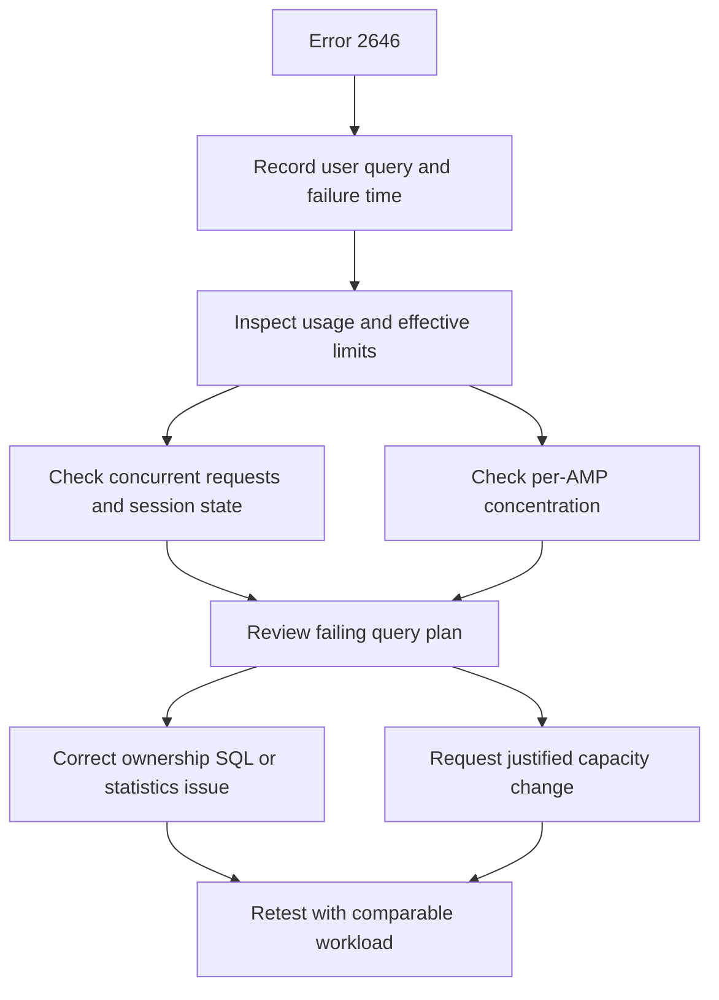

# Diagnose Teradata Error 2646 Before Adding Spool Space

Author: [nawazdhandala](https://www.github.com/nawazdhandala)

Tags: Database, SQL, Troubleshooting

Description: Diagnose Teradata spool exhaustion using per-AMP usage, profile limits, concurrent queries and plan evidence before deciding whether more space is the right fix.

A report that ran yesterday now fails with error 2646. Increasing its spool limit may get it running, but it can also hide a changed join, concentrated intermediate data or overlapping jobs. Preserve enough evidence to distinguish those cases before changing capacity.

Teradata's [2646 message reference](https://docs.teradata.com/r/Teradata-VantageCloud-Lake-Analytics-Database-Messages/Database-Messages/2646) identifies insufficient space for the spool file. This guide uses Database Engine 20.00 dictionary definitions and Vantage 17.20 administration concepts. Confirm their applicability to your deployment. The inspection SQL is source-reviewed; no live Teradata system was available for execution.

## Understand the resource that ran out

Spool is working storage for query processing, not simply the final result sent to your client. A query returning ten rows might first build a large intermediate join result. Volatile tables also consume spool, so long-lived session state can compete with a new request. Teradata describes these categories in [Sizing Spool Space](https://docs.teradata.com/r/Enterprise_IntelliFlex_VMware/Database-Design/Database-Level-Capacity-Planning-Considerations/Sizing-Spool-Space).

An AMP, or Access Module Processor, is a parallel unit of database work and storage management. Data that is unevenly distributed can put much more pressure on one AMP than the average suggests. A healthy-looking system total does not automatically mean the failing request had usable capacity where it needed it.



## Capture the incident before retrying repeatedly

Record the logon user, session, query identifier, failure timestamp, SQL text and parameter values. Preserve the relevant application job identifier and whether other jobs used the same database account. Ask the database administrator for retained query-monitoring evidence if the failed request is no longer active.

A retry can overlap with another attempt and make the shortage worse. Stop automatic retries for the affected job while coordinating recovery. Do not cancel unrelated sessions just because they share an account; first establish ownership and business impact.

Spool is shared among concurrent queries executed by a user, as documented in [profile administration](https://docs.teradata.com/r/Enterprise_IntelliFlex_VMware/Database-Administration/Working-with-Users-Roles-and-Profiles-Operational-DBAs/Creating-User-Profiles/Creating-Profiles). A query that succeeds alone but fails during a scheduled overlap may need workload coordination rather than a different SQL plan.

## Inspect individual AMPs and profile settings

Run this with an account permitted to read `DBC.DiskSpaceV`, or ask an administrator to run it. Replace the string with the affected logon user, not necessarily the database containing the queried tables:

```sql
SELECT DatabaseName, AccountName, Vproc,
       CurrentSpool, PeakSpool, MaxSpool, MaxProfileSpool
FROM DBC.DiskSpaceV
WHERE DatabaseName = 'REPLACE_WITH_LOGON_USER'
ORDER BY CurrentSpool DESC, Vproc;
```

The [20.00 dictionary reference](https://docs.teradata.com/r/Enterprise_IntelliFlex_VMware/Data-Dictionary/Views-Reference/DiskSpaceV-X) defines current and peak spool by AMP, along with the user and profile limits. Preserve the account column: do not casually combine rows from different accounting contexts and interpret them as one snapshot of a single query.

`CurrentSpool` sampled after the failure may already have fallen because intermediate work was released. `PeakSpool` provides historical context, but it is not automatically this query's peak. Different AMPs can reach their maxima at different times. Summing those historical maxima does not prove that the resulting total was used simultaneously.

Profile limits can supersede user limits. Global space accounting and permitted skew also affect enforcement, so `MaxSpool - CurrentSpool` is not a universal admission guarantee. Review the site's effective settings with the DBA using the [global accounting rules](https://docs.teradata.com/r/Enterprise_IntelliFlex_VMware/Database-Administration/Managing-Space-Operational-DBAs/Global-Space-Accounting).

## Measure concentration without hiding an idle sample

For a quick account-level summary of the same view, use:

```sql
SELECT AccountName,
       SUM(CAST(CurrentSpool AS DECIMAL(38,0))) AS CurrentSpoolBytes,
       MAX(CurrentSpool) AS BusiestAmpBytes,
       AVG(CAST(CurrentSpool AS FLOAT)) AS AverageAmpBytes,
       MAX(CAST(CurrentSpool AS FLOAT)) /
           NULLIF(AVG(CAST(CurrentSpool AS FLOAT)), 0) AS MaxToAverage
FROM DBC.DiskSpaceV
WHERE DatabaseName = 'REPLACE_WITH_LOGON_USER'
GROUP BY AccountName;
```

The ratio compares the busiest AMP with the average in each returned account group. A ratio of three means the maximum is three times that average. A null result for an entirely idle group avoids dividing by zero; it is not evidence of balanced activity during the failed query.

In a local arithmetic fixture, four values of 90, 10, 10 and 10 produced total 120, maximum 90, average 30 and ratio 3. Four zero values produced a null ratio. That verifies the calculation on synthetic rows using SQLite, not Teradata dictionary access, dialect acceptance or enforcement behavior.

Use the detailed rows to interpret the aggregate. Check that the expected AMPs and account context are represented. A single sample can miss a short-lived spike, so correlate it with the incident timeline and retained monitoring data.

## Find the step that expands or concentrates data

Review the failed query's plan with the same relevant parameters. Look for a large intermediate result, redistribution on a concentrated key, duplication of a substantial input, or a join producing far more rows than intended. An omitted join condition or nonunique business key can multiply rows before a final aggregation hides the expansion.

`EXPLAIN` is useful, but review how your system handles dynamic plans before treating every explained request as execution-free. Teradata's [request-modifier documentation](https://docs.teradata.com/r/Lake-Working-with-SQL/SQL-Commands/SQL-Data-Manipulation-Language/Query-and-Workload-Analysis-Statements/EXPLAIN-Request-Modifier) explicitly notes partial execution for a dynamic plan.

Compare estimates with available runtime evidence. Low confidence suggests an estimation issue to investigate; it does not prove the plan is bad. High confidence does not guarantee accuracy when statistics are stale. The official [confidence-level explanation](https://docs.teradata.com/r/Enterprise_IntelliFlex_VMware/SQL-Request-and-Transaction-Processing/Interpreting-EXPLAIN-Output/EXPLAIN-Confidence-Levels) makes both distinctions.

## Choose a fix that matches the evidence

| Finding | Targeted response |
|---|---|
| Unintended join multiplication | Correct the join and verify result semantics |
| Large avoidable intermediate rows | Project needed columns and apply valid filters earlier |
| Concurrent jobs exhaust shared allowance | Adjust scheduling or workload controls |
| Volatile tables outlive their useful work | Review session lifecycle with their owner |
| Necessary balanced work exceeds its allowance | Request a measured capacity adjustment |

A larger allowance can be legitimate. Request it with observed workload size, concurrency, concentration and expected growth, and confirm underlying capacity. Changing a user limit alone may have no effect when a profile supplies the effective limit.

Retest with comparable data and concurrency, checking result correctness as well as completion, runtime and spool behavior. Do not reset shared peak counters or modify dictionary tables to make the evidence look clean. Preserve the original incident and the successful comparison so the next capacity decision starts from measured behavior.
