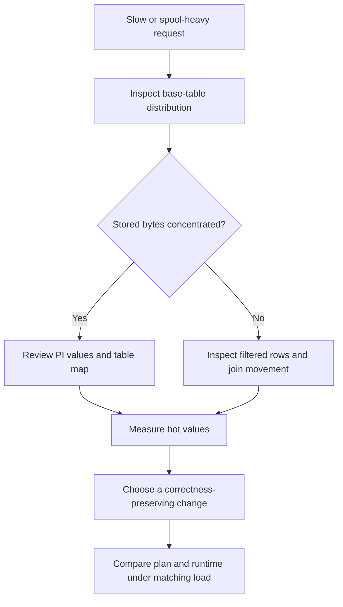

# Find Teradata AMP Skew in Tables and Redistributed Joins

Author: [nawazdhandala](https://www.github.com/nawazdhandala)

Tags: Database, SQL, Performance

Description: Separate stored-table skew from join redistribution, inspect hot key values and map-aware hash distribution, and choose fixes that preserve query correctness.

A Teradata query can leave most AMPs waiting while one does the bulk of the work. Adding resources or increasing spool may help temporarily, but neither explains why the work concentrated there. Start by identifying when the imbalance appears: in the stored table, after a filter, or during a join's data movement.

An AMP, or Access Module Processor, handles part of Teradata's parallel database work. Skew means that data or processing is distributed unevenly across those units. This guide uses Vantage 17.20 hash-function and design references plus Database Engine 20.00 dictionary definitions. Its SQL is source-reviewed; only the portable hot-value aggregation was exercised locally, against synthetic SQLite data.

## Separate storage skew from execution skew

A primary index, or PI, helps determine the AMP placement of rows in a conventional hash-distributed table. A repeated PI value therefore deserves attention when a large fraction of rows shares it. But even an evenly stored table can produce uneven intermediate data when a join redistributes rows using a different key.

For example, orders might be distributed by a well-spread order identifier. A reporting join can then move those orders by customer identifier. If one customer owns most of the selected orders, that movement creates a different distribution from the base table's.

The [primary-index guidelines](https://docs.teradata.com/r/Enterprise_IntelliFlex_VMware/Database-Administration/Working-with-Tables-and-Views-Application-DBAs/Choosing-a-Primary-Index/Guidelines-for-Choosing-Primary-Index-Columns) emphasize even distribution and stable values. Teradata's [join strategy documentation](https://docs.teradata.com/r/Enterprise_IntelliFlex_VMware/SQL-Request-and-Transaction-Processing/Join-Planning-and-Optimization/Join-Strategies-and-Methods) explains that redistribution and duplication depend on the selected strategy. Inspect the actual plan before deciding that the stored PI is the problem.



## Inspect the physical table first

With permission to read `DBC.TableSizeV`, replace both string placeholders:

```sql
SELECT Vproc, CurrentPerm
FROM DBC.TableSizeV
WHERE DatabaseName = 'REPLACE_WITH_DATABASE'
  AND TableName = 'REPLACE_WITH_TABLE'
ORDER BY CurrentPerm DESC, Vproc;
```

`CurrentPerm` reports permanent bytes. Teradata's [table-skew procedure](https://docs.teradata.com/r/Enterprise_IntelliFlex_VMware/Database-Administration/Managing-Space-Operational-DBAs/Finding-and-Fixing-Skewed-Tables-by-Querying-the-TableSizeV-View) uses per-AMP values from this view to identify uneven storage. The [dictionary reference](https://docs.teradata.com/r/Enterprise_IntelliFlex_VMware/Data-Dictionary/Views-Reference/TableSizeV-X) defines the columns.

Compare the largest values with the rest of the returned population. Keep the table's map and storage design in view: do not label AMPs outside its intended placement as missing data. Also distinguish bytes from rows. Variable row sizes, compression and physical storage details mean byte imbalance is not an exact row-count measurement.

If the physical table looks balanced, move on. Rebuilding it without investigating the failing step can create a costly migration while leaving the real bottleneck unchanged.

## Examine the key after the query's filters

Use a bounded, approved staging slice with representative data. The example assumes an existing `lab.orders_slice` table containing a `customer_id` column; substitute your staging table and the exact key used at the suspect step. A full-table grouping can itself be expensive, so do not run it indiscriminately during an incident.

```sql
SELECT customer_id, COUNT(*) AS RowsForValue
FROM lab.orders_slice
GROUP BY customer_id
ORDER BY RowsForValue DESC;
```

This reveals concentration directly. In a local fixture with 100 rows and 21 distinct customer values, customer zero accounted for 80 rows. The other twenty values appeared once each. Counting distinct values alone would hide how dominant that one value was.

Use the same relevant predicates as the problematic query when constructing the slice. A globally diverse customer population can become highly concentrated in a particular date range, region or failed-processing state. Keep nulls and placeholder values visible initially; excluding them can remove the very concentration you need to explain.

For a composite redistribution key, group by the entire expression or column combination. Checking each component separately does not establish the combined distribution. Likewise, a cast or normalization expression in the join can merge values that looked distinct in the original column.

## Evaluate a candidate distribution using the right map

Teradata provides `HASHROW`, `HASHBUCKET` and `HASHAMP` for distribution analysis. This example uses a single candidate key and an explicitly named contiguous map:

```sql
SELECT HASHAMP(
           HASHBUCKET(HASHROW(customer_id))
           MAP = REPLACE_WITH_CONTIGUOUS_MAP
       ) AS CandidateAmp,
       COUNT(*) AS CandidateRows
FROM lab.orders_slice
GROUP BY 1
ORDER BY CandidateRows DESC;
```

Replace the map identifier with the reviewed target map. The syntax follows Teradata's [contiguous-map example](https://docs.teradata.com/r/Enterprise_IntelliFlex_VMware/SQL-Functions-Expressions-and-Predicates/Hash-Related-Functions/HASHAMP/Examples/Example-HASHAMP-with-an-Expression-and-a-Contiguous-Map). Sparse maps require additional colocation information under the [HASHAMP syntax rules](https://docs.teradata.com/r/Enterprise_IntelliFlex_VMware/SQL-Functions-Expressions-and-Predicates/Hash-Related-Functions/HASHAMP/HASHAMP-Function-Syntax); this snippet is not a sparse-map recipe.

The result shows candidate row counts only for AMPs that receive rows. Include zero-row AMPs from the intended map when calculating a full-map average. Otherwise, a candidate using only a few AMPs can appear artificially balanced. This predicts hash placement for the selected expressions; it does not measure the optimizer's complete runtime behavior or prove that a different PI makes every join faster.

## Choose the smallest useful correction

| Finding | Change to evaluate |
|---|---|
| Stored table dominated by a repeated PI value | A more evenly distributed, stable PI candidate |
| Balanced table, concentrated join key | Relevant statistics and alternative join strategy |
| Invalid placeholder joins multiply rows | Correct the data or join semantics |
| Query carries unnecessary rows into movement | Valid earlier filtering or aggregation |
| One workload slice dominates | A workload-specific design rather than a global rebuild |

Do not remove a legitimate high-volume customer just to improve the distribution chart. An outer join also has different null-preservation requirements from an inner join. Rewrites that split hot and ordinary values must be mutually exclusive and collectively complete, preserve duplicates correctly, and retain the intended unmatched rows.

The optimizer can use strategies such as partial redistribution and partial duplication to address skew. Give it accurate information before inventing manual data spreading. Statistics cannot change the underlying hot values, but they can help the optimizer choose how to process them.

## Validate the result beyond the skew number

Test the candidate against representative data volume, parameter values and concurrency. Compare row counts and business totals first, then query duration, spool behavior and per-AMP work. A lower storage-skew number is not sufficient if the new design increases data movement for important joins.

For a table redesign, plan the copy, dependencies, statistics, capacity and rollback with the table owner. For a query rewrite, retain the original version and its plan for comparison. The success criterion is balanced useful work with correct results, rather than a visually uniform distribution obtained at the expense of the application.
