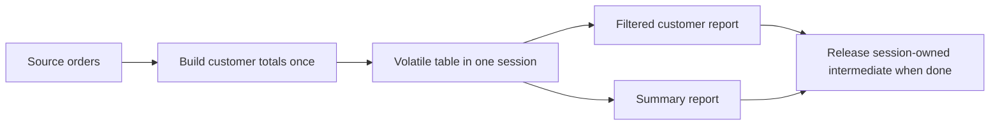

# Teradata CTEs, Derived Tables or Volatile Tables for Reuse?

Author: [nawazdhandala](https://www.github.com/nawazdhandala)

Tags: Database, SQL, Performance

Description: Compare query-local CTEs and derived tables with session-scoped volatile tables, accounting for optimizer rewrites, build cost, spool lifetime and data freshness.

A reporting job calculates customer totals, filters them for one output, then calculates the same totals again for another output. Moving the aggregation into a common table expression makes the SQL easier to read. It does not automatically create a reusable result across separate requests.

The useful distinction is lifetime. A CTE or derived table belongs to a query. A volatile table is an explicitly created object in a database session. Choosing between them means balancing optimization freedom, repeated work, storage lifetime and the freshness of the result. The examples below follow Teradata Vantage 17.20 conventions and official syntax references; no Teradata execution or performance benchmark was performed.

## Choose the lifetime before the syntax

A common table expression, or CTE, names a query within a `WITH` modifier. A derived table places a query in the `FROM` clause with an alias. Both help organize one request. Teradata's [CTE example](https://docs.teradata.com/r/Enterprise_IntelliFlex_VMware/SQL-Data-Manipulation-Language/SELECT-Statements/WITH-Modifier/WITH-Modifier-Examples/Example-Common-Table-Expression) demonstrates named-query references.

A volatile table stores a result for use in its creating session. Its contents are governed by transaction-preservation options, and its lifetime is not durable storage. The [volatile-table documentation](https://docs.teradata.com/r/Enterprise_IntelliFlex_VMware/SQL-Data-Definition-Language-Detailed-Topics/CREATE-TABLE-Options/CREATE-TABLE-Table-Kind-Clause/Volatile-Tables) describes its scope and restrictions.

| Need | Starting choice |
|---|---|
| Name several stages inside one query | CTE |
| Express one nested relational input | Derived table |
| Reuse a reviewed result across several requests in one session | Volatile table |
| Share a durable result across sessions | A separately designed persistent solution |

This is a starting point, not a speed ranking. Confirm the generated plan and measure the complete workflow before deciding that one form reduces work.

## Compare equivalent query-local forms

Assume an approved `lab.orders` table with `customer_id` and numeric `order_total` columns. This CTE computes customer totals and returns customers whose totals reach 100:

```sql
WITH customer_totals AS
(
    SELECT customer_id, SUM(order_total) AS total_spend
    FROM lab.orders
    GROUP BY customer_id
)
SELECT customer_id, total_spend
FROM customer_totals
WHERE total_spend >= 100;
```

The same logical request can be expressed with a derived table:

```sql
SELECT customer_id, total_spend
FROM
(
    SELECT customer_id, SUM(order_total) AS total_spend
    FROM lab.orders
    GROUP BY customer_id
) AS customer_totals
WHERE total_spend >= 100;
```

Neither form promises a particular spool layout just because the SQL has an intermediate name. Teradata documents [view folding](https://docs.teradata.com/r/Lake-Working-with-SQL/SQL-Reference/SQL-Request-and-Transaction-Processing/Query-Rewrite-Statistics-and-Optimization/Examples-Query-Rewrites/View-Folding?contentId=PWX0OgRZbVnhrCsYhssG1A), including its applicability to derived tables and the optimizer's ability to combine eligible work. Aggregation and other operations can affect those choices.

In a local SQLite fixture, both query forms returned customer 1 with total 110 and customer 3 with total 150. That checks their intended result semantics on the fixture. SQLite's plan is not evidence of how Teradata will fold or spool them.

## Materialize only when reuse justifies it

To reuse those totals across multiple statements, create a volatile table in an approved test session. This is an executing data operation, not an explanation request. It scans and aggregates the source and consumes resources:

```sql
CREATE MULTISET VOLATILE TABLE vt_customer_totals AS
(
    SELECT customer_id, SUM(order_total) AS total_spend
    FROM lab.orders
    GROUP BY customer_id
)
WITH DATA
PRIMARY INDEX (customer_id)
ON COMMIT PRESERVE ROWS;
```

The name must be unused in that session. The `WITH DATA` clause populates the table; the PI controls its intended distribution. `ON COMMIT PRESERVE ROWS` keeps rows after a transaction commits. Without an explicit preservation choice, the default deletion behavior can surprise a multi-statement job. See the official [CREATE TABLE syntax elements](https://docs.teradata.com/r/Lake-Working-with-SQL/SQL-Commands/SQL-Data-Definition-Language/Table-Statements/CREATE-TABLE-and-CREATE-TABLE-AS/CREATE-TABLE-and-CREATE-TABLE-AS-Syntax-Elements?contentId=KMpKq9ztWUaqbqOG6epGYw) and [WITH DATA reference](https://docs.teradata.com/r/Enterprise_IntelliFlex_VMware/SQL-Data-Definition-Language-Syntax-and-Examples/Table-Statements/CREATE-TABLE-and-CREATE-TABLE-AS/Syntax-Elements/AS_clause/WITH-DATA).

Now these two consumers read the saved totals in the same physical connection:

```sql
SELECT customer_id, total_spend
FROM vt_customer_totals
WHERE total_spend >= 100;

SELECT COUNT(*) AS CustomerCount,
       SUM(total_spend) AS CombinedSpend
FROM vt_customer_totals;
```

A connection pool must retain the creating session for this workflow. Another connection cannot assume it has that volatile table. On reconnect, recreate the intermediate result through the job's recovery path rather than retrying a downstream statement against a missing object.



## Count all the costs, including retained spool

The volatile version adds a build stage. It can be worthwhile when several expensive consumers share the same reduced input, but a one-use result may simply add overhead and restrict what can be optimized together.

Spool is not eliminated by naming a volatile table. Teradata explicitly includes volatile tables in its [spool categories](https://docs.teradata.com/r/Enterprise_IntelliFlex_VMware/Database-Design/Database-Level-Capacity-Planning-Considerations/Sizing-Spool-Space). The saved result remains present while consumers may create their own intermediate spools. Peak simultaneous usage can therefore rise even if repeated base-table scans fall.

Keep only the columns and rows that all intended consumers need. Consider statistics when downstream planning needs information about the materialized result, and include collection cost in the comparison. Release the job-owned volatile table when it is no longer needed, using the application's established cleanup path. Do not indiscriminately drop session objects you did not create.

## Preserve freshness and transaction meaning

The saved totals reflect the data read during their creation under the applicable transaction rules. Later consumers do not automatically see new orders. Repeating the original query against changing source data can legitimately produce a different result.

Decide whether the job wants a consistent reused intermediate or newly evaluated data for every output. Account for the session's transaction mode, commits and failure recovery. A faster workflow that accidentally serves stale totals is not equivalent to the original requirement.

Measure complete elapsed time: creation, optional statistics, every consumer and cleanup. Compare it with the complete original sequence using equivalent input and concurrency. Check result rows and aggregate totals before comparing spool and duration. Prefer the simplest form that meets those requirements, and retain materialization only when its measured reuse benefit exceeds its extra storage and lifecycle cost.
