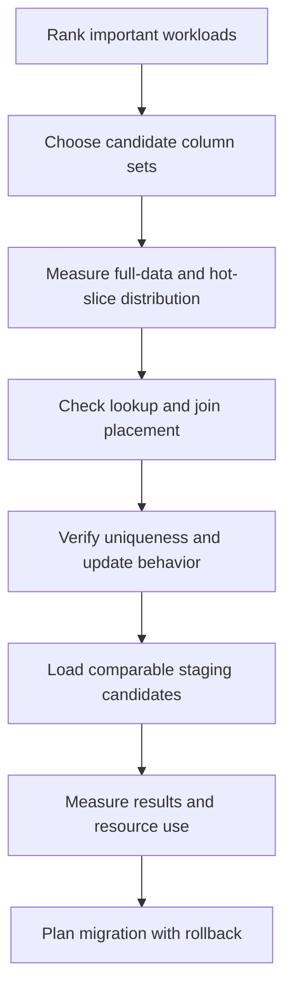

# Choose a Teradata Primary Index for Distribution and Local Joins

Author: [nawazdhandala](https://www.github.com/nawazdhandala)

Tags: Database, SQL, Database Design

Description: Compare Teradata primary-index candidates against data distribution, lookup and join workloads, while keeping uniqueness, table maps and migration costs explicit.

Choosing a Teradata primary index is a physical design decision. A candidate can distribute rows evenly yet require movement for important joins. Another can keep related rows together but concentrate most of the table on a few AMPs. The best choice depends on the data and the workload together.

This guide compares order-based and customer-based placement for a conventional hash-distributed orders table. It follows Vantage 17.20 design guidance and documented table-definition syntax. The SQL is source-reviewed rather than executed on a Teradata server. It is a staging design exercise, not a command sequence for replacing a production table.

## Separate identity from placement

A primary key identifies a business row. A primary index, or PI, participates in determining where rows reside and how they can be accessed. Those can use the same columns, but they answer different questions. Teradata explicitly distinguishes them in its [key and index relationship guide](https://docs.teradata.com/r/Enterprise_IntelliFlex_VMware/Database-Administration/Working-with-Tables-and-Views-Application-DBAs/Choosing-a-Primary-Index/Relationship-of-Primary-Indexes-Primary-Keys-and-Foreign-Keys).

A unique primary index, or UPI, enforces uniqueness for its indexed combination. A nonunique primary index, or NUPI, permits repeated values. Repeated NUPI values are placed together, which can help related access but can also create skew. The [PI performance reference](https://docs.teradata.com/r/Enterprise_IntelliFlex_VMware/Database-Design/Primary-Index-Primary-AMP-Index-and-NoPI-Objects/Performance-Considerations-for-Primary-Indexes) describes those different consequences.

Do not choose a UPI solely to make distribution look better if the data does not satisfy its uniqueness requirement. Conversely, changing to a NUPI does not preserve a uniqueness rule unless that rule is enforced separately.

## Write down the competing workloads

For an orders table, identify at least these patterns:

| Workload | Placement question |
|---|---|
| Find one order by its identifier | Can the full PI be supplied by the lookup? |
| Retrieve a customer's history | Are that customer's rows grouped usefully? |
| Join orders to customers | Are corresponding rows already on compatible AMPs? |
| Aggregate a broad date range | Is work spread evenly across the participating AMPs? |
| Load and update orders | Are the PI values stable and the write cost acceptable? |

Weight the patterns using actual frequency and service objectives. A once-a-month report should not automatically dictate placement for thousands of latency-sensitive lookups. Equally, optimizing one lookup while creating an overloaded AMP during every daily load may be a poor tradeoff.

Teradata's [selection guidelines](https://docs.teradata.com/r/Enterprise_IntelliFlex_VMware/Database-Administration/Working-with-Tables-and-Views-Application-DBAs/Choosing-a-Primary-Index/Guidelines-for-Choosing-Primary-Index-Columns) prioritize even distribution and caution against frequently changing PI values. Consider both present data and plausible growth, especially when a few customers dominate activity.



## Compare two explicit staging definitions

The following definitions require an approved `lab` database, table-creation privileges and capacity for both candidates. Review the database's storage and map defaults first. Use the same intended contiguous map for a fair comparison; these minimal examples deliberately inherit the reviewed default rather than assume a map name exists everywhere.

```sql
CREATE MULTISET TABLE lab.orders_by_order
(
    order_id BIGINT NOT NULL,
    customer_id BIGINT NOT NULL,
    order_date DATE NOT NULL,
    order_total DECIMAL(18,2)
)
UNIQUE PRIMARY INDEX (order_id);

CREATE MULTISET TABLE lab.orders_by_customer
(
    order_id BIGINT NOT NULL,
    customer_id BIGINT NOT NULL,
    order_date DATE NOT NULL,
    order_total DECIMAL(18,2)
)
PRIMARY INDEX (customer_id);
```

The first candidate distributes by order identifier and enforces its uniqueness. The second places a customer's orders together but does not enforce unique `order_id`. That semantic difference is part of the comparison: before using the second design for real data, define and evaluate whatever separate integrity mechanism your application requires.

These clauses follow the documented [primary-index table examples](https://docs.teradata.com/r/Enterprise_IntelliFlex_VMware/SQL-Data-Definition-Language-Syntax-and-Examples/Index-Statements/CREATE-JOIN-INDEX/Examples/Example-Creating-a-Unique-Join-Index) and [primary-index definitions](https://docs.teradata.com/r/Enterprise_IntelliFlex_VMware/Database-Design/Indexes-and-Maps/Primary-Indexes-and-Primary-AMP-Indexes). MULTISET is a table duplicate-row policy, not a substitute for a business uniqueness constraint.

Populate approved candidates with the same representative data through your normal controlled loading process. Do not compare an empty candidate with a populated production table, or silently deduplicate data to make a unique index accept it.

## Check distribution before promising local joins

If customer 42 owns half the orders, placing all orders by customer can concentrate roughly that customer's contribution on one destination AMP before considering other rows. Distinct-customer count alone will not reveal that concentration. Inspect value frequencies, null or placeholder handling, and the subsets selected by common predicates.

An order identifier with many distinct values is a plausible distribution candidate, but test the actual placement and byte usage. Row-count balance and storage balance are related but not identical, particularly when row widths or compression differ.

For join locality, matching PI names are insufficient. Check the complete join expression, compatible column types and maps. Teradata's [table-definition considerations](https://docs.teradata.com/r/Enterprise_IntelliFlex_VMware/Database-Administration/Working-with-Tables-and-Views-Application-DBAs/Creating-Tables/Considerations-for-Defining-Tables) recommend consistent join-column types and sizes. Its [maps guidance](https://docs.teradata.com/r/Enterprise_IntelliFlex_VMware/Database-Design/Indexes-and-Maps/Maps) explains the role of colocation.

Sparse maps add another requirement: using the same sparse map does not alone establish the same placement. Teradata's [CREATE MAP reference](https://docs.teradata.com/r/Enterprise_IntelliFlex_VMware/SQL-Data-Definition-Language-Syntax-and-Examples/Map-Statements/CREATE-MAP?contentId=zp9bJOIOasifct0shXAejQ) describes matching colocation names for corresponding PI-based joins.

A composite PI can improve distribution but change access expectations. If the PI is `(customer_id, order_id)`, a predicate providing only `customer_id` does not specify the complete hashed key. Treat that as a separate candidate, not as a free combination of both single-column designs.

## Measure the workload and plan the change

Collect appropriate statistics on each staging candidate and compare plans with the same parameters. Then measure lookup latency, join runtime, spool, per-AMP work and load behavior. Include hot customers and broad reports, not just uniformly distributed test data. Preserve row counts and business aggregates as correctness checks.

A local join is valuable only if the resulting work remains acceptably balanced. It can be better to distribute a large fact table evenly and move some data for a join than to concentrate the whole workload around a hot key. Let measured workload costs decide.

Before changing production, inventory dependent views, access rights, load jobs, integrity rules and statistics. Estimate the extra space and time needed for copying or reorganizing data, and retain a rollback path. Document why the chosen PI wins for the weighted workload and what future change in customer distribution would justify revisiting it.
