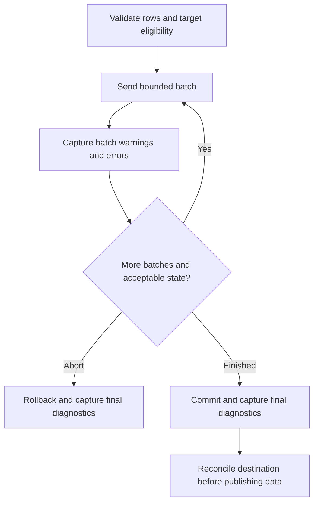

# Load Teradata from Python: Batches, FastLoad and Parallel Sessions

Author: [nawazdhandala](https://www.github.com/nawazdhandala)

Tags: Python, Database, Performance

Description: Build a bounded batch-insert baseline, evaluate FastLoad eligibility and diagnostics, and measure parallel loading without hiding commit costs or rejected rows.

A slow Python load is not necessarily waiting for more database sessions. It may be constructing rows inefficiently, sending tiny batches, waiting for network round trips, or spending time applying data after transfer finishes. Measure those stages before adding concurrency.

This guide uses `teradatasql==20.0.0.76`, the [pinned published package](https://pypi.org/project/teradatasql/20.0.0.76/). It was installed and imported locally. The batching helper was tested with a fake connection, including rollback behavior. No Teradata server, FastLoad run or throughput benchmark was available, so the examples establish API usage and testable boundaries rather than a performance claim.

## Start with the destination's requirements

SQL batch inserts are a practical baseline for existing tables and workloads needing ordinary insert behavior. FastLoad is a specialized loading path. Check the target before choosing it: an empty permanent staging table is different from a populated destination that needs incremental updates.

Teradata's [FastLoad utility overview](https://docs.teradata.com/r/Lake-Database-Reference/Database-Administration/Loading-and-Exporting-Data-Application-DBAs/FastLoad-Utility) describes restrictions involving secondary indexes, join indexes, referential integrity and large-object types. Confirm the applicable driver and server limitations rather than assuming every INSERT can become a bulk load.

Duplicate handling also matters. For primary-indexed MULTISET targets, FastLoad does not preserve duplicate rows the same way ordinary inserts may. Teradata explains the PI/NoPI distinction in its [loading guidance](https://docs.teradata.com/r/Enterprise_IntelliFlex_Lake_VMware/Teradata-FastLoad-Reference-17.20/Using-Teradata-FastLoad/Programming-Considerations/Loading-No-Primary-Index-Tables). A faster run that changes the required row population is not an acceptable substitution.

## Establish a bounded SQL-batch baseline

Use a dedicated, authenticated connection configured according to your site's transport and credential policy. Provision an approved `lab.load_stage` table with compatible `row_id` and `payload` columns. The helper does not create, truncate or drop that table.

Install the pinned driver in your project environment:

```bash
python -m pip install teradatasql==20.0.0.76
```

Pass the helper an iterator yielding two-value rows, such as `(integer_id, string_payload)`. It materializes only one batch at a time and owns one transaction across all batches:

```python
from itertools import islice


def batches(rows, size):
    if size <= 0:
        raise ValueError('Batch size must be positive')
    source = iter(rows)
    while batch := list(islice(source, size)):
        yield batch


def load_sql_batches(connection, rows, size=10_000):
    """Own one transaction on a dedicated connection; caller closes it."""
    connection.autocommit = False
    submitted = 0
    try:
        with connection.cursor() as cursor:
            for batch in batches(rows, size):
                cursor.executemany(
                    'INSERT INTO lab.load_stage (row_id, payload) VALUES (?, ?)',
                    batch,
                )
                submitted += len(batch)
        connection.commit()
    except Exception:
        connection.rollback()
        raise
    return submitted
```

The caller must close the dedicated connection and must not pass a connection already carrying unrelated transactional work. The helper leaves auto-commit disabled. Its result is the number of rows submitted, not an independently reconciled destination count.

The question marks bind values; the table name is fixed SQL. Do not interpolate untrusted table names into a generalized loader. Validate incoming types and widths before the transfer loop so malformed data is caught close to its source.

A local test fed 23 rows in batches of ten and verified batch sizes of 10, 10 and 3 with one final commit. An injected failure in the second batch triggered rollback and propagated the error. Those are application-control tests, not proof of database atomicity or recovery after a lost connection.

Ten thousand rows is an illustrative default. A batch of wide strings can use much more memory than the same number of small numeric rows. Compare batch sizes while observing Python memory, conversion time and transfer duration. Do not assume the largest batch that fits is fastest.

## Treat FastLoad as a separate loading protocol

The [pinned driver documentation](https://github.com/Teradata/python-driver/blob/5762e99d5af6173e0cb0359154f6aa86cd8ee86f/README.md#fastload) documents the required escape prefix and consistent parameter types across batches. For an eligible, empty target, the request begins:

```python
fastload_sql = (
    '{fn teradata_require_fastload}'
    'INSERT INTO lab.load_stage (row_id, payload) VALUES (?, ?)'
)
```

Using `require` makes an ineligible request fail instead of silently falling back to ordinary SQL execution. Keep auto-commit disabled while sending batches, and keep one consistent insert request and column-type contract throughout the operation.

Do not simply replace the SQL string in the baseline helper and call the implementation finished. FastLoad can report data problems through separate diagnostics. The official [batch sample](https://github.com/Teradata/python-driver/blob/5762e99d5af6173e0cb0359154f6aa86cd8ee86f/samples/FastLoadBatch.py) retrieves warnings and errors after each batch and again after commit or rollback.

For an existing FastLoad cursor and request, these diagnostic calls retrieve the current messages:

```python
messages = {}
for kind in ('warnings', 'errors'):
    cursor.execute(
        '{fn teradata_nativesql}'
        + '{fn teradata_get_' + kind + '}'
        + fastload_sql
    )
    messages[kind] = cursor.fetchall()
```

This is a diagnostic fragment, not a complete FastLoad transaction manager. Store messages in a restricted job record, decide how to handle rejected rows, and read them before the next batch or transaction-ending operation replaces the prior diagnostic state. After commit, a problem requires reconciliation; a later rollback cannot undo a completed commit.



## Distinguish transfer sessions from Python workers

FastLoad opens parallel transfer connections itself. The driver's `sessions` setting or `{fn teradata_sessions(n)}` controls that mechanism; it is not the size of a Python thread pool. Start with the driver's recommended automatic choice, then experiment within the DBA-approved workload limits.

Adding multiple independent Python loaders can multiply connection count and pressure rather than improve transfer. Avoid competing FastLoad jobs against the same target. When parallel jobs are justified, partition ownership explicitly, give each job an identifiable input and staging destination, and define how the validated outputs are combined.

Measure rows per second over the complete job, including connection setup, row conversion, transfer, final apply/commit and reconciliation. Also record session count, server queueing and impact on other workloads. A higher transfer rate that produces a longer commit or more contention is not an end-to-end improvement.

## Make recovery and publication explicit

A connection failure around commit can leave an uncertain outcome. Do not blindly replay the input because an exception reached Python. Use a job identifier, a known input manifest and a reconciliation query appropriate to the staging design. Separate data loading from the step that makes the staged data available to consumers.

Compare source rows, accepted destination rows and reported rejects or duplicates before declaring success. Preserve enough evidence to explain missing rows without exposing payloads in ordinary logs. Start performance testing with the SQL-batch baseline, add FastLoad only for eligible work, and increase concurrency only when measured job completion improves without breaking correctness or workload limits.
