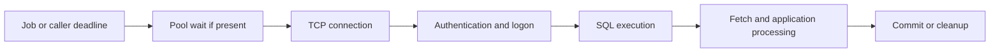

# Diagnose Teradata Python Timeouts by Connection Stage

Author: [nawazdhandala](https://www.github.com/nawazdhandala)

Tags: Python, Database, Troubleshooting

Description: Separate TCP connection, logon, SQL request and idle-session failures in the Teradata Python driver, with explicit timeout units and safe stage-level timing.

A Python job reports a timeout, so someone increases the query timeout. The next run fails at the same point because it never finished authentication. Timeout troubleshooting becomes much easier when you first identify which operation was waiting.

This guide uses `teradatasql` 20.0.0.76 and the official driver documentation pinned to commit `5762e99d5af6173e0cb0359154f6aa86cd8ee86f`. Local checks cover package import and the timing helper's success and failure paths. They do not reproduce database timeouts or establish how your network and server enforce limits.

## Assign each timeout to its boundary

The [pinned connection-parameter reference](https://github.com/Teradata/python-driver/blob/5762e99d5af6173e0cb0359154f6aa86cd8ee86f/README.md#connection-parameters) documents different units and scopes:

| Parameter | Unit | Documented scope | Default |
|---|---|---|---|
| `connect_timeout` | Milliseconds | Establishing a TCP socket | 10000 |
| `logon_timeout` | Seconds | Logon | 0, no timeout |
| `request_timeout` | Seconds | Executing each SQL request | 0, no timeout |
| `browser_timeout` | Seconds | Completing browser authentication | 180 |

A value of 30 for `connect_timeout` means thirty milliseconds, not thirty seconds. Zero is not a conservative deadline for the first three settings; it removes their timeout.

These are not interchangeable with the deadline of an HTTP request, a scheduled job or a connection-pool checkout. Record all relevant layers. A caller can stop waiting before the database operation has completed its own cancellation or cleanup.



The diagram is a diagnostic sequence, not a promise that all driver activities occur once or that the timeout values simply add together.

## Time the operation that actually fails

Avoid wrapping connection, execution, fetching and processing in one timer. A large result may be quick to start returning but slow to transfer or consume. Conversely, a query can spend time waiting before it executes meaningful work.

This helper records elapsed time and a success/error label without printing credentials, SQL parameters or result data:

```python
import time


def timed(stage, operation):
    started = time.perf_counter()
    outcome = 'error'
    try:
        result = operation()
        outcome = 'ok'
        return result
    finally:
        print(f'{stage}: {outcome}, {time.perf_counter() - started:.3f}s')


def probe(connection):
    with connection.cursor() as cursor:
        timed('execute', lambda: cursor.execute(
            '{fn teradata_request_timeout(15)}SELECT CURRENT_TIMESTAMP'
        ))
        timed('fetch', cursor.fetchone)
```

`probe` expects an already-established dedicated connection. Its query is a small diagnostic request rather than your production workload. The request-specific escape sets a fifteen-second timeout for that request, taking precedence over the connection default. The [driver escape-function reference](https://github.com/Teradata/python-driver/blob/5762e99d5af6173e0cb0359154f6aa86cd8ee86f/README.md#request-scope-function-escape-clauses) documents this override.

The helper re-raises exceptions because it does not catch them; its `finally` block still reports the failed stage. Local tests verified both outcomes. The measured execute/fetch intervals describe application calls, not a breakdown of the server's internal execution phases.

## Configure a deliberate connection experiment

For a TLS-enabled deployment using a reviewed CA bundle, the following illustrates explicit values. Set `TD_HOST`, `TD_USER` and `TD_CA_FILE` through your approved environment setup; obtain the password interactively. The host must match the server certificate. This example does not use browser authentication.

```python
import getpass
import os
import teradatasql
from timed_probe import timed, probe

password = getpass.getpass('Database password: ')
connection = timed('connect-and-logon', lambda: teradatasql.connect(
    host=os.environ['TD_HOST'],
    user=os.environ['TD_USER'],
    password=password,
    sslmode='VERIFY-FULL',
    sslca=os.environ['TD_CA_FILE'],
    connect_timeout='5000',
    logon_timeout='30',
    request_timeout='60',
))
try:
    probe(connection)
finally:
    connection.close()
```

These are test budgets, not universal production recommendations. `VERIFY-FULL` checks trust and hostname under the [driver TLS settings](https://github.com/Teradata/python-driver/blob/5762e99d5af6173e0cb0359154f6aa86cd8ee86f/README.md#connection-parameters). Preserve verification when diagnosing slow connections; disabling it changes the test and can conceal the actual certificate problem.

A failure inside `connect-and-logon` still requires the driver's error details and network or authentication evidence to separate socket establishment from logon. Store those details in restricted diagnostics after reviewing them for sensitive content. Do not paste a connection string or identity token into a general support channel.

## Distinguish server delay from network failure

If the session exists, ask the DBA to correlate its identifier and failure time with server state. Teradata's [session-state reference](https://docs.teradata.com/r/Enterprise_IntelliFlex_VMware/Database-Utilities/Query-Session-qrysessn/Query-Session-States) distinguishes active work, lock blocking, workload delay and response processing.

An active request waiting on a lock needs a different investigation from a TCP connection that cannot be established. A workload-management delay can reflect intentional capacity controls. Raising every timeout may make the job eventually finish while leaving the operational problem unchanged.

Use the failed request's parameters and workload window when reproducing. A trivial timestamp query proves basic connectivity and execution only; it does not reproduce a large join, blocked transaction or slow fetch. Once the small probe succeeds, introduce the affected workload under controlled conditions and keep the stage timings.

## Investigate idle-session failures separately

A pooled connection can work when created and fail after sitting unused. Record how long it was idle, whether the network path changed, and whether the failure occurred on its first subsequent operation. Review pool validation and retirement behavior along with gateway and infrastructure policies.

Do not copy a timeout from another Teradata client and assume it controls this driver. For example, the documented [Query Service idle and session limits](https://docs.teradata.com/r/Teradata-Query-Service-Installation-Configuration-and-Upgrade-Guide-for-Customers/February-2022/Configuring-Query-Service/Service-Configuration/Adding-Teradata-Systems) belong to that service. BTEQ has its own [interactive timeout options](https://docs.teradata.com/r/Enterprise_IntelliFlex_Lake_VMware/Basic-Teradata-Query-Reference-20.00/Starting-and-Exiting-BTEQ/Starting-a-BTEQ-Session/Command-Line-Options/Restrictions-Options). Neither defines a universal Python `session_timeout` setting.

Gateway keepalive and logon protection also serve different purposes. The [gateway control reference](https://docs.teradata.com/r/Enterprise_IntelliFlex_VMware/Database-Utilities/Gateway-Control-gtwcontrol/Syntax-Elements) distinguishes connection-related controls. Coordinate changes with the administrator instead of weakening a system-wide policy to accommodate one client.

## Recover without assuming the write failed

A timeout is an observation from one layer. For a write or commit, it does not always tell the application whether the server accepted the change. Avoid unconditional replay when the outcome is uncertain. Reconcile using a job identifier or another application-specific idempotency mechanism before retrying.

Discard or recover a connection according to the driver's error and the application's transaction policy before returning it to a pool. Keep retry counts bounded and include backoff so a timeout incident does not become a connection storm. Choose new budgets only after identifying the waiting stage, measuring normal and exceptional durations, and checking the caller's overall deadline.
