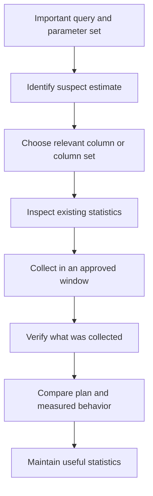

# Collect Teradata Statistics the Optimizer Can Use

Author: [nawazdhandala](https://www.github.com/nawazdhandala)

Tags: Database, SQL, Performance

Description: Choose Teradata statistics from real predicates and joins, distinguish individual from joint column statistics, and verify collection before judging plan changes.

A statistics job can finish successfully while the query you care about still receives a poor estimate. Perhaps the job collected an unrelated column, missed a correlated column pair, or reused information that no longer describes recent data. The solution is to connect every proposed statistic to a specific estimation problem.

Statistics summarize data characteristics for the optimizer. They do not change the table's rows, redistribute a hot key or correct an invalid join. This guide uses conventional table examples and Teradata's documented optimizer-form statements, including Database Engine 20.00 HELP examples. No live Teradata collection or optimizer test was performed; review the examples against your release and table type before execution.

## Start with a query and an estimate

Choose a small set of important queries. Record their parameters, current plans and actual workload behavior. Find the first estimate that appears inconsistent with the data: a date filter that should be selective, a customer key with a dominant value, or a join whose estimated output is implausibly small.

Map that estimate to its input columns. A join on `customer_id` and a filter on `order_date` suggest different statistics from a query filtering both country and currency. Avoid collecting every possible column combination. Each extra statistic becomes work that must remain justified and maintained.

The [optimizer-form COLLECT reference](https://docs.teradata.com/r/Enterprise_IntelliFlex_VMware/SQL-Data-Definition-Language-Syntax-and-Examples/Statistics-Statements/COLLECT-STATISTICS-Optimizer-Form?contentId=mqxn5NLKhKR~FJuqpSzx_g) describes the demographic information and dictionary storage involved. Its purpose is improving planning information, not guaranteeing a particular join strategy.



## Inventory before changing anything

Assume an approved staging table named `lab.orders`. Replace that identifier with your reviewed object. Start with:

```sql
HELP STATISTICS lab.orders;
```

The [HELP STATISTICS examples](https://docs.teradata.com/r/Enterprise_IntelliFlex_VMware/SQL-Data-Definition-Language-Syntax-and-Examples/Statistics-Statements/HELP-STATISTICS-Optimizer-Form/Examples/Example-Summary-Statistics-on-a-Database?contentId=7F~xmClR8UlVQWKtIBWEJQ) show how this reports collected columns and summary information. Save the output before collection so you can compare what existed and when it was collected.

Check the exact column set, not just whether the table has any statistics. Separate entries on two columns are not the same entry as statistics on their combination. Also retain the existing collection policy and options from the site's statistics tooling. An old timestamp is a clue, but a stable lookup table may remain well represented for much longer than a rapidly changing fact table.

For more detailed review, Teradata's [SHOW STATISTICS reference](https://docs.teradata.com/r/Enterprise_IntelliFlex_VMware/SQL-Data-Definition-Language-Syntax-and-Examples/Statistics-Statements/SHOW-STATISTICS) describes reporting collection SQL and optional detailed or summary values. Use the form appropriate to your release and access rights rather than editing the dictionary directly.

## Collect individual statistics for individual questions

Suppose queries join orders to customers by `customer_id` and frequently restrict orders by date. With the relevant columns present, this collects two separate statistics:

```sql
COLLECT STATISTICS
    COLUMN (customer_id),
    COLUMN (order_date)
ON lab.orders;
```

The two `COLUMN` clauses matter. This is not a joint distribution of customer and date. It gives the optimizer information about each named column independently.

Run collection only with the required authorization and an approved resource window. Teradata's [statistics collection guidance](https://docs.teradata.com/r/Lake-Database-Reference/Database-Administration/Improving-Query-Performance-Using-COLLECT-STATISTICS-Application-DBAs/Statistics-Collection) identifies the `STATISTICS` privilege for ordinary tables and notes the scan cost of collection. A statement that updates only metadata can still read substantial table data and compete with application work.

The example assumes conventional columns and no special row-level security requirements. Protected objects and other table types can have additional privileges or restrictions; use the statement reference rather than widening an account's permissions until the command happens to work.

## Use joint statistics when predicates travel together

Imagine a synthetic order population with 800 US/USD rows and 200 GB/GBP rows. The marginal share for US is 80 percent, and the marginal share for USD is also 80 percent. Multiplying those shares gives 64 percent, while the actual joint US/USD share is 80 percent.

That arithmetic demonstrates correlation: knowing one value tells you something about the other. It is not a claim that Teradata always multiplies those two percentages. The optimizer has additional estimation methods, but individual summaries cannot fully describe every relationship between columns.

If important queries frequently apply these columns together, evaluate:

```sql
COLLECT STATISTICS
    COLUMN (country_code, currency_code)
ON lab.orders;
```

Here one `COLUMN` clause contains two names, so it describes a joint column set. Teradata's [multiple-column guidance](https://docs.teradata.com/r/Lake-Working-with-SQL/SQL-Commands/SQL-Data-Definition-Language/Statistics-Statements/COLLECT-STATISTICS-Optimizer-Form/COLLECT-STATISTICS-Usage-Notes-Optimizer-Form/Collecting-Statistics-on-Multiple-Columns) distinguishes this from separate single-column statistics.

Do not expand the set indefinitely. Add a column because the workload uses the relationship, not because it is available. If the query applies an expression rather than the raw column, check whether the collected statistic can support that expression. A matching-looking name alone does not establish optimizer usability.

## Verify the collection and its effect separately

After an authorized collection, run the inventory again:

```sql
HELP STATISTICS lab.orders;
```

First confirm that the intended entries exist and examine their reported collection details. Then obtain a fresh plan for the same query and parameter set. Record whether the suspect row estimate or movement decision changed. Finally, execute a controlled workload comparison and measure runtime, spool and correctness.

A higher confidence label is useful context, not the acceptance criterion. The [confidence-level documentation](https://docs.teradata.com/r/Lake-Working-with-SQL/SQL-Reference/SQL-Request-and-Transaction-Processing/Interpreting-EXPLAIN-Output/EXPLAIN-Confidence-Levels?contentId=TNaartsZcnjtyHEocBJf8g) explains that stale information can still support a high-confidence estimate. Conversely, a useful plan can contain lower-confidence steps.

## Make maintenance reflect data change

Schedule recollection around meaningful changes: a large load, a new range of dates, or a shift in the values driving important predicates. Table growth is only one signal. The total row count can remain similar while the distribution changes substantially.

Sampling and threshold options can reduce maintenance cost, but they need their own evaluation. A small sample may represent a uniform population differently from a skewed one. Threshold-based recollection can skip work, so a successful scheduled request is not proof that every statistic was refreshed. Teradata describes that distinction in [recollection optimization](https://docs.teradata.com/r/Lake-Working-with-SQL/SQL-Reference/SQL-Request-and-Transaction-Processing/Query-Rewrite-Statistics-and-Optimization/Optimizing-the-Recollection-of-Statistics).

Keep a short maintenance record linking each useful statistic to its queries, collection policy, cost and last verified benefit. Review unused entries with the workload owner before removal, because another application may depend on them. The goal is a manageable set of relevant, current information whose effect you can demonstrate with real plans and workloads.
