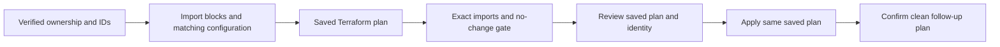

# Import Cloud Resources in CI with a Terraform No-Change Gate

Author: [nawazdhandala](https://www.github.com/nawazdhandala)

Tags: Terraform, CI/CD, Infrastructure as Code

Description: Gate Terraform imports on exact resource IDs and zero managed-resource mutations, then apply the reviewed saved plan through a controlled CI workflow.

Importing an existing resource into Terraform changes its management relationship. It should not accidentally change the resource itself. Yet an import plan can also propose updates because the destination configuration differs from the live object.

In CI, a reviewer should not have to spot every dangerous action in a long text log. Add a machine-enforced gate that requires the approved imports and rejects managed-resource changes. Keep ownership verification and human review around that gate: a harmless-looking plan for the wrong account is still the wrong import.

This tutorial focuses on the CI handoff. It assumes you have already inventoried the resource and written a matching destination resource block. The concrete gate is pinned to Terraform **1.11.4**, whose plan JSON format is **1.2**.

## Define an import-only change

For this workflow, an acceptable plan must import exactly the reviewed address-to-ID mapping. Every managed resource must have the `no-op` action, meaning the plan proposes no managed-resource mutation. Data-source reads are allowed. Output additions, resource moves, drift, deferred changes, and failed or unresolved checks are sent to separate review.

This is intentionally stricter than merely rejecting deletes. An import that changes a security setting or adds a tag is still a change. If that update is intended, perform the adoption and the modification as separately reviewed operations.



Terraform's configuration-driven import workflow requires both an import declaration and the destination resource configuration. Importing is completed by applying the plan; producing a plan alone does not adopt the object into state. [Import workflow documentation](https://developer.hashicorp.com/terraform/language/import).

## Commit a small, explicit import manifest

Suppose an existing reviewed root already declares `aws_vpc.adopted` with settings matching a verified VPC. Using AWS provider **6.25.0**, the import ID for `aws_vpc` is its VPC ID. Add this block, replacing the placeholder with the actual ID:

```hcl
import {
  to = aws_vpc.adopted
  id = "REPLACE_WITH_VERIFIED_VPC_ID"
}
```

This fragment belongs beside the existing resource and provider configuration. Confirm the account, Region, provider alias, and backend before planning. Importing the VPC does not recursively import its subnets, routes, or other resources. [Pinned AWS VPC import documentation](https://github.com/hashicorp/terraform-provider-aws/blob/v6.25.0/website/docs/r/vpc.html.markdown).

Commit `expected-imports.json` with the same reviewed identity:

```json
{
  "aws_vpc.adopted": "REPLACE_WITH_VERIFIED_VPC_ID"
}
```

The manifest is an approval input, not something generated from whatever the plan happens to contain. Protect changes to it with the same review as the Terraform configuration.

Check that no other state already manages the object. The gate below cannot discover ownership in another repository or backend. When another state owns it, use a coordinated ownership migration rather than importing a second copy.

Generated configuration can help prepare the destination block, but it is a draft to review. Do not generate configuration and immediately apply it inside an unattended import job. [HashiCorp's configuration-generation guidance](https://developer.hashicorp.com/terraform/language/import/generating-configuration).

## Check structured plan data

Save this Python 3.11 script as `import_gate.py` in a reviewed automation directory. It checks the plan itself rather than searching text output for a familiar summary line.

```python
import json
import sys


def check(plan, expected):
    if plan.get('terraform_version') != '1.11.4' or plan.get('format_version') != '1.2':
        raise ValueError('Review the gate before changing Terraform/JSON versions')
    if (plan.get('errored') is not False or plan.get('complete') is not True
            or plan.get('applyable') is not True):
        raise ValueError('Require a successful, complete, applyable import plan')
    if not expected or not all(isinstance(k, str) and isinstance(v, str)
                               and k and v for k, v in expected.items()):
        raise ValueError('Expected imports must be a nonempty address-to-ID map')
    if plan.get('resource_drift') or plan.get('deferred_changes'):
        raise ValueError('Resolve drift or deferred changes separately')
    if any(c.get('status') != 'pass' for c in plan.get('checks', [])):
        raise ValueError('All reported checks must pass')
    imports, seen = {}, set()
    for resource in plan.get('resource_changes', []):
        address = resource['address']
        change = resource['change']
        if address in seen or resource.get('previous_address') or resource.get('deposed'):
            raise ValueError('Duplicate, moved, or deposed resource needs separate review')
        seen.add(address)
        mode, actions = resource['mode'], change['actions']
        if mode == 'managed':
            if actions != ['no-op']:
                raise ValueError('Managed resource mutation: ' + address)
            if 'importing' in change:
                imports[address] = change['importing']['id']
        elif mode == 'data':
            if actions not in (['read'], ['no-op']) or 'importing' in change:
                raise ValueError('Unexpected data-source action')
        else:
            raise ValueError('Unknown resource mode')
    if any(c['actions'] != ['no-op'] for c in plan.get('output_changes', {}).values()):
        raise ValueError('Review output changes in a separate change')
    if imports != expected:
        raise ValueError('Planned import addresses/IDs do not exactly match approval')


if __name__ == '__main__':
    with open(sys.argv[1]) as stream:
        plan = json.load(stream)
    with open(sys.argv[2]) as stream:
        expected = json.load(stream)
    check(plan, expected)
    print('Import-only gate passed')
```

In Terraform's JSON, `change.importing.id` identifies a planned import. A no-op resource can still carry that import metadata, so checking action lists alone would miss whether the requested adoption is present. The `complete`, `errored`, and `applyable` fields also matter. [Plan JSON structure](https://developer.hashicorp.com/terraform/internals/json-format).

This gate is specific to string-ID imports in the pinned version. It deliberately rejects unknown versions instead of silently accepting a new representation. When upgrading Terraform, review the JSON contract and rerun the fixture suite before changing the gate's accepted version.

An exception makes the command fail. The messages identify the rejected category without printing resource attribute values. Keep the complete plan in restricted storage for authorized reviewers.

## Produce one plan and gate that exact artifact

Run the following from the verified Terraform root in a CI job with authenticated backend and provider access. The root must have a committed dependency lockfile and all required variables. Put the two gate files at the paths shown, or adjust the paths explicitly.

```bash
set -euo pipefail
umask 077
terraform init -input=false -lockfile=readonly
terraform plan -input=false -lock-timeout=60s -out=import.tfplan
terraform show -json import.tfplan > import-plan.json
python3 import_gate.py import-plan.json expected-imports.json
```

This uses ordinary plan exit behavior: a successful plan returns success even when it includes imports. The gate then evaluates its content. Do not put `continue-on-error` around the gate or apply from an unconditional cleanup step.

`show -json` can reveal sensitive values even when Terraform marks them sensitive. Protect the binary plan, JSON, and logs; do not post them wholesale in a public pull request. [Show output and sensitive data](https://developer.hashicorp.com/terraform/cli/commands/show).

Attach the source commit, variable revision, backend/workspace identity, CLI version, provider lockfile digest, expected-import manifest, and plan digest to the review record. An approved digest must come from the trusted planning job or approval system, not from an editable file downloaded beside the plan.

Use the same per-state coordination as normal applies. Another deployment can change state while an import waits for review. If the saved plan becomes stale, regenerate it and repeat the gate and approval; do not automatically apply a new, unreviewed plan.

## Apply only after the review gate

The authorized apply stage should retrieve the immutable approved plan and verify its provenance, target state, and digest. It must use compatible configuration and dependency selections. Then execute the saved plan:

```bash
terraform apply -input=false -lock-timeout=60s import.tfplan
```

Passing a saved plan does not produce another interactive approval prompt. Your CI approval therefore has to happen before this command. Omitting the filename would create a different planning path and break the link to the reviewed artifact. [Saved-plan apply behavior](https://developer.hashicorp.com/terraform/cli/commands/apply).

The import writes state even when managed-resource actions are no-op. Preserve backend versioning and recovery procedures. No-op is not a claim that the entire operation is read-only, and it does not authorize skipping the ownership review.

After success, run a normal fresh plan and verify that no resource changes remain. Retained import blocks are idempotent once the objects are managed, so the one-time gate should no longer find the expected pending imports. That is why this strict gate belongs to the adoption workflow, not every later deployment. [Import block behavior](https://developer.hashicorp.com/terraform/language/block/import).

## Rehearse both acceptance and rejection

Test a genuine import-only plan, then mutate fixtures to contain an update, create, delete, each replacement ordering, a wrong ID, an extra or missing import, and an incomplete plan. The job must stop on each rejected case. Also verify that approval failure cannot reach the apply stage.

For this article, I generated an actual Terraform 1.11.4 plan importing a disposable built-in `terraform_data` object. The gate accepted it, and twenty-four local scenarios covered that plan and rejection fixtures. Applying the local saved plan produced a clean follow-up plan without a repeated import. The built-in resource does not represent a cloud object, so this tests Terraform's plan/gate flow rather than AWS ownership or provider behavior. [Terraform data resource](https://developer.hashicorp.com/terraform/language/resources/terraform-data).

No AWS resource was imported or changed. Cloud permissions, cross-state ownership, CI approvals, artifact provenance, and failure recovery still require an environment-specific rehearsal before production adoption.
