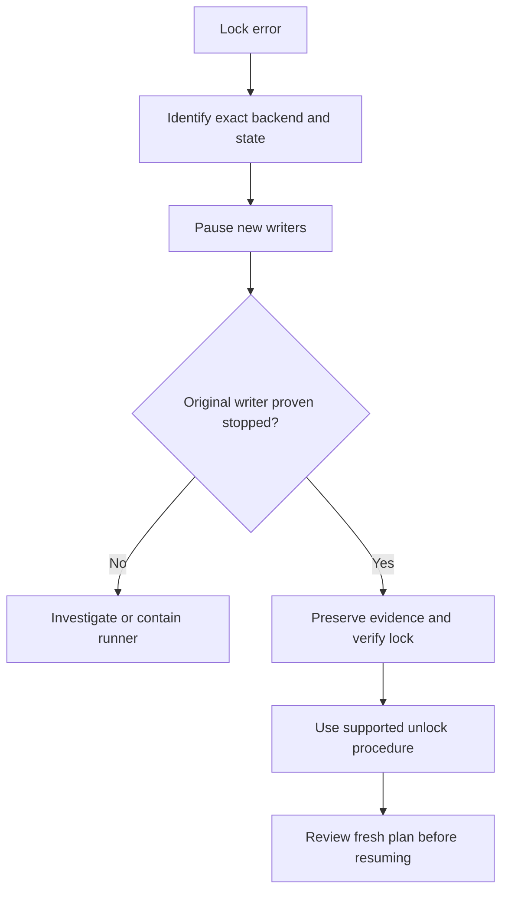

# Terraform State Lock Stuck in CI? Prove the Writer Is Gone First

Author: [nawazdhandala](https://www.github.com/nawazdhandala)

Tags: Terraform, CI/CD, Troubleshooting

Description: Recover a stuck Terraform state lock by identifying the owner, stopping competing writers, preserving evidence, and checking backend-specific unlock behavior.

A pipeline fails with an error acquiring the state lock. Another run was canceled twenty minutes ago, so someone suggests copying the lock ID into `terraform force-unlock`.

The missing question is whether the original writer can still write. An old lock can belong to a slow operation, a disconnected runner, or a process whose cancellation has not finished. Unlocking while that process remains active allows competing operations to act on the same state.

Treat lock recovery as a short coordination incident. Identify the state, stop new writers, establish what happened to the owner, and only then use the backend's supported recovery procedure.

## Understand what the lock protects

Terraform state maps configuration addresses to real resources and records information Terraform needs for later operations. A state lock coordinates access to that state. It does not cancel provider requests, roll back an interrupted apply, or prove that the infrastructure matches the last saved state.

When a backend supports locking, Terraform acquires a lock for operations that could write state. A lock-acquisition failure should stop the operation. Disabling locking removes that coordination rather than repairing it. [HashiCorp's state-locking documentation](https://developer.hashicorp.com/terraform/language/state/locking).



A lock's age is evidence about timing, not a lease expiry. Do not invent an age threshold after which every lock becomes safe to delete.

## Identify the exact state before touching it

Collect the failed command's lock details: ID, operation, owner, Terraform version, creation time, and path where available. Save the CI run URL, attempt number, commit, runner identity, and backend configuration source.

From the already initialized working directory used for this environment, these commands report the CLI version and selected workspace:

```bash
terraform version
terraform workspace show
```

The [workspace command](https://developer.hashicorp.com/terraform/cli/commands/workspace/show) reports selection; it does not prove you are connected to the intended backend. Compare the backend type, account or service endpoint, bucket/container, state key, and workspace with the failed job. Two repositories can target one state. Two workspaces can use different keys in the same bucket.

Do not reinitialize against a guessed backend just to make an unlock command run. Recover the reviewed configuration and environment settings used by the job. Keep backend credentials and cached initialization files out of incident chat.

For S3, identify whether the installation uses S3 lockfiles, legacy DynamoDB locking, or both during migration. Current documentation describes opt-in `use_lockfile` and deprecated DynamoDB locking. The lock mechanism is not inferable from the fact that state lives in S3. [S3 backend locking options](https://developer.hashicorp.com/terraform/language/backend/s3).

## Stop new writers and trace the original owner

Pause automatic applies, scheduled runs, retries, and manual launches for this state. Tell other operators which state is under recovery. This pause must cover every entry point, including another repository or an engineer's workstation.

Then follow the owner back to its execution environment:

| Evidence | Useful conclusion | Remaining uncertainty |
|---|---|---|
| CI run says canceled | The coordinator accepted or completed cancellation | Whether detached or remote work remains |
| Runner execution has ended | That execution is no longer running | Whether another writer was started |
| Process/container termination confirmed | That local writer cannot continue | Whether an accepted cloud operation is still progressing |
| No recent state update | No update observed in that interval | Whether a stalled writer may resume |

Use runner or orchestration records to confirm process termination. If the runner is unreachable, establish containment through the platform responsible for it rather than treating missing logs as proof of exit. Revoking access can be part of containment, but account for credential lifetime, propagation, and any already accepted requests.

GitHub Actions cancellation involves reevaluating job conditions and signaling processes; it is a sequence, not simply a UI flag. Understand your CI system's equivalent lifecycle. [GitHub's cancellation reference](https://docs.github.com/en/actions/reference/workflows-and-actions/workflow-cancellation).

Also inspect the last provider operations. A database creation request may finish after the Terraform process dies. Before the next apply, determine whether such operations completed, failed, or remain in progress. State-lock removal cannot settle that question.

## Preserve the state and recovery evidence

Once writers are stopped, preserve the backend's current state version or snapshot through its normal retention mechanism. Record its version identifier and timestamp in the incident. Do not overwrite it with an older local copy.

If your procedure also requires a local state export, use a restricted directory and avoid printing it. In a POSIX shell, after confirming the backend and permissions:

```bash
umask 077
recovery_dir=$(mktemp -d "${TMPDIR:-/tmp}/tf-recovery.XXXXXX")
terraform state pull > "$recovery_dir/state.json"
```

Check the command's exit status before trusting the file; shell redirection can create an empty file even when retrieval fails. Store the export in your approved restricted evidence location, not as a public CI artifact. State may contain secrets.

`state pull` outputs the state using the installed Terraform version's supported representation; it is not necessarily a byte-for-byte copy of a stored backend object. Preserve backend-native versions when exact recovery evidence matters. [State pull behavior](https://developer.hashicorp.com/terraform/cli/commands/state/pull).

Record why the writer is considered stopped, who paused admission, and the exact lock being evaluated. Recheck immediately before unlocking. If another owner or lock ID appears, stop and investigate instead of reusing the old incident conclusion.

## Use the backend's unlock behavior deliberately

For a backend and Terraform version whose recovery procedure supports this command, run it from the verified configuration only after the previous checks:

```bash
terraform force-unlock 'REPLACE_WITH_VERIFIED_LOCK_ID'
```

Keep the interactive confirmation. The command removes the current configuration's state lock; it does not modify infrastructure. The `-force` option only suppresses confirmation. Local state files cannot be unlocked by another process through this mechanism. [Force-unlock reference](https://developer.hashicorp.com/terraform/cli/commands/force-unlock).

Do not assume every backend checks the supplied ID in the same way. For example, Terraform **1.11.4**'s S3 implementation compares the supplied ID with lock information before its unlock operations. Its HTTP implementation instead sends lock information cached in the client; a fresh force-unlock process has no previously acquired lock information to send. These are version-specific source observations, not a general guarantee about all Terraform releases. [Tagged S3 source](https://github.com/hashicorp/terraform/blob/v1.11.4/internal/backend/remote-state/s3/client.go), [tagged HTTP source](https://github.com/hashicorp/terraform/blob/v1.11.4/internal/backend/remote-state/http/client.go).

In a localhost HTTP fixture, I verified that Terraform 1.11.4 sent fresh force-unlock requests without the supplied ID in the body. An endpoint requiring lock information rejected them; an explicitly permissive fixture accepted the empty request. That fixture is not a production server recommendation. It demonstrates why server policy and backend version matter. Consult the HTTP service's supported operator recovery process instead of weakening its checks. [HTTP backend protocol](https://developer.hashicorp.com/terraform/language/backend/http).

If a supported unlock fails, investigate permissions, connectivity, lock changes, and backend-specific behavior. Do not substitute blind deletion of a lock object, table row, or state file.

## Reconcile before reopening the queue

Keep automatic writers paused while one designated operator creates a fresh plan with the same reviewed configuration and variables. For example, when required inputs are already supplied:

```bash
terraform plan -input=false -lock-timeout=60s
```

The timeout waits for lock acquisition; it does not evict the lock holder. Review the plan for resources created before the interrupted process saved state, unfinished replacements, or unexpected deletion. Do not disable refresh or locking to hide discrepancies. The [plan reference](https://developer.hashicorp.com/terraform/cli/commands/plan) documents lock timeout and planning behavior.

An unlocked state can still be incomplete. Resolve discrepancies through reviewed recovery or import procedures, then create a new deployment plan. Resume one controlled run before reopening normal admission. Keep the evidence record with the cause and prevention work, such as per-state CI coordination and sufficient shutdown time.

Local validation exercised lock contention, timeout, fresh HTTP unlock behavior, and a subsequent plan using Terraform 1.11.4. No cloud backend was unlocked, no provider resources were created, and no apply was run.
