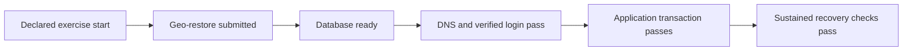

# Test Azure MySQL Geo-Restore, DNS Cutover, and Recovery Time

Author: [nawazdhandala](https://www.github.com/nawazdhandala)

Tags: Azure, MySQL, Disaster Recovery, Reliability

Description: Rehearse Azure MySQL geo-restore with application-side DNS checks, measured recovery milestones, and honest evidence of recovery time and data gaps.

A geo-restore that creates a healthy database in 35 minutes can still leave an application unavailable for hours. Its identity may depend on the failed region, its DNS resolver may be unreachable, or its connection pool may still hold connections to the old database.

A useful disaster-recovery drill measures the complete path to a working application. It also distinguishes what an exercise proves from what a real regional outage could do differently. Start in an authorized staging environment or an isolated recovery exercise; do not disconnect production simply to make the test look realistic.

## Define the two objectives before starting

Recovery time objective, or RTO, is the tolerated service outage. Recovery point objective, or RPO, is the tolerated data loss. Azure's [business-continuity overview](https://learn.microsoft.com/en-us/azure/mysql/flexible-server/concepts-business-continuity) treats these as application-specific decisions.

Write an acceptance statement that can actually be measured. For example: “Within 60 minutes of the declared exercise start, the recovery application must complete a verified read and write and sustain the agreed test load for five minutes.” The numbers are illustrative; use your service's approved objectives.

Define the data-loss test separately. A successful login says nothing about whether the latest acknowledged orders survived. Record both the last recovered business operation and any missing acknowledged operations.

Decide what starts the clock. If your production RTO includes detection and operator response, starting the drill timer only when someone clicks Restore understates it. Keep detection, authorization, provisioning, and application recovery as separate milestones even when the exercise begins with a simulated alert.

## Confirm that geo-restore is available

Verify that geo-redundant backups are enabled and that the intended target region supports the required restore path and compute capacity. Geo-restore uses the latest available geographically replicated backup; it is not an arbitrary point-in-time selection. Microsoft documents a possible replication delay of up to an hour and variable restore duration in its [backup and restore guidance](https://learn.microsoft.com/en-us/azure/mysql/flexible-server/concepts-backup-restore).

Do not substitute zone-redundant high availability for regional recovery. A standby in another availability zone addresses a different failure boundary.

Prepare the destination dependencies before the exercise: network access, DNS resolution, operator access, application identity, certificate trust, secrets, monitoring, and any encryption-key access. Record which are pre-provisioned and which the recovery operator must create. Excluding their creation from a drill is acceptable only when they will also exist before a real incident.

For a virtual-network-integrated server, review the destination's delegated subnet and private DNS links. Microsoft's [VNet integration documentation](https://learn.microsoft.com/en-us/azure/mysql/flexible-server/concepts-networking-vnet) describes this network model. If the deployment uses Private Link instead, review that distinct endpoint configuration; do not reuse a delegated-subnet checklist as though the two models were identical.

## Create an independent data checkpoint

Use a small synthetic workload whose results are safe to inspect. One practical design has a single test writer commit numbered marker records and save each successful acknowledgement, its sequence number, and UTC time outside the database's failure region.

At the declared incident time, stop that test writer and preserve its acknowledgement list. After restore, check the longest uninterrupted sequence of recovered markers against the list. Checking only the largest sequence number can hide gaps. For real business data, use the application's consistency rules rather than assuming all tables share this simple sequence.

Treat the measured marker gap as an observation with a sampling interval, not an exact measurement of every possible lost transaction. Preserve ambiguous outcomes where the client lost its connection before receiving a commit acknowledgement.

There is another important limitation: in an online drill, the original region may continue copying backups after your simulated incident time. A zero-gap result in that exercise does not prove zero loss during an actual region-wide failure. State that limitation in the report instead of upgrading a successful rehearsal into a service guarantee.

## Restore and record the provisioning milestone

Use the Azure portal's Restore workflow and select geo-redundant restore when available for the configured source. Choose the supported destination and a distinct server name, then record request submission and resource completion. Follow the [official portal restore procedure](https://learn.microsoft.com/en-us/azure/mysql/flexible-server/how-to-restore-server-portal); available choices depend on the source configuration.

Keep the test application and scheduled jobs from automatically attaching to the new server. Validate its settings first. Restored servers are non-HA according to Azure's restore documentation, so include any required protection changes in the acceptance plan. During a primary-region outage, the backup redundancy available for the restored target may also differ from an ordinary online drill.



The database-ready milestone is an intermediate result. Keep the RTO clock running while validating the application path.

## Test DNS from the application network

Use the new server's canonical Azure hostname in the recovery connection settings. DNS cutover includes proving that the application runtime resolves the intended hostname through the recovery DNS path, not merely editing a record in a portal.

On a Windows recovery host with the DnsClient and NetTCPIP modules, replace the hostname and run:

```powershell
$RecoveryHost = 'RECOVERY_SERVER.mysql.database.azure.com'
Resolve-DnsName -Name $RecoveryHost -Type A -DnsOnly
Test-NetConnection -ComputerName $RecoveryHost -Port 3306 -InformationLevel Detailed
```

The first command shows DNS answers; compare them with the destination's expected network configuration. The second reports the selected remote address and whether TCP port 3306 is reachable. These operations are documented in [Resolve-DnsName](https://learn.microsoft.com/en-us/powershell/module/dnsclient/resolve-dnsname?view=windowsserver2025-ps) and [Test-NetConnection](https://learn.microsoft.com/en-us/powershell/module/nettcpip/test-netconnection?view=windowsserver2025-ps). TCP success does not verify TLS, authentication, or query execution. Repeat the equivalent checks from the actual application runtime, whose DNS path may differ.

If you use a stable custom DNS alias, rehearse it with the real driver and certificate verification enabled. A CNAME does not make a certificate valid for an arbitrary customer hostname. MySQL's [VERIFY_IDENTITY behavior](https://dev.mysql.com/doc/refman/8.4/en/connection-options.html) includes hostname checking. Prefer updating application configuration to the canonical endpoint when the alias cannot satisfy that policy.

Allow for resolver and application caches. Existing pooled connections do not move just because DNS changed. Drain and replace the relevant pools through the application's controlled recovery process. Keep the original writer fenced so a partial cutover cannot create two independent write histories.

## Measure application recovery, not optimistic timestamps

Record UTC timestamps and evidence for each milestone. This Python 3.11 example calculates the complete exercise duration from two illustrative timestamps:

```python
from datetime import datetime

exercise_start = datetime.fromisoformat("2026-11-20T10:00:00+00:00")
sustained_checks_passed = datetime.fromisoformat("2026-11-20T10:47:30+00:00")
elapsed_seconds = (sustained_checks_passed - exercise_start).total_seconds()
if elapsed_seconds < 0:
    raise ValueError("Recovery cannot finish before the exercise starts")
print(f"Observed recovery: {elapsed_seconds / 60:.1f} minutes")
```

It prints `47.5 minutes`; that is example arithmetic, not a measured Azure result. Use timestamps from synchronized systems and the same clock convention. Python's [datetime documentation](https://docs.python.org/3.11/library/datetime.html) covers the timezone-aware subtraction used here.

Attach a compact evidence table to the drill record:

| Milestone | Supporting evidence |
|---|---|
| Exercise started | Declared incident or synthetic alert timestamp |
| Restore completed | Resource operation result |
| Connection path passed | Runtime DNS, verified TLS login, and endpoint |
| Application recovered | Identifiable committed transaction and readback |
| Recovery sustained | Agreed load, error rate, and latency observations |
| Data gap assessed | Acknowledgement list and recovered marker comparison |

Declare a failed objective when the measured duration or accepted data gap exceeds its target, even if the server eventually works. Assign a concrete follow-up to the slowest unresolved stage. Keep the recovered environment contained until results are reviewed, and treat returning production traffic as a separate, controlled operation with its own data-consistency decision.
