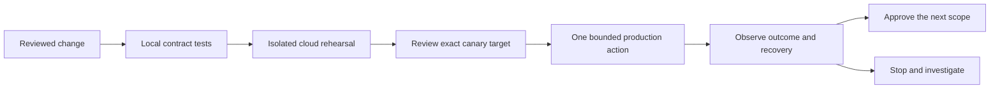

# Test Cloud Automation with Mocks, Sandbox Accounts, and Canaries

Author: [nawazdhandala](https://www.github.com/nawazdhandala)

Tags: AWS, Cloud Automation, Testing

Description: Build evidence in layers: SDK contract tests, isolated cloud rehearsals, and narrowly scoped production canaries with explicit pass and stop criteria.

A mocked cloud API test can pass while the real deployment role lacks permission. A sandbox run can pass while production has a different policy or resource layout. A production canary can succeed on one resource without proving that a broad selector is safe.

Each test layer answers a different question. Make those questions explicit, preserve the evidence, and expand scope only when the next layer addresses the remaining uncertainty.

## Use three layers with different acceptance criteria

| Layer | What it establishes | What it does not establish |
| --- | --- | --- |
| Local contract tests | Request fields and response-handling behavior | Real permissions or service behavior |
| Sandbox account | Real APIs, policy interactions, asynchronous state changes | Every production dependency or scale condition |
| Production canary | Behavior on a specific approved production target | Safety for all resources matching a selector |

A contract test checks the boundary between your code and the SDK. It should catch an incorrect parameter, unexpected response shape, or swallowed error. It should not be presented as a successful cloud deployment.



Keep the tested artifact revision fixed through these stages. Otherwise the successful sandbox run may describe different code from the production canary.

## Test real SDK requests with fake responses

For Python AWS automation, botocore `Stubber` intercepts client calls, checks expected parameters, and returns queued responses or errors. That is stronger than a mock accepting arbitrary keyword arguments, but it still does not contact AWS. See the [Stubber reference](https://botocore.amazonaws.com/v1/documentation/api/latest/reference/stubber.html).

Consider a permission probe for stopping an EC2 instance. AWS defines `DryRun=True` as a permission check that returns `DryRunOperation` when allowed or `UnauthorizedOperation` when denied. It does not stop the instance. See [StopInstances](https://docs.aws.amazon.com/AWSEC2/latest/APIReference/API_StopInstances.html).

Save this helper as `permission.py`. The example uses Python 3.11 and Boto3 **1.40.76**, the versions used in local validation.

```python
from botocore.exceptions import ClientError


def may_request_stop(ec2, instance_id):
    try:
        ec2.stop_instances(InstanceIds=[instance_id], DryRun=True)
    except ClientError as error:
        code = error.response['Error']['Code']
        if code == 'DryRunOperation':
            return True
        if code == 'UnauthorizedOperation':
            return False
        raise
    raise RuntimeError('Unexpected dry-run response; do not infer permission')
```

The helper returns permission evidence, not approval to stop a workload. A throttling error remains an error. An unexpected success-shaped response does not silently become permission evidence.

Save the following as `test_permission.py` in the same directory. The explicit fake credentials prevent these tests from looking for real credentials. Every client call is intercepted inside `Stubber`.

```python
import unittest
import boto3
from botocore.exceptions import ClientError
from botocore.stub import Stubber
from permission import may_request_stop


class PermissionTests(unittest.TestCase):
    def setUp(self):
        self.ec2 = boto3.client(
            'ec2', region_name='eu-west-1',
            aws_access_key_id='FAKELOCALACCESSKEY',
            aws_secret_access_key='fake-local-secret',
        )
        self.instance = 'i-0123456789abcdef0'
        self.params = {'InstanceIds': [self.instance], 'DryRun': True}

    def test_allowed_response(self):
        with Stubber(self.ec2) as stub:
            stub.add_client_error(
                'stop_instances', service_error_code='DryRunOperation',
                expected_params=self.params,
            )
            self.assertTrue(may_request_stop(self.ec2, self.instance))
            stub.assert_no_pending_responses()

    def test_denied_response(self):
        with Stubber(self.ec2) as stub:
            stub.add_client_error(
                'stop_instances', service_error_code='UnauthorizedOperation',
                expected_params=self.params,
            )
            self.assertFalse(may_request_stop(self.ec2, self.instance))

    def test_other_error_is_not_permission(self):
        with Stubber(self.ec2) as stub:
            stub.add_client_error(
                'stop_instances', service_error_code='RequestLimitExceeded',
                expected_params=self.params,
            )
            with self.assertRaises(ClientError):
                may_request_stop(self.ec2, self.instance)

    def test_unexpected_success_is_not_permission(self):
        with Stubber(self.ec2) as stub:
            stub.add_response('stop_instances', {}, self.params)
            with self.assertRaises(RuntimeError):
                may_request_stop(self.ec2, self.instance)


if __name__ == '__main__':
    unittest.main()
```

With the pinned SDK installed in your test environment, run `python test_permission.py`. Expect four passing tests. The fixture instance ID is illustrative and never reaches AWS during these tests.

Notice that the expected parameters include `DryRun: True`. If a code change removes that flag, the stub rejects the call rather than quietly accepting it. The tests cover the interpretation of provider responses; they do not evaluate IAM policies or prove the instance is safe to stop.

## Rehearse the workflow in a sandbox account

Use a dedicated account containing disposable fixtures, separate deployment credentials, and no accidental access to production data. Make fixture ownership, expiry, and cleanup part of the test design. Include enough representative policy and networking to exercise the actual failure modes.

Before mutation, verify the account identity and Region against an explicit allowlist. Avoid falling back to whatever profile or environment credentials happen to be present. Record the role, account, artifact revision, target IDs, and test run ID.

Effective AWS permissions depend on multiple policy types, including identity policies, resource policies, boundaries, and organization restrictions where applicable. A locally fabricated success response cannot evaluate these interactions. See [IAM policy evaluation](https://docs.aws.amazon.com/IAM/latest/UserGuide/reference_policies_evaluation-logic.html).

If you use service control policies (SCPs), remember that they restrict available permissions rather than grant them, and they do not affect the organization's management account. Test changes in a controlled organizational unit before broad attachment, following [AWS Organizations guidance](https://docs.aws.amazon.com/organizations/latest/userguide/orgs_manage_policies_scps.html).

Run the complete lifecycle: create the fixture, execute the action, wait for the actual service state, verify application-level effects, and clean up. Inject a denied action, interrupted worker, duplicate request, and delayed response. Preserve failures and remaining resources in a cleanup ledger instead of declaring the test successful because its main step finished.

## Treat a production canary as a separate authorization boundary

A canary is a small, deliberately selected trial. For automation, select exact resource IDs and a maximum action count before starting. A tag such as `Canary=true` is useful inventory metadata, but a changing tag query should not silently expand the approved target set.

Use a deployment role whose effective permissions match the intended action and target wherever the service supports that scope. Keep the approved target manifest separate from discovery output. If discovery produces an extra resource, the run should stop for review rather than process it because it happens to match.

For a stop/start workflow, choose a workload explicitly approved for that interruption, confirm its dependencies and data behavior, and rehearse restart checks. A read-only permission probe is a preflight check; it does not exercise the stop, restart, or application recovery path. Do not describe it as a completed operational canary.

Define pass criteria before execution: the expected state transition, unchanged unrelated resources, acceptable application behavior, correct audit evidence, and completed recovery. Also define stop criteria such as an unexpected target, authorization failure, rising error rate, or an unconfirmed operation outcome.

## Keep evidence proportional to the claim

A useful report might say: “Four local SDK contract tests passed; sandbox stop/start and application recovery passed for one fixture; production canary not yet run.” That tells the reviewer what remains uncertain.

Keep request and response identifiers, timestamps, role identity, scope, and relevant logs. Avoid storing secrets or entire sensitive payloads just to make the report look comprehensive. Record which checks were not performed and why.

Local validation for this tutorial executed only the four stubbed tests. No sandbox or production requests were made. When you adapt the pattern, promote the same reviewed artifact through the remaining layers and require new evidence whenever scope, permissions, or resource behavior changes.
