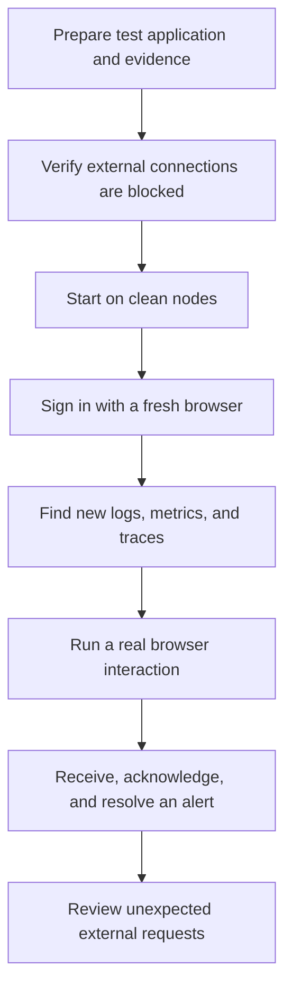

# How to Test That Your Monitoring Stack Works Without Internet Access

Author: [nawazdhandala](https://www.github.com/nawazdhandala)

Tags: Air-Gapped, Monitoring, Observability

Description: Run a staged offline acceptance test for monitoring, from empty-cache startup and fresh login to telemetry, browser checks, and acknowledged alerts.

An offline acceptance test must demonstrate new work. A dashboard displaying yesterday's metrics proves little about today's ingestion. A running container does not prove that its replacement can start. An alert in a database does not prove that an operator received it.

Use the following protocol in a disposable staging environment that represents the intended deployment. It progresses from establishing the network boundary to proving an observable request and a complete incident response. The steps are proposed tests, not results from a deployment performed for this article.

Work through the stages in order. If a stage fails, repair it before treating later results as evidence of offline operation.



## 1. Prepare the Test and Its Evidence Record

Choose a release, configuration, and artifact bundle. Include database dependencies, exporters, synthetic-runner images, browser binaries, and operating-system libraries. Prepare internal DNS, time, identity, certificate trust, and notification destinations before starting.

Create a run identifier such as `offline-acceptance-20261120-01`. Record it with the configuration revision, image digests, UTC start time, operators, and network rule identifiers. Save evidence inside the environment so producing the report does not require internet access.

Agree on deadlines before testing. Illustrative targets are ten minutes for startup, two minutes for searchable telemetry, and one minute for alert delivery after the alert actually fires. Adjust them to your configured scrape, export, evaluation, and notification intervals. Do not redefine success after observing a slow result.

Prepare a dedicated instrumented test application with a harmless endpoint, a counter, structured logging, and a request path through two services. Confirm that these features work before isolation; otherwise you cannot distinguish instrumentation defects from offline failures.

## 2. Restrict Staging Egress and Verify the Boundary

Use a dedicated staging network or disposable cluster with its own egress controls. Have the network owner deny external routes while retaining explicitly required internal destinations. Include IPv4, IPv6 where enabled, proxy paths, node traffic, and the operator and synthetic-browser networks. Preserve a separate administrative recovery path and a documented rollback.

Do not change shared production firewall rules or empty production caches for this exercise.

Kubernetes NetworkPolicy can contribute pod-level restrictions, but enforcement requires a supporting network plugin, policies are additive, and host-network behavior varies. A namespace policy alone is insufficient evidence about node image downloads or workstation traffic. Review the [NetworkPolicy documentation](https://kubernetes.io/docs/concepts/services-networking/network-policies/) with your cluster administrator.

Use an approved external HTTPS canary, known to work before isolation, and an internal control endpoint. Attempt new connections from each relevant network origin. Retain denial records and confirm that internal connections still succeed. A DNS failure or an unavailable external server alone does not prove egress enforcement.

**Pass:** the intended external paths are denied, required internal paths work, and logs identify the enforcement point. Otherwise stop: subsequent successes could be using an unnoticed internet route.

## 3. Cold-Start on Nodes Without Application Images

Provision fresh disposable nodes without cached monitoring or synthetic-runner images. Keep only the documented platform bootstrap artifacts needed to operate the cluster. Record that baseline; the claim is about application-image availability, not a machine booting without an operating system.

Deploy the approved bundle while egress remains restricted. Require images to come from the intended internal registry. A registry configured as an on-demand public proxy must also succeed without upstream access.

Kubernetes documents that `IfNotPresent` can reuse cached images and `Never` fails when an image is absent. This is why restarting an existing pod is insufficient. See [image pull behavior](https://kubernetes.io/docs/concepts/containers/images/).

For Kubernetes inspection, use an installed `kubectl`, read permissions, and an explicitly verified staging context. Replace every uppercase value below. These commands read resources; they do not create isolation or deploy anything.

```bash
TEST_CONTEXT='REPLACE_WITH_STAGING_CONTEXT'
TEST_NAMESPACE='REPLACE_WITH_TEST_NAMESPACE'
TEST_POD='REPLACE_WITH_POD_NAME'

kubectl --context="$TEST_CONTEXT" -n "$TEST_NAMESPACE" get pods -o wide
kubectl --context="$TEST_CONTEXT" -n "$TEST_NAMESPACE" describe pod "$TEST_POD"
kubectl --context="$TEST_CONTEXT" -n "$TEST_NAMESPACE" logs "$TEST_POD" \
  --all-containers=true --since=15m --timestamps=true
```

The official references document [pod listing](https://kubernetes.io/docs/reference/kubectl/generated/kubectl_get/), [resource descriptions](https://kubernetes.io/docs/reference/kubectl/generated/kubectl_describe/), and [container log options](https://kubernetes.io/docs/reference/kubectl/generated/kubectl_logs/). Retain relevant events and redact credentials from captured logs.

**Pass:** all required services become ready within the deadline using internal artifacts, including initialization jobs. A public image-pull attempt or missing runtime package fails this stage.

## 4. Sign In from a Fresh Browser

Use an isolated workstation and a new browser profile with no saved session. Sign in as a dedicated test operator, open a dashboard, run a query, and perform an authorized configuration read. Capture redirects and failed requests using browser developer tools.

If automation uses Playwright, a new [non-persistent browser context](https://playwright.dev/docs/api/class-browsercontext) provides isolated browsing state. Do not load saved authentication state into this login test. A fresh context does not itself block internet traffic; the staging network must do that.

**Pass:** login and the required UI actions complete locally within the agreed deadline. An already authenticated tab is not acceptable evidence. Classify failed requests by function: a blocked optional analytics call differs from a failed login redirect or required JavaScript download.

## 5. Prove New Logs, Metrics, and Traces

Use stable test service names and attach the run identifier to log records and a trace attribute. In compatible OpenTelemetry SDKs, `OTEL_SERVICE_NAME` sets the `service.name` resource attribute; this setting does not install instrumentation. See [SDK configuration](https://opentelemetry.io/docs/languages/sdk-configuration/general/).

Keep metric identification bounded. Use one dedicated test series, a fixed service label, and the recorded time window. Do not create a permanent metric label for every run identifier: Prometheus warns against [unbounded label cardinality](https://prometheus.io/docs/practices/naming/).

Capture a baseline counter sample, then send exactly ten requests with retries disabled to the dedicated endpoint. Configure the test path to increment once per request and exclude health checks and other traffic. Preserve test traces through any head or tail sampling policy.

| Signal | Required evidence | Pass criterion |
| --- | --- | --- |
| Logs | Search result containing the exact run identifier and service | Newly generated records appear within the deadline |
| Metrics | Baseline and post-run counter samples for the same series | Difference is ten, with no process restart or counter reset |
| Traces | Trace ID and displayed spans for both test services | Expected parent-child relationship and run attribute are present |

For metrics, compare actual counter samples rather than expecting an extrapolated [increase query](https://prometheus.io/docs/prometheus/latest/querying/functions/#increase) to return an exact integer. A reset invalidates that run's baseline; establish a new one and repeat. Save queries and timestamps so cached dashboard panels cannot substitute for evidence.

## 6. Exercise the Real Synthetic Browser Runner

Run a configured browser check from the same runner image and network placement intended for production. Navigate to an internal test page, submit a harmless form, and assert the resulting confirmation text. Capture its result and screenshot in the monitoring platform.

For Playwright-based runners, browser versions and system dependencies must accompany the selected Playwright release; its [browser documentation](https://playwright.dev/docs/browsers) describes these installation requirements. Package them before isolation instead of adding an install-on-start workaround.

**Pass:** a freshly started runner completes the interaction and stores its evidence without fetching browsers, libraries, fonts, or scripts externally. An HTTP status check alone does not cover a browser check's execution dependencies.

## 7. Trigger, Receive, Acknowledge, and Resolve

Create a test-only alert route that reaches a designated internal operator. Make the dedicated endpoint return a controlled error, recording the change time. Wait through the configured evaluation interval and pending period.

Record four separate events: alert fired, notification received, operator acknowledged, and incident resolved after the endpoint recovered. Include the incident identifier and destination. A notification adapter reporting success is insufficient without recipient evidence.

**Pass:** the intended person receives the message and completes the configured acknowledgment workflow without external access. If acknowledgment uses a separate incident system, include it in the test. For a workflow without acknowledgment support, record that limitation instead of claiming this stage passed unchanged.

## 8. Review Hidden Dependencies and Close the Run

Correlate denied traffic, DNS queries, process logs, and browser requests across every stage. Identify callers for unexpected destinations. Observe scheduled jobs over a defined window and deliberately exercise infrequent paths such as plugin loading; a short run cannot establish that future renewal works.

| Failure | First investigation |
| --- | --- |
| Works on old nodes only | Missing internal image or undeclared cached dependency |
| Login fails but dashboards stay open | External identity endpoint or reused session |
| Logs arrive but metrics or traces do not | Signal-specific pipeline, exporter, sampling, or query filter |
| Browser check fails before navigation | Browser binary, library, or writable-directory prerequisite |
| Alert fires without recipient evidence | Delivery destination, credentials, routing, or operator access |

Accept the run only when required stages pass and every external attempt is explained. Document disabled optional integrations, unresolved failures, and untested lifecycle operations separately. After repairs, repeat the affected stage and downstream checks, then perform a clean final run. The result is evidence for a specific release and boundary, with explicit limits, rather than a general claim that the product works offline.
