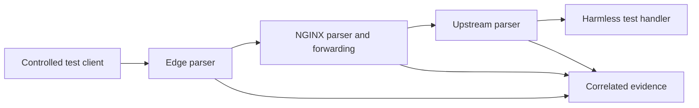

# Test NGINX Request Framing for HTTP Smuggling Risks

Author: [nawazdhandala](https://www.github.com/nawazdhandala)

Tags: Nginx, Security, Testing

Description: Build an isolated NGINX request-framing test, compare frontend and origin evidence, and understand what parser rejection tests do and do not prove.

HTTP request smuggling becomes possible when components disagree about where one request ends and another begins. A frontend may believe it forwarded one request while a downstream parser interprets some remaining bytes differently. On reused connections, that disagreement can affect a later request.

A useful assessment therefore follows the request through every relevant hop. A single HTTP error, a scanner label, or a patched NGINX binary alone does not describe the behavior of the complete deployment.

This guide demonstrates limited, loopback-only framing checks using NGINX 1.30.7. The local test accepted an ordinary request and rejected two ambiguous header combinations before they reached the origin. It did not establish that an arbitrary proxy chain is immune to request smuggling.

## Map the parsers before testing

Write down the actual path: external load balancer, web application firewall, NGINX, service proxy, and application server. Record versions and the protocol on each connection. An HTTP/2 client-facing connection does not imply that the upstream connection is also HTTP/2.



For the first test, remove the external edge and connect directly to an isolated NGINX listener. Then repeat an approved assessment through the staging edge. This separates NGINX's behavior from transformations made earlier in the chain.

Check the deployed package against [NGINX security advisories](https://nginx.org/en/security_advisories.html), including vendor backports and enabled modules. The version used here identifies the tested fixture; it is not a permanent recommendation to remain on that release.

## Define the rejection contract

Content-Length declares a body size. Transfer-Encoding can instead describe transfer framing such as chunked encoding. Conflicting declarations make message boundaries ambiguous. [RFC 9112](https://www.rfc-editor.org/rfc/rfc9112.html#section-6.3) defines body-length precedence and error handling, including requirements for messages containing both fields.

The pinned [NGINX request implementation](https://github.com/nginx/nginx/blob/release-1.30.7/src/http/ngx_http_request.c) rejects the combinations exercised below. The acceptance criteria for this narrow test are:

| Case | Frontend result | Origin evidence |
| --- | --- | --- |
| One valid Content-Length | 200 from the test handler | One request with exactly four body bytes |
| Conflicting Content-Length fields | 400 | No matching request |
| Content-Length plus chunked Transfer-Encoding | 400 | No matching request |

A 400 is meaningful only when you know who generated it. If the origin receives an ambiguous request and rejects it, the frontend has not demonstrated the intended rejection boundary.

## Prepare a dedicated lab path

Use a disposable staging instance with no real users, credentials, cache entries, or state-changing handlers. Bind the test listener to loopback. The origin should record the case identifier, body length, and received framing headers, then return a short fixed response.

This fragment belongs inside `http`; replace the origin port with your lab handler's port:

```nginx
server {
    listen 127.0.0.1:18080;

    location = /probe {
        proxy_pass http://127.0.0.1:18081;
        proxy_http_version 1.1;
        proxy_request_buffering on;
    }
}
```

Keep the fixture's proxy and origin logs. Request buffering is explicit so the baseline has a known forwarding mode. It is not a general security fix: changing buffering changes when body data is forwarded, and the real deployment's mode must also be assessed. See the [proxy request-buffering documentation](https://nginx.org/en/docs/http/ngx_http_proxy_module.html#proxy_request_buffering).

Run the normal configuration test before starting this isolated instance. Do not aim malformed framing probes at shared production connections. Even a rejected request can complicate other traffic when the actual chain behaves differently from the lab.

## Send exact bytes for three small cases

A high-level HTTP library may normalize duplicate headers before transmission. The following Python 3 script sends the intended bytes directly to the dedicated loopback listener. Save it as `probe.py` in a scratch directory after starting the lab.

```python
import socket

# Dedicated loopback-only staging listener, never a shared endpoint.
address = ('127.0.0.1', 18080)
cases = {
    'valid-length': (b'Content-Length: 4\r\n', b'test', 200),
    'conflicting-lengths': (
        b'Content-Length: 4\r\nContent-Length: 5\r\n', b'test', 400),
    'length-and-chunked': (
        b'Content-Length: 5\r\nTransfer-Encoding: chunked\r\n',
        b'0\r\n\r\n', 400),
}
for name, (framing, body, expected) in cases.items():
    request = (
        b'POST /probe HTTP/1.1\r\nHost: lab.invalid\r\n'
        + b'X-Test-Case: ' + name.encode() + b'\r\n'
        + b'Connection: close\r\n' + framing + b'\r\n' + body
    )
    with socket.create_connection(address, timeout=2) as connection:
        connection.settimeout(3)
        connection.sendall(request)
        response = b''
        while True:
            chunk = connection.recv(4096)
            if not chunk:
                break
            response += chunk
            if len(response) > 65536:
                raise RuntimeError('Unexpectedly large lab response')
    status_line = response.split(b'\r\n', 1)[0]
    status = int(status_line.split()[1])
    print(name, status_line.decode('ascii', errors='replace'))
    assert status == expected, (name, status, expected)
```

Run `python3 probe.py`. Each case uses a new connection, sends one small request, and expects closure. The timeouts and response-size bound keep failures observable rather than allowing an indefinite wait. There is no embedded second request or attempt to target another user's connection.

In the local NGINX 1.30.7 run, the script printed 200, 400, and 400 respectively. The origin recorded only `valid-length`, with the body `test`. NGINX's error log recorded the invalid framing cases. That combination established frontend rejection for these exact inputs.

## Compare evidence, not just status codes

For every case, retain the exact input bytes, frontend status, frontend error, origin request count, and origin interpretation. Use the harmless case identifier to correlate records. If a request times out, classify it as unresolved until the logs explain whether the parser was waiting for more bytes or a connection failed elsewhere.

Do not treat a 502 as equivalent to a clean rejection. It can mean that the frontend forwarded something the upstream could not process. Likewise, a successful baseline proves basic routing but not correct behavior for every framing variation.

The script intentionally creates fresh downstream connections and asks them to close. That makes the initial boundary test easier to interpret, but it does not exercise cross-request effects on reused upstream connections. Assess those separately in a dedicated security test environment using your organization's approved methodology and the actual backend parser.

## Expand coverage around the deployed chain

After the basic checks, cover the protocol conversions your service actually uses. Include HTTP/2-to-HTTP/1 translation if present, the edge product's normalization behavior, request-body streaming settings, and the application's real server implementation. Repeat after changing any parser or adding an intermediary.

Avoid turning every difference into an exploit claim. Two parsers can reject an input differently without creating a useful request boundary disagreement. A credible finding needs a reproducible interpretation mismatch and evidence of its effect within the controlled environment.

When a mismatch appears, preserve the smallest reproducer, keep the affected path out of shared testing, and review supported fixes for the relevant products. Re-run the same evidence collection after remediation. Keep the report scoped: these three checks are valuable regression tests, while a full assessment requires broader protocol and connection-lifecycle coverage.
