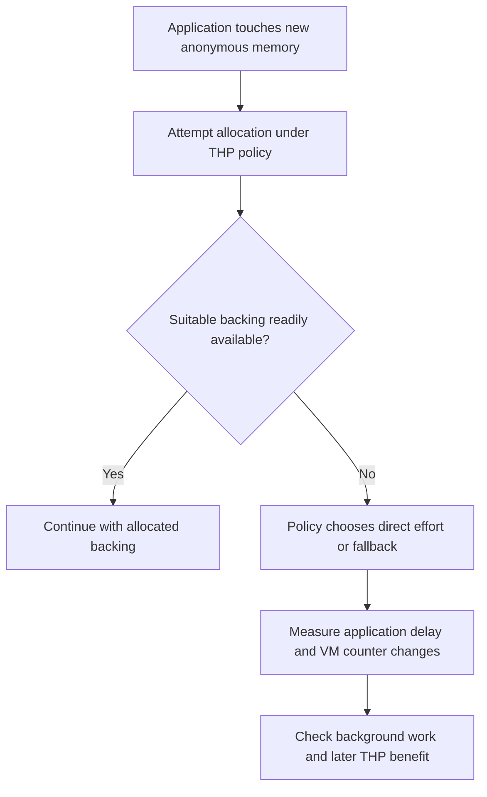

# Explain THP Allocation Stalls with Compaction Counters and Policy

Author: [nawazdhandala](https://www.github.com/nawazdhandala)

Tags: Linux, HugePages, Performance

Description: Correlate THP fault activity, direct compaction, memory pressure, and defrag policy to investigate allocation latency without confusing counters with timings.

An application pauses while touching a new buffer, and `compact_stall` increases. That is useful evidence, but it does not yet prove that Transparent Huge Pages caused the pause or tell you how long compaction took.

THP can reduce address-translation overhead after allocation while making some allocation paths more expensive. The operational question is whether work performed to obtain larger pages is delaying the workload phase that matters, and whether the later benefit justifies that cost.

This guide follows **Linux 6.12**, with traditional anonymous THP fault handling as the main example. Start with read-only collection. Any policy comparison belongs on an isolated staging host because these settings affect more than one process.

## Separate direct work from background work

Memory compaction moves movable pages so that larger contiguous free regions can be formed. Direct compaction runs as part of an allocation path; background compaction attempts to prepare memory outside that immediate request. Reclaim, which makes memory available by reclaiming pages, is another source of delay and can occur alongside compaction.

In Linux 6.12, `compact_stall` is incremented in the direct-compaction allocation path when compaction was not skipped. It is a count of such events, not milliseconds and not a THP-only counter. `compact_success` and `compact_fail` describe the resulting allocation outcome in that path. The [page allocator source](https://raw.githubusercontent.com/torvalds/linux/v6.12/mm/page_alloc.c) shows these relationships.

A successful compaction event may still have been expensive. A failed event may consume time without obtaining the desired allocation. Therefore, optimizing only for a higher success ratio can miss the user-visible problem.



## Record the active policy before interpreting counters

On the affected host, capture these settings:

```bash
uname -r
for name in enabled defrag; do
    printf '%s: ' "$name"
    cat "/sys/kernel/mm/transparent_hugepage/$name"
done
for file in /sys/kernel/mm/transparent_hugepage/hugepages-*kB/enabled; do
    [ -r "$file" ] || continue
    printf '%s: ' "$file"
    cat "$file"
done
cat /sys/kernel/mm/transparent_hugepage/khugepaged/defrag
cat /proc/sys/vm/compaction_proactiveness
```

Bracketed values in the THP policy files identify the active selection. Preserve the per-size settings too; modern kernels can have different policies for different THP sizes.

The global THP defrag policy changes how aggressively the fault path pursues large pages:

| Setting | Practical interpretation |
|---|---|
| `always` | Allows direct reclaim and compaction effort for THP allocation |
| `defer` | Requests background preparation instead of that direct effort |
| `defer+madvise` | Uses direct effort for advised regions and background preparation otherwise |
| `madvise` | Uses direct effort for regions advised with `MADV_HUGEPAGE` |
| `never` | Avoids this THP defrag effort on the ordinary fault path |

These are policy distinctions, not guarantees about latency. The [THP defrag documentation](https://www.kernel.org/doc/html/v6.12/admin-guide/mm/transhuge.html) describes the modes. Check whether the application or its allocator actually calls `MADV_HUGEPAGE`; two applications under the same host policy can follow different paths.

The `khugepaged/defrag` switch controls the background collapse daemon separately. `compaction_proactiveness` controls proactive compaction and can itself have system-wide costs. Do not treat all three controls as synonyms. See the [VM compaction controls](https://www.kernel.org/doc/html/v6.12/admin-guide/sysctl/vm.html#compaction-proactiveness).

## Measure an interval around the expensive phase

Choose a reproducible phase: initial buffer population, a request burst that allocates new arenas, or a worker restart. Measure its application latency and throughput using the same instrumentation in every run.

Before that phase:

```bash
snapshot_dir=$(mktemp -d)
cat /proc/vmstat > "$snapshot_dir/before.vmstat"
if [ -r /proc/pressure/memory ]; then
    cat /proc/pressure/memory > "$snapshot_dir/before.memory-pressure"
fi
printf 'Evidence directory: %s\n' "$snapshot_dir"
```

Run the documented workload phase, then capture the end state:

```bash
cat /proc/vmstat > "$snapshot_dir/after.vmstat"
if [ -r /proc/pressure/memory ]; then
    cat /proc/pressure/memory > "$snapshot_dir/after.memory-pressure"
fi
```

Keep the interval duration and workload timestamps with these files. Do not compare across a reboot. If unrelated jobs run during the interval, record them; the counters are host-wide.

Save this Python 3 helper as `vmstat-delta.py`:

```python
import argparse
from pathlib import Path

parser = argparse.ArgumentParser()
parser.add_argument("before", type=Path)
parser.add_argument("after", type=Path)
args = parser.parse_args()


def read(path):
    return {name: int(value) for name, value in
            (line.split() for line in path.read_text().splitlines())}


before, after = read(args.before), read(args.after)
names = ("compact_stall", "compact_success", "compact_fail",
         "thp_fault_alloc", "thp_fault_fallback", "thp_collapse_alloc")
for name in names:
    if name not in before or name not in after:
        print(f"{name}: unavailable in one or both snapshots")
    elif after[name] < before[name]:
        print(f"{name}: decreased; discard this interval")
    else:
        print(f"{name}: +{after[name] - before[name]}")
```

Run it with the captured files:

```bash
python3 vmstat-delta.py "$snapshot_dir/before.vmstat" "$snapshot_dir/after.vmstat"
```

A result such as `compact_stall: +40` means 40 counted events, not 40 milliseconds. `thp_fault_alloc: +8` means allocation events occurred, not that exactly eight huge pages still back your target buffer. THP fault, fallback, and collapse counters describe different paths; the [THP monitoring reference](https://www.kernel.org/doc/html/v6.12/admin-guide/mm/transhuge.html#monitoring-usage) defines them.

## Combine the signals without inventing attribution

Pressure Stall Information, or PSI, measures disruption from resource pressure. In `/proc/pressure/memory`, `some` concerns intervals when at least some tasks stall on memory, while `full` concerns simultaneous stalls of all non-idle tasks. The `total` value is cumulative microseconds of pressure time. It does not isolate THP or name the responsible allocation. See the [PSI interface](https://www.kernel.org/doc/html/v6.12/accounting/psi.html).

Use the observations to narrow hypotheses:

| Interval evidence | Reasonable next step |
|---|---|
| Latency rises with direct-compaction events during buffer population | Investigate the allocation path and its policy |
| Compaction rises without THP fault activity | Check other high-order allocations and unrelated workloads |
| THP allocation succeeds but latency is poor | Measure the cost of obtaining and clearing pages |
| Fallbacks rise while latency improves | Evaluate whether smaller backing trades startup cost for later overhead |
| Memory pressure rises broadly | Investigate reclaim and capacity, not only THP |

Correlation is a starting point. If the cause remains unclear, use a bounded, approved tracing session that attributes compaction to tasks and timestamps. Linux defines compaction begin/end and related events in its [compaction tracepoint source](https://raw.githubusercontent.com/torvalds/linux/v6.12/include/trace/events/compaction.h). Check the actual kernel's available events before choosing a tracing command.

## Compare policies as a controlled experiment

Save the original settings and change one policy at a time on a staging host. Keep workload size, concurrency, NUMA placement, and memory headroom comparable. Recreate the relevant allocation phase: reusing already populated buffers can hide the cost you intended to measure.

Compare initial latency, tail latency under sustained load, CPU use, memory pressure, and actual THP backing. A change that improves startup while degrading steady-state throughput may still be right for one service and wrong for another.

Do not force global compaction or drop caches merely to produce a cleaner graph. Those actions change the experiment and can impose unrelated costs. Likewise, a `never` defrag setting is not a universal ban on every mechanism that can produce huge pages; explicit collapse requests and other paths need separate analysis. The [MADV_COLLAPSE contract](https://man7.org/linux/man-pages/man2/madvise.2.html) describes its independence from the usual THP sysfs policy.

The delta helper passed synthetic positive, missing-counter, and decreasing-counter cases. Shell examples were syntax-checked. No Linux compaction, policy change, tracing session, or latency benchmark was executed for this article. Report the measured tradeoff from your staging runs before making a production recommendation.
