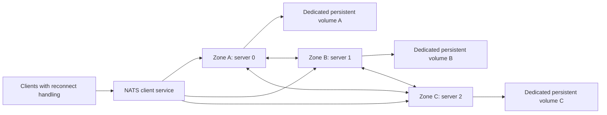

# Run Three-Replica JetStream on Kubernetes with Controlled Upgrades

Author: [nawazdhandala](https://www.github.com/nawazdhandala)

Tags: NATS, Kubernetes, Helm, Messaging

Description: Render a three-server JetStream topology with persistent storage, strict zone spreading, disruption limits, and a staged upgrade process that checks replica health.

Three NATS pods do not automatically give every stream three copies. Kubernetes decides where server processes run and which volumes they mount. JetStream separately decides how many replicas each stream has. Both layers must match your failure plan.

This guide uses official NATS Helm chart 1.3.7, whose application version is NATS Server 2.11.4. The example was rendered with Helm 3.17.3 and Kubernetes version capabilities set to 1.30.0. These are reproducible example versions, not a recommendation to deploy an old release without reviewing your support policy.

## Define what must survive

For a three-replica stream, a majority is two replicas. One unavailable server can be tolerated while the other two remain healthy and connected. Losing two removes that majority. Leader elections can briefly interrupt operations, so clients still need bounded retries and safe handling of uncertain publication outcomes. The [JetStream node-loss guide](https://docs.nats.io/learn/jetstream/surviving-node-loss) explains replication and storage durability.

Place the three servers in distinct failure domains:



Independent volumes matter. Three processes sharing a single writable JetStream directory are not three independent replicas. A PersistentVolumeClaim, or PVC, requests storage for a pod; a StatefulSet preserves each pod's identity and claim association across replacement.

## Check the storage and scheduling prerequisites

This example requires three eligible zones with correctly labeled nodes. The StorageClass placeholder `zonal-ssd` must be replaced with a real class that provisions suitable persistent storage in those zones. For zonal volumes, `WaitForFirstConsumer` binding lets storage provisioning account for pod scheduling. Review the provisioner's supported topology and failure behavior in addition to the [Kubernetes StorageClass rules](https://kubernetes.io/docs/concepts/storage/storage-classes/).

A zonal disk may reattach to a replacement node in its zone, but it does not necessarily move across zones. After a zone failure, surviving JetStream replicas provide availability; the lost pod's original volume may remain unavailable. Do not delete its PVC merely to make the scheduler stop complaining.

Also confirm volume permissions, disk latency, backup recovery, and enough capacity on the surviving servers. Replication does not protect against an authorized deletion applied to every replica.

## Render an explicit topology overlay

Save this as `topology-values.yaml`. It is an availability overlay for an isolated review, not a complete production security configuration. Merge your approved account, authentication, client TLS, route TLS, and network-policy settings before installation.

```yaml
config:
  cluster:
    enabled: true
    replicas: 3
  jetstream:
    enabled: true
    fileStore:
      enabled: true
      maxSize: 8Gi
      pvc:
        enabled: true
        size: 10Gi
        storageClassName: zonal-ssd
    memoryStore:
      enabled: false
container:
  merge:
    resources:
      requests:
        cpu: "500m"
        memory: 1Gi
      limits:
        memory: 1Gi
podTemplate:
  topologySpreadConstraints:
    topology.kubernetes.io/zone:
      maxSkew: 1
      minDomains: 3
      whenUnsatisfiable: DoNotSchedule
podDisruptionBudget:
  enabled: true
  merge:
    spec:
      maxUnavailable: 1
statefulSet:
  merge:
    spec:
      updateStrategy:
        type: RollingUpdate
        rollingUpdate:
          partition: 3
natsBox:
  enabled: false
```

These keys come from the [pinned chart values](https://raw.githubusercontent.com/nats-io/k8s/nats-1.3.7/helm/charts/nats/values.yaml). The chart supplies the topology constraint's label selector, avoiding a hand-written selector that accidentally matches unrelated pods.

The ten-GiB claim is per server, not shared across the cluster. The eight-GiB JetStream file-store limit leaves some volume headroom; validate actual overhead and disk alerts rather than treating that gap as a universal sizing rule. CPU and memory values are starting points for staging measurement.

`minDomains: 3` and `DoNotSchedule` deliberately prevent this topology from silently collapsing into fewer zones. If only two eligible zones exist, a pod may remain Pending. That is a capacity or topology issue to resolve, not evidence that the spread rule should automatically be removed. See the [topology-spread documentation](https://kubernetes.io/docs/concepts/scheduling-eviction/topology-spread-constraints/).

The rollout partition starts at three. With ordinals zero through two, no existing pod is eligible for a template update until the partition is lowered. Initial creation is still possible.

## Inspect what Helm actually produces

Use the official chart repository and pin the version:

```bash
helm repo add nats https://nats-io.github.io/k8s/helm/charts/
helm repo update nats
helm template nats nats/nats --version 1.3.7 \
  --namespace messaging --kube-version 1.30.0 \
  -f topology-values.yaml > rendered.yaml
```

The [Helm template command](https://helm.sh/docs/helm/helm_template/) renders manifests locally. It does not prove that a StorageClass exists, a volume can bind, or your admission policies will accept the resources.

Review the rendered StatefulSet, ConfigMap, PVC template, disruption budget, and container images. In this render, the server image was `nats:2.11.4-alpine` and the configuration reloader was `natsio/nats-server-config-reloader:0.17.2`. Disabling nats-box avoids an unnecessary tool deployment in this example.

After merging your real security settings and rendering again, an existing staging namespace can provide a separate API check:

```bash
kubectl --namespace messaging apply --dry-run=server -f rendered.yaml
```

The [server dry-run option](https://kubernetes.io/docs/reference/kubectl/generated/kubectl_apply/) validates requests without persisting them. It still does not provision storage or test runtime connectivity. Deploy through your normal reviewed Helm release process only after those checks pass.

## Request three replicas on the stream itself

A three-server cluster can still host a one-replica stream. Set stream replication explicitly when creating a new staging stream. With a connected nats.go 1.42.0 JetStream client named `js` and context `ctx`:

```go
stream, err := js.CreateStream(ctx, jetstream.StreamConfig{
    Name:     "ORDERS_LAB",
    Subjects: []string{"lab.orders"},
    Storage:  jetstream.FileStorage,
    Replicas: 3,
    MaxBytes: 1024 * 1024 * 1024,
    MaxAge:   24 * time.Hour,
})
if err != nil {
    return err
}
```

This fragment requires the `time` and `jetstream` imports. Use the returned stream to inspect its actual configuration and cluster state. The one-GiB and one-day limits are lab choices. Do not silently recreate an existing production stream to change its replication settings.

Before accepting traffic, verify three assigned replicas, an elected leader, healthy followers, and successful publication and consumption with unique test identifiers. Repeat a controlled one-server interruption in staging and confirm recovery before considering the topology ready.

## Understand what the disruption budget protects

The rendered PodDisruptionBudget, or PDB, permits at most one selected pod to be unavailable during supported voluntary evictions. It helps with operations such as a node drain using the eviction API. It does not prevent hardware failure, and it does not control a StatefulSet controller's rolling update. Direct pod deletion also bypasses eviction protection. These limits are described in [Kubernetes disruption handling](https://kubernetes.io/docs/concepts/workloads/pods/disruptions/).

Do not begin maintenance while one replica is already unhealthy. Two remaining healthy replicas are the operating majority, not spare capacity for another simultaneous interruption.

## Upgrade one ordinal, then check JetStream

Prepare the target chart, all image versions, complete values, backups, and rollback compatibility before touching the running release. Render the target with partition three first. Review its diff, including immutable storage-related fields and any changed probes or shutdown behavior.

Use the reviewed Helm values to lower `statefulSet.merge.spec.updateStrategy.rollingUpdate.partition` to two. This makes only ordinal two eligible for the new pod template. Wait for its volume to attach, its process to become ready, and its JetStream replicas to catch up. Then lower to one, repeat those checks, and finally lower to zero. Kubernetes documents this mechanism under [partitioned StatefulSet updates](https://kubernetes.io/docs/concepts/workloads/controllers/statefulset/).

The chart's rendered readiness probe uses `/healthz?js-server-only=true`; readiness is not a substitute for checking every affected stream's replication state. Keep the chart's graceful shutdown hook and sufficient termination time unless you have tested a deliberate change. Stop the rollout if replica health, acknowledgment latency, or application delivery checks regress.

Local validation passed Helm lint, rendering, manifest assertions, and NATS's configuration parser. The stream fragment compiled against the pinned client. No Kubernetes cluster was available, so PVC binding, zone placement, server-side admission, replica catch-up, failure recovery, and rolling upgrades remain required staging tests.
