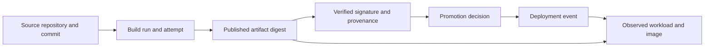

# Trace an Artifact from Source Commit to Production Deployment

Author: [nawazdhandala](https://www.github.com/nawazdhandala)

Tags: Artifact Management, CI/CD, Supply Chain Security

Description: Link source commits, build attempts, verified provenance, promotion decisions and deployed digests into a usable artifact investigation trail.

During an incident, “version 2.7 is deployed” is rarely enough. Which commit produced it? Was it the original build or a rerun? Did promotion copy the tested image, or rebuild it? Which production workloads actually started that artifact?

Build the investigation trail around immutable identifiers and explicit relationships. A tag or release name can help people navigate, but the evidence should resolve to exact source revisions, build attempts and artifact digests. This article shows how to collect those relationships without mistaking a convenient JSON record for cryptographic proof.

## Define the links you need to answer questions

Start with an evidence model that works in both directions: from an affected source commit to deployments, and from a running artifact back to its origin.

| Stage | Stable identifiers to retain | Question answered |
| --- | --- | --- |
| Source | Repository identity and exact checked-out commit | What source was presented to the build? |
| Build | Workflow identity, run ID and attempt | Which execution produced this output? |
| Artifact | Repository reference and content digest | Which exact object was published? |
| Verification | Evidence reference, verifier policy and result | Why was this artifact accepted? |
| Promotion | Source and destination digests, approver and time | Was the approved object moved unchanged? |
| Deployment | Cluster, namespace, workload identity and observed image | Where did it actually run? |

Retain each event rather than editing one mutable “current release” document. Two deployments of the same artifact are different events. A second build of the same commit is also a different event, because dependencies, toolchains or parameters may differ.



## Capture the actual build inputs

Record the revision from the checked-out workspace, not only from the trigger event. Pull-request workflows and custom checkout logic can make those different. Also record workflow revision, parameters, submodules and resolved dependencies according to your builder's contract. A clean Git commit alone does not describe everything downloaded during the build.

GitHub Actions provides `GITHUB_RUN_ID` and `GITHUB_RUN_ATTEMPT`; the attempt increases on reruns while the run ID remains the same. Preserve both. See GitHub's [variables reference](https://docs.github.com/en/actions/reference/workflows-and-actions/variables) for their exact meaning.

Here is a small index-record example for a GitHub Actions shell step after checkout and image publication. It uses Git and **jq 1.6**. Set `ARTIFACT_REF` to the fully qualified registry reference containing the digest obtained from the successful publication. Set `TRACE_OUTPUT` to a new output path outside the build context. The example does not publish anything or contact a registry.

```bash
set -euo pipefail
: "${ARTIFACT_REF:?Set the published repository@sha256:digest reference}"
: "${TRACE_OUTPUT:?Set a new trace record file path}"
: "${GITHUB_SERVER_URL:?Run inside GitHub Actions}"
: "${GITHUB_REPOSITORY:?Missing repository identity}"
: "${GITHUB_RUN_ID:?Missing run ID}"
: "${GITHUB_RUN_ATTEMPT:?Missing run attempt}"

commit=$(git rev-parse --verify 'HEAD^{commit}')
jq -e -n \
  --arg repository "$GITHUB_REPOSITORY" \
  --arg commit "$commit" \
  --arg run "$GITHUB_RUN_ID" \
  --arg attempt "$GITHUB_RUN_ATTEMPT" \
  --arg server "$GITHUB_SERVER_URL" \
  --arg artifact "$ARTIFACT_REF" '
  if ($artifact | test("^[^@[:space:]]+@sha256:[0-9a-f]{64}$")) then
    {
      schema: "example.artifact-trace-index/v1",
      source: {repository: $repository, commit: $commit},
      build: {
        runId: $run,
        attempt: $attempt,
        url: ($server + "/" + $repository + "/actions/runs/" + $run)
      },
      artifact: {reference: $artifact}
    }
  else error("Expected an immutable SHA-256 artifact reference") end
' > "$TRACE_OUTPUT"
```

The result is a JSON index containing the checked-out commit, run identity and supplied digest reference. [Git's revision parser](https://git-scm.com/docs/git-rev-parse) verifies that `HEAD` resolves to a commit. [jq's `--arg`](https://jqlang.org/manual/v1.6/) safely encodes values as strings rather than interpolating them into JSON syntax.

The reference check rejects tag-only input; it does not establish that the registry contains that digest. Retain this record only after the step succeeds. A failed command can leave an empty output file, so downstream collectors must reject unsuccessful or incomplete records.

This custom schema is an investigation index, not SLSA provenance. The example was executed against a temporary local Git repository with synthetic CI variables; no GitHub workflow or image publication was executed for this article.

## Attach trust to the artifact relationship

A source label or self-written record is a claim. Verification needs evidence from a trusted producer and a policy that defines acceptable identities and inputs.

SLSA build provenance identifies produced artifacts through the statement's subject and describes the build through `buildDefinition` and `runDetails`. Its `builder.id`, build type and resolved dependencies help interpret how an output relates to source inputs. Use the documented schema for your builder rather than assuming every producer puts a commit in the same field. The [SLSA 1.2 build provenance specification](https://slsa.dev/spec/v1.2/build-provenance) retains the predicate type `https://slsa.dev/provenance/v1`.

Store the verification result with the artifact digest, expected signer or builder identity, policy revision, verifier version and verification time. A successful signature check alone does not prove that the artifact came from the approved repository or branch. Check those expectations using the producer's evidence contract.

Retain the evidence itself or a durable, integrity-protected reference to it. A temporary build-log URL is a poor sole record if logs expire before the release's audit window ends.

## Record promotion without obscuring a rebuild

When promoting the same artifact, record source and destination references plus the digests observed at both locations. If the digest changes, investigate rather than declaring the objects equivalent because their tags match.

Container indexes add a useful distinction: a multi-platform index references platform-specific manifests. Copying only one platform can produce a different top-level identity. Record whether promotion preserved the entire index or deliberately selected a child manifest, and keep that relationship visible.

A rebuild is a new build event even if it uses the same source commit. Link its new output and verification results separately. Approval should identify the exact digest it authorizes, the destination environment and the applicable policy, so a later tag change cannot silently redefine the approval.

## Connect deployment intent to observed execution

A deployment record should retain the desired digest, configuration revision, actor and time. Kubernetes supports image references pinned by digest, as explained in its [container image documentation](https://kubernetes.io/docs/concepts/containers/images/). This avoids relying on a tag's meaning at a later time.

Then collect observed workload identity and runtime image information. A desired manifest is not proof that a rollout finished. Preserve cluster identity, namespace, workload and Pod UIDs, container name, observation time and runtime-reported image ID. Keep missing observations explicit while a container is pending or a rollout is incomplete.

Do not assume a runtime image ID string equals the top-level registry index digest. Platform selection and runtime representation can require another documented mapping. Verify that relationship for your runtime before using a simple string comparison as a deployment gate.

Finally, test the trail with a realistic question: given one production image, can an on-call engineer find its build attempt, reviewed source, accepted evidence and promotion decision without guessing from timestamps? Repeat the reverse query for a revoked release. Missing links should become visible collection failures, not plausible-looking blank fields in an otherwise green dashboard.
