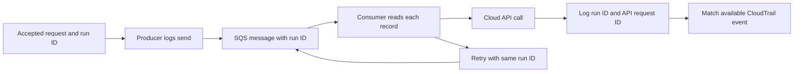

# Trace One Automation Run Across Queues, Functions, and Cloud APIs

Author: [nawazdhandala](https://www.github.com/nawazdhandala)

Tags: AWS, Cloud Automation, Observability

Description: Carry a stable run ID through queue messages and structured logs, then connect function attempts to cloud API request IDs without mixing unrelated work.

An automation request enters a queue, runs in a function, calls a cloud API, and retries an hour later. Searching by the function invocation ID finds only one attempt. Searching by a queue message ID can miss later messages created by the same workflow.

Give the business run a stable correlation ID, then record the narrower identifiers beside it. The result is a chain you can follow from the original request to each execution attempt and provider response.

## Give each identifier one job

Create the run ID when the trusted entry point accepts a new automation request. Persist it with the request and reuse it across scheduled retries, queue handoffs, and recovery workers. A new business request gets a new run ID; another attempt at the existing request keeps the original.

| Identifier | Scope | What it answers |
| --- | --- | --- |
| Run ID | One accepted business run | Which requested operation is this? |
| Step/attempt ID | One step execution attempt | Which retry produced this result? |
| Queue message ID | One queue message | Which transport object was received? |
| Invocation ID | One function invocation | Which function execution handled it? |
| Cloud API request ID | One provider request | Which API response or audit event corresponds? |
| Trace/span ID | Instrumented execution context | How are timed operations related? |

A correlation ID is not an authorization token or an idempotency guarantee. Validate who may request an operation independently. Likewise, recording the same run ID twice does not prevent duplicate side effects.

## Carry the run ID across the queue boundary

SQS supports custom message attributes, separate from its message body and system attributes. Use a string attribute for the run ID. Custom metadata does not automatically become tracing context in every consumer; read and propagate it explicitly. See [SQS message metadata](https://docs.aws.amazon.com/AWSSimpleQueueService/latest/SQSDeveloperGuide/sqs-message-metadata.html).



Use structured JSON logs with consistent field names. Log the allowed metadata needed for investigation, not full queue bodies, credentials, callback tokens, or every provider response.

## A producer and per-record consumer

The following helpers use Python 3.11 and Boto3 **1.40.76**, the SDK version used for local tests. They expect preconfigured authorized SQS and EC2 clients, an existing queue URL, a persisted UUID run ID, and a volume ID approved for inspection. The consumer calls `DescribeVolumes`, a read operation.

Save the helpers in your application module. They are not a complete Lambda batch handler. The surrounding handler must validate the business request, process each record with its own context, and implement the desired retry policy.

```python
import json
from uuid import UUID
from botocore.exceptions import ClientError


def send_job(sqs, queue_url, run_id, volume_id):
    canonical_run = str(UUID(run_id))
    return sqs.send_message(
        QueueUrl=queue_url,
        MessageBody=json.dumps({'volume_id': volume_id}),
        MessageAttributes={
            'run_id': {'DataType': 'String', 'StringValue': canonical_run},
        },
    )


def inspect_record(record, invocation_id, ec2, emit):
    run_id = str(UUID(record['messageAttributes']['run_id']['stringValue']))
    volume_id = json.loads(record['body'])['volume_id']
    fields = {
        'run_id': run_id,
        'message_id': record['messageId'],
        'invocation_id': invocation_id,
        'service': 'ec2',
        'action': 'DescribeVolumes',
        'region': ec2.meta.region_name,
    }
    emit({**fields, 'phase': 'api_started'})
    try:
        response = ec2.describe_volumes(VolumeIds=[volume_id])
    except ClientError as error:
        emit({**fields, 'phase': 'api_failed',
              'error_code': error.response['Error']['Code'],
              'aws_request_id': error.response.get(
                  'ResponseMetadata', {}).get('RequestId')})
        raise
    emit({**fields, 'phase': 'api_completed',
          'aws_request_id': response.get(
              'ResponseMetadata', {}).get('RequestId')})
    return response
```

At the producer, pass the stored run ID to `send_job`; log the returned SQS `MessageId` alongside that same run ID. In a Lambda consumer, pass `context.aws_request_id` as `invocation_id`. A suitable JSON-line emitter is `lambda fields: print(json.dumps(fields))`.

The consumer's `stringValue` spelling follows the Lambda SQS event shape; the producer's SDK request uses `StringValue`. Those are different interfaces. The official [SQS event examples](https://docs.aws.amazon.com/lambda/latest/dg/with-sqs.html) show the incoming record structure, and the [Python Lambda context reference](https://docs.aws.amazon.com/lambda/latest/dg/python-context.html) defines the invocation request ID.

On success, the helper logs the provider's response request ID. On a service error, it logs the error code and available request ID, then re-raises the exception. Boto3 documents `ClientError` and `ResponseMetadata` in its [error-handling guide](https://boto3.amazonaws.com/v1/documentation/api/latest/guide/error-handling.html).

Network errors can occur before a response supplies a request ID. Add a top-level attempt outcome record for those failures, but do not fabricate a provider ID. SDK retries can also make multiple requests; this helper captures the final returned response or service error, not every internal retry attempt.

## Keep batch and retry context separate

One Lambda invocation can receive several SQS records belonging to different runs. An invocation-level global `run_id` risks tagging later records with the first record's identity. The example constructs a fresh field dictionary per record, so two runs in one invocation remain distinguishable.

If a message lacks a valid run ID, record a bounded validation failure using its message and invocation identifiers. Do not silently mint a new run ID halfway through the workflow. Decide whether malformed messages should be retried or moved through the configured failure-handling path.

For partial batch failures, configure and implement Lambda's supported partial batch response behavior so successful records do not needlessly repeat. Correlation alone does not make retrying mutations safe. The [Lambda SQS integration guide](https://docs.aws.amazon.com/lambda/latest/dg/with-sqs.html) describes the batch behavior and links to error handling.

## Search the whole run, then narrow to an API request

For JSON logs in supported CloudWatch Logs Insights log groups, select the producer and consumer groups and query the run ID. Replace the example UUID with the actual persisted identifier:

```text
fields @timestamp, run_id, phase, message_id, invocation_id, aws_request_id
| filter run_id = "12345678-1234-4234-8234-123456789012"
| sort @timestamp asc
| limit 200
```

This assumes your logging pipeline exposes these fields at the JSON root. Adapt field paths if a logger wraps them inside another object. CloudWatch documents [JSON field discovery](https://docs.aws.amazon.com/AmazonCloudWatch/latest/logs/CWL_AnalyzeLogData-discoverable-fields.html), including its Standard log-class requirement. Broaden the time window and pagination/query strategy when a run produces more than the chosen result limit.

From an API log entry, use the request ID together with service, account, Region, action, and time to locate the corresponding available audit record. CloudTrail calls the provider-generated identifier `requestID`; its own `eventID` identifies the audit event. Do not equate those fields or assume every event includes a request ID. See [CloudTrail record contents](https://docs.aws.amazon.com/awscloudtrail/latest/userguide/cloudtrail-event-reference-record-contents.html).

Ensure the relevant events are actually collected and retained. A correlation ID in your application does not automatically appear as a custom field in CloudTrail.

## Add tracing without replacing the durable run ID

OpenTelemetry propagates context between instrumented operations so their spans can be related. Use the appropriate propagator and instrumentation for the transport, and include the run ID as an allowed attribute or log field. A business run spanning long delays and several retries may involve multiple traces; the durable run ID still joins the operational record. See [OpenTelemetry context propagation](https://opentelemetry.io/docs/concepts/context-propagation/).

Avoid putting run IDs into ordinary metric labels: each new run adds another distinct value. Use metrics for aggregate failure rates and duration, and logs or traces to investigate individual runs.

Test with two runs in one batch, a repeated message, a service error, and a missing correlation attribute. Confirm that each record retains the correct run ID and that available provider request IDs remain attached to the right attempt. Local SDK-stubbed tests covered producer metadata, two-record isolation, error correlation, and invalid UUID rejection. Live queue delivery, logging queries, and audit matching still need staging verification.
