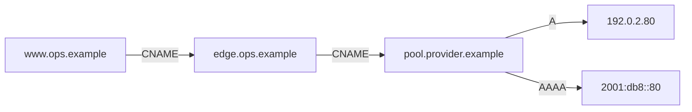

# Trace a CNAME Chain with nslookup from Alias to Final Address

Author: [nawazdhandala](https://www.github.com/nawazdhandala)

Tags: DNS, Networking, Troubleshooting

Description: Follow CNAME records one hop at a time, inspect final A and AAAA records, and identify missing targets, loops, and independently cached alias changes.

You query `www.ops.example.` and nslookup prints a different name above the address. Is the requested record wrong, or did DNS successfully follow an alias? To answer that, separate the name you asked for, the aliases in the response, and the owner of the final address record.

A CNAME record associates one DNS name with another. The name on the left is the alias; the record's value is its target. The target may itself be another alias. An address belongs to the name that owns the A or AAAA record, even when the resolver returns it in response to a question about the original alias.

## Draw the intended chain

Suppose the service owner expects this illustrative chain:



The diagram contains two CNAME records and two final address records. It does not mean the first name has its own A record. Nor does it imply that both address families must exist in every deployment.

[RFC 1034's alias discussion](https://www.rfc-editor.org/rfc/rfc1034.html#section-3.6.2) explains how address queries can be restarted at a CNAME target. This is why an ordinary A lookup may return the alias chain together with the final address, whereas a CNAME lookup asks about the alias relationship itself.

Use this distinction to define the incident precisely: wrong alias target, missing final address, or a valid chain leading to an unreachable service. Those require different repairs.

## Start with the original address query

The following commands use syntax documented for Windows Server 2025 and BIND 9.18.33. Substitute your approved resolver for `192.0.2.53` and your service name for the examples. The addresses and names shown are documentation placeholders.

```bash
nslookup -debug -type=A www.ops.example. 192.0.2.53
nslookup -debug -type=AAAA www.ops.example. 192.0.2.53
```

The final dots make the queried names absolute. The explicit resolver keeps server selection fixed. Save each complete response, including status, names, types, and TTLs. Debug output is easier to interpret than a compact list that groups names under labels such as “Aliases.” See the [BIND nslookup manual](https://bind9.readthedocs.io/en/v9.18.33/manpages.html#nslookup-name-server-lookup-utility).

For a successful A result in this example, expect CNAME information connecting the original name to `pool.provider.example.`, and an A record owned by that final name. Do not count the resolver's displayed address as a service address.

A successful A query does not establish that IPv6 works. Inspect the AAAA result separately. Conversely, no AAAA record may be normal for an intentionally IPv4-only service; compare the result with the service contract rather than treating every absent family as a fault.

## Ask about each alias explicitly

Now inspect the individual relationships:

```bash
nslookup -debug -type=CNAME www.ops.example. 192.0.2.53
nslookup -debug -type=CNAME edge.ops.example. 192.0.2.53
nslookup -debug -type=CNAME pool.provider.example. 192.0.2.53
```

The first query should identify `edge.ops.example.` as its target. The second should identify `pool.provider.example.`. If the final name directly owns address records, the third should have no CNAME record. That absence is not a failed address lookup: you asked for a different record type. Microsoft documents the [CNAME query type](https://learn.microsoft.com/en-us/windows-server/administration/windows-commands/nslookup-set-querytype).

Use the target actually returned by each response for the next query. Do not keep following the planned diagram when the first answer points somewhere else. Record that divergence and identify who owns the record that introduced it.

Build a small table while tracing:

| Owner name | Returned type | Value | TTL |
| --- | --- | --- | --- |
| www.ops.example. | CNAME | edge.ops.example. | Record observed value |
| edge.ops.example. | CNAME | pool.provider.example. | Record observed value |
| pool.provider.example. | A | 192.0.2.80 | Record observed value |

Each row is a separate record. Preserve the TTL attached to that row instead of assigning one lifetime to the whole chain. The table should reflect observed responses, not values copied from this example.

## Verify the final name directly

Once you reach a name without another CNAME, ask for its address records:

```bash
nslookup -debug -type=A pool.provider.example. 192.0.2.53
nslookup -debug -type=AAAA pool.provider.example. 192.0.2.53
```

Compare these results with the final records in the original lookup. A difference can reflect a cache refresh or a dynamic routing policy, so retain timestamps and full address sets before declaring an inconsistency.

If the final name does not exist, the alias that points to it may still exist. A negative answer can contain preceding CNAME records; read the chain before deciding which name is missing. [RFC 2308](https://www.rfc-editor.org/rfc/rfc2308.html) describes negative responses involving CNAMEs and distinguishes nonexistent names from missing record types.

This matters during provider changes. An internal alias can remain correctly published while its former external target has been removed. Recreating the internal alias with the same target would not repair that dependency. The service owner must confirm the intended destination.

## Diagnose loops and conflicting records

Keep a list of names already visited. If following the returned targets brings you back to one of them, the published relationships form a loop. Stop tracing and preserve the records. Do not assume that a generic SERVFAIL response proves a loop: it can also result from other resolution failures.

A practical manual investigation also needs a stopping point for an unexpectedly long chain. Escalate to the record owners when the chain becomes unclear rather than repeatedly querying an unbounded sequence. The purpose is to find the responsible relationship, not to invent a universal maximum supported by every resolver.

For ordinary DNS data, a name that owns a CNAME cannot also own an independent A or AAAA record. [RFC 2181, section 10.1](https://www.rfc-editor.org/rfc/rfc2181.html#section-10.1) clarifies alias exclusivity, with DNS security metadata exceptions. Do not “fix” an alias by adding an address at that same owner name without changing the design.

Also distinguish a DNS CNAME from a provider's product called an alias. [Route 53 alias records](https://docs.aws.amazon.com/Route53/latest/DeveloperGuide/resource-record-sets-choosing-alias-non-alias.html), for example, can return addresses directly and support the zone apex. A CNAME query cannot reveal every provider-side routing relationship; consult the provider configuration when the DNS answer contains only A or AAAA records.

## Repair and verify the specific broken hop

If a CNAME target is wrong, correct that record with its owner. If the final address record is missing, work with the target zone's owner. If recursive and authoritative answers disagree, compare the relevant zone at each hop instead of assuming the original zone controls the entire chain.

Plan a change around the lifetimes of the individual records. A resolver can retain an earlier alias target while another record has already refreshed. Lowering a new record's TTL does not retroactively change the lifetime of an older cached copy. Preserve pre-change observations when a coordinated cutover matters.

After the approved repair, repeat the original A and AAAA lookups through the affected resolver, then test the service using the original application hostname. Resolving the final target directly is useful diagnosis, but it does not replace checking the name users actually enter. Close the incident with the observed chain, its intended owners, and a successful application result rather than a screenshot of only the last IP address.
