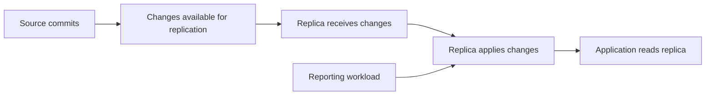

# Diagnose Azure MySQL Replica Lag Before Changing Server Size

Author: [nawazdhandala](https://www.github.com/nawazdhandala)

Tags: Azure, MySQL, Performance, Troubleshooting

Description: Investigate Azure MySQL replica lag using service metrics, transaction and worker checks, and evidence that separates capacity limits from replication errors.

A replica that is ten minutes behind might need more capacity. It might also be applying one unusually large transaction, competing with a reporting query, or waiting after an error. Increasing its size before distinguishing those cases can make the incident more expensive without making the data current.

Start with the application's freshness requirement, then locate where progress slows down. The read-only SQL below targets MySQL 8.0.22 or later within the 8.0 series. It was checked against official documentation and parsed locally, but not executed against an Azure server.

## Check Azure's replication signals first

Open Metrics on the affected replica and align the incident interval with the source's charts. Record **Replication Lag In Seconds**, **Replica IO Status**, and **Replica SQL Status**, together with CPU, storage and I/O utilization. Their API names are `replication_lag`, `Replica_IO_Running`, and `Replica_SQL_Running`. The [Azure monitoring reference](https://learn.microsoft.com/en-us/azure/mysql/flexible-server/concepts-monitor-mysql-reference) lists their supported aggregations and sampling intervals.

There is an important Azure-specific trap: Microsoft's current read-replica documentation says storage-based replication can report `REPLICA_IO_RUNNING` as `No` in SQL output even when replication is working. Use Azure's Replica IO Status and Replica SQL Status metrics to determine service replication status. Do not declare a broken receiver from that SQL field alone. See the [read-replica monitoring caveat](https://learn.microsoft.com/en-us/azure/mysql/flexible-server/concepts-read-replicas).

This distinction matters because generic MySQL troubleshooting examples often assume a conventional receiver thread. Azure documentation describes more than one implementation detail; establish which behavior applies to your server before interpreting low-level fields.

Keep a missing metric separate from zero lag. A chart with no recent samples is not evidence that a replica has caught up.

## Separate receiving changes from applying them

For diagnosis, think of replication as two stages: changes become available to the replica, and the replica applies them to its data. A binary log, or binlog, records changes for replication. A conventional MySQL replica receives those events into relay logs before applying them.



The reporting arrow represents shared resource pressure, not another replication feed. The diagram is a diagnostic model; it does not assert that every Azure server exposes identical receiver internals.

On the replica, collect this status twice, separated by a short observation interval. It requires a database account permitted to inspect replication, including MySQL's `REPLICATION CLIENT` privilege:

```sql
SHOW REPLICA STATUS;
```

Inspect error messages, apply progress, and lag together. `Last_SQL_Error` can direct you to worker failures. Upstream `Seconds_Behind_Source` can be zero while a slow receiver is behind, and `NULL` means unknown in relevant stopped-thread states. Older terminology may appear in service output. These limitations are documented in [SHOW REPLICA STATUS](https://dev.mysql.com/doc/refman/8.0/en/show-replica-status.html).

Treat file names and positions as paired coordinates where exposed. Subtracting positions from different binlog files does not produce a useful backlog size. Likewise, one status snapshot cannot establish whether progress is continuing.

## Look for a stopped worker before tuning throughput

If Azure reports an apply problem or the status includes an SQL error, inspect worker details where the service exposes them. This query needs read access to the relevant Performance Schema table:

```sql
SELECT CHANNEL_NAME, WORKER_ID, SERVICE_STATE,
       LAST_ERROR_NUMBER, LAST_ERROR_MESSAGE, LAST_ERROR_TIMESTAMP
FROM performance_schema.replication_applier_status_by_worker
ORDER BY CHANNEL_NAME, WORKER_ID;
```

Performance Schema contains operational instrumentation. Here, each row describes a replication worker. A nonzero error number and message provide a concrete investigation lead; compare the timestamp with the incident. Historical errors do not by themselves prove a worker remains stopped. The column meanings are defined in the [MySQL worker-status documentation](https://dev.mysql.com/doc/refman/8.0/en/performance-schema-replication-applier-status-by-worker-table.html).

Empty results or denied access are reasons to use service diagnostics and support, not proof that replication is healthy. Preserve the errors before making changes. Do not skip a transaction merely to make the lag graph fall: doing so can hide missing data.

## Find large or long-lived source transactions

A transaction can be expensive to replay even if the source's average CPU looks modest. Identify whether lag began immediately after a bulk update, import, or schema change. Compare the change's start and commit times with the replica's behavior.

Run this query on the **source** using an account with `PROCESS` privilege:

```sql
SELECT trx_id, trx_state, trx_started,
       TIMESTAMPDIFF(SECOND, trx_started, NOW()) AS age_seconds,
       trx_mysql_thread_id, trx_rows_modified
FROM information_schema.innodb_trx
ORDER BY trx_started
LIMIT 20;
```

Expect the oldest active InnoDB transactions first. `trx_rows_modified` helps distinguish an old read transaction from a transaction changing many rows, but it is not an estimate of replication bytes. The table contains current transactions, so an already committed bulk job will no longer appear. See [INNODB_TRX columns and permissions](https://dev.mysql.com/doc/refman/8.0/en/information-schema-innodb-trx-table.html).

Use application job logs to investigate completed work. A slow-query log records slow statements, while a long transaction may consist of many individually fast statements. Avoid treating either source as a complete transaction history.

For recurring bulk work, consider smaller committed batches only if the application's atomicity requirements allow them. Atomicity means the operation must succeed or fail as one unit. Splitting a financially indivisible operation simply to reduce lag can change its correctness.

## Check competition on the replica

A read replica still needs resources to apply writes. Compare lag with the timing of expensive reports, exports, and broad scans. Reduce or reschedule a known noncritical reporting job under an agreed change, then observe whether apply progress improves while the source workload stays similar.

Microsoft identifies long-running replica queries, missing primary keys, and heavy source transaction bursts among causes of lag. Its [replication-latency troubleshooting guide](https://learn.microsoft.com/en-us/azure/mysql/how-to-troubleshoot-replication-latency) also discusses advanced tuning. Treat those settings as workload-specific experiments, not a collection of values to paste into every server.

For missing keys or inefficient reports, plan a reviewed schema or query change. Do not launch an untested index build during the incident and assume the additional work will immediately help.

## Scale the bottleneck you can demonstrate

Use the evidence to choose one intervention:

| Evidence | Next investigation or controlled change |
| --- | --- |
| Apply error with no progress | Resolve the specific error before capacity tuning |
| Lag rises with reports | Reduce reporting concurrency or improve the query |
| Sustained replica CPU pressure | Evaluate additional compute against the same workload |
| I/O pressure during replay | Review storage performance and compute-dependent ceilings |
| One exceptional bulk commit | Observe replay progress and redesign the next batch |

Azure recommends updating replicas to equal or greater configuration values before increasing the source configuration. Replica capacity can be changed independently after creation. This guidance appears in the [replica configuration considerations](https://learn.microsoft.com/en-us/azure/mysql/flexible-server/concepts-read-replicas).

A larger replica must have spare capacity to drain accumulated work while processing new changes. If it can only match the incoming rate, the backlog will remain. Judge a change over a comparable workload interval, including the recovery period, rather than celebrating a single lower sample.

## Restore confidence in reads

Define freshness by application behavior. A dashboard may tolerate several minutes; a customer checking a just-completed payment may require a read from the primary or another explicit consistency mechanism.

After the cause is addressed, confirm sustained healthy service metrics, continued apply progress, and visibility of known committed application records. Read those records through fresh transactions so an old snapshot does not confuse the check. Keep any temporary traffic-routing change until the freshness requirement is satisfied.

Do not stop replication as a lag remedy: Azure's stop-replication operation turns a read replica into a standalone server. Preserve the replication relationship while diagnosing it, and escalate with timestamps, metrics, errors, and recent workload changes when the available evidence is insufficient.
