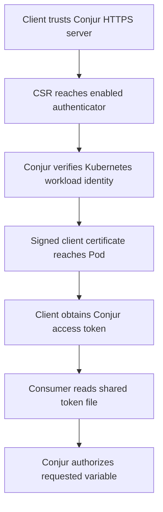

# Troubleshoot Conjur Kubernetes Authentication Step by Step

Author: [nawazdhandala](https://www.github.com/nawazdhandala)

Tags: CyberArk, Kubernetes, Troubleshooting

Description: Separate Conjur TLS, certificate requests, Kubernetes identity, and token-volume failures with a staged diagnosis that preserves secret confidentiality.

A Pod can resolve Conjur's hostname, reach its HTTPS port, and still fail authentication. It can also authenticate successfully while its application cannot read the resulting access token. Treating every failure as a bad Conjur password sends the investigation in the wrong direction.

Start by identifying the authentication flow actually deployed. This guide focuses on the certificate-based `authn-k8s` client, then separates it from projected-JWT authentication. It uses official troubleshooting source pinned at `bfc444df74b7588d23b0ab8d4070e0b12e47ce80` and client documentation pinned at `487e9772ef0fc6df463a2b808aa9f59099e63d56`. Match the investigation to your installed image and server versions rather than upgrading components during diagnosis.

## Map the four boundaries

In the certificate-based flow, the client sends a certificate signing request, or CSR. Conjur validates the workload identity and delivers a signed client certificate into the requesting Pod. The client then authenticates using mutual TLS, where both sides present identity evidence, and writes the resulting Conjur access token for its consumer. [Pinned client flow](https://github.com/cyberark/conjur-authn-k8s-client/blob/487e9772ef0fc6df463a2b808aa9f59099e63d56/README.md).



Each arrow is a separate checkpoint. A variable-access denial after successful authentication is not a TLS failure. A missing file after authentication is not proof that the host policy is wrong.

Build an incident record containing the cluster context, namespace, Pod name and UID, actual ServiceAccount, authentication container name, image versions, authenticator ID, and failure timestamp. Do not include token values, private keys, or retrieved secrets.

## Inspect the running Pod, not only its template

Admission webhooks and defaults can change a Pod after deployment. Read the admitted ServiceAccount and container images with the following commands. Replace all placeholders and select the intended context explicitly:

```bash
kubectl --context REPLACE_CONTEXT -n REPLACE_NAMESPACE \
  get pod REPLACE_POD \
  -o 'jsonpath={.metadata.uid}{"\n"}{.spec.serviceAccountName}{"\n"}'
kubectl --context REPLACE_CONTEXT -n REPLACE_NAMESPACE \
  get pod REPLACE_POD \
  -o 'jsonpath={range .spec.initContainers[*]}{.name}{"\t"}{.image}{"\n"}{end}{range .spec.containers[*]}{.name}{"\t"}{.image}{"\n"}{end}'
```

Expect the deployed identity and authentication container, including an init container if that mode is used. Compare these values with Conjur's host policy. [JSONPath output reference](https://kubernetes.io/docs/reference/kubectl/jsonpath/). Do not substitute the Deployment name for the Pod name or assume a ServiceAccount named `default` was intended.

Read a bounded log window for the specific container, retaining it in your restricted incident workspace:

```bash
kubectl --context REPLACE_CONTEXT -n REPLACE_NAMESPACE \
  logs REPLACE_POD -c REPLACE_AUTH_CONTAINER \
  --since=10m --tail=100 --timestamps
```

If the container restarted, repeat with `--previous` for its prior instance. Correlate the timestamp with server logs. Avoid pasting raw debug output into a ticket before checking it for credentials. [Kubernetes log options](https://kubernetes.io/docs/reference/kubectl/generated/kubectl_logs/).

## Resolve HTTPS failures before changing identity policy

A hostname-resolution error, connection timeout, and certificate-name mismatch are distinct failures. Check the configured authentication URL, network path, and server certificate in that order. A certificate's subject alternative names must cover the hostname used by the client; using an IP address instead can fail name validation even if the connection succeeds.

`CONJUR_SSL_CERTIFICATE` supplies the trust bundle for the client's Conjur connection. It is separate from the short-lived client certificate created through the CSR flow. Replacing the server trust bundle with the wrong certificate does not repair a rejected workload identity. [Client configuration reference](https://github.com/cyberark/conjur-authn-k8s-client/blob/487e9772ef0fc6df463a2b808aa9f59099e63d56/README.md).

Validate the intended DNS name and approved CA chain. Do not bypass certificate verification to move the error further down the flow. If a proxy terminates TLS, include its certificate and routing configuration in the investigation.

## Decode a CSR rejection from the server's evidence

The official troubleshooting guide associates `CAKC029E` with an invalid response to a CSR. Server-side evidence can reveal a Kubernetes API permission denial or a workload identity that cannot be found. It also identifies an authenticator-not-enabled condition separately. [Pinned troubleshooting guide](https://github.com/cyberark/conjur/blob/bfc444df74b7588d23b0ab8d4070e0b12e47ce80/app/domain/authentication/authn_k8s/TROUBLESHOOTING.md).

| Evidence | Boundary to investigate | Narrow correction |
| --- | --- | --- |
| Server cannot get the application Pod | Conjur server's Kubernetes API identity | Correct the relevant binding and namespace scope |
| ServiceAccount or Deployment not found | Host policy versus admitted workload | Correct the mismatched resource identity |
| Authenticator ID is disabled or absent | Server authenticator configuration | Review the intended enabled authenticator list |
| Client certificate never appears | Certificate delivery and container path | Check the receiving container and required write access |

An administrator allowed to impersonate the Conjur server's Kubernetes ServiceAccount can check one relevant permission:

```bash
kubectl --context REPLACE_CONTEXT auth can-i get pod/REPLACE_APP_POD \
  --namespace REPLACE_APP_NAMESPACE \
  --as system:serviceaccount:REPLACE_CONJUR_NAMESPACE:REPLACE_CONJUR_SERVICEACCOUNT
```

This tests authorization for that identity; it does not test network reachability or every permission used by certificate delivery. Review the installed version's authenticator Role for the remaining operations. Do not grant cluster-admin to the application Pod to fix a permission missing from the Conjur server. [Authorization inspection](https://kubernetes.io/docs/reference/kubectl/generated/kubectl_auth/kubectl_auth_can-i/).

## Check token sharing without printing the token

The client documents `/run/conjur/access-token` as its shared-token location. Ensure the producer and consumer use the same Pod volume, compatible paths, and suitable permissions. Identical mount paths backed by different volumes do not share data.

The following local Python helper checks one simple manifest arrangement. Save a restricted Pod JSON file as `pod.json`, then adapt the two container names. It inspects metadata only; the JSON may still contain sensitive environment settings, so do not publish the complete file.

```python
import json

pod = json.load(open('pod.json'))
spec = pod['spec']
containers = spec.get('initContainers', []) + spec.get('containers', [])
by_name = {c['name']: c for c in containers}

def token_mount(name):
    matches = [m for m in by_name[name].get('volumeMounts', [])
               if m['mountPath'] == '/run/conjur']
    if len(matches) != 1:
        raise ValueError('Expected one /run/conjur mount')
    mount = matches[0]
    if 'subPath' in mount or 'subPathExpr' in mount:
        raise ValueError('Review subPath layout separately')
    return mount

producer = token_mount('REPLACE_AUTH_CONTAINER')
consumer = token_mount('REPLACE_APP_CONTAINER')
if producer['name'] != consumer['name'] or producer.get('readOnly', False):
    raise ValueError('Token volume is not shared or producer cannot write')
print('Mount wiring matches; filesystem permissions still require review')
```

This check does not prove the token exists or that the consumer's user can read it. Review ownership, file mode, security context, and mount permissions without displaying contents. A memory-backed `emptyDir` is Pod-scoped and disappears when the Pod is removed, so a recreated Pod must authenticate again. [Volume lifecycle](https://kubernetes.io/docs/concepts/storage/volumes/#emptydir).

## Keep projected JWT diagnosis separate

For a provider using `JWT_TOKEN_PATH`, inspect the projected Kubernetes token path, audience, expiry, and the ServiceAccount claims expected by the Conjur JWT authenticator. That input token is not the Conjur access-token output file discussed above. The provider's version **1.11.1** JWT example shows the separate projection. [Pinned JWT manifest](https://github.com/cyberark/secrets-provider-for-k8s/blob/v1.11.1/assets/jwt-k8s.yaml).

Conclude the investigation only when authentication succeeds, the intended consumer can read its token, and one authorized variable can be retrieved while an unrelated variable remains denied. Repeat after Pod recreation and token renewal. Those checks distinguish a repaired identity flow from a temporary success caused by cached state.
