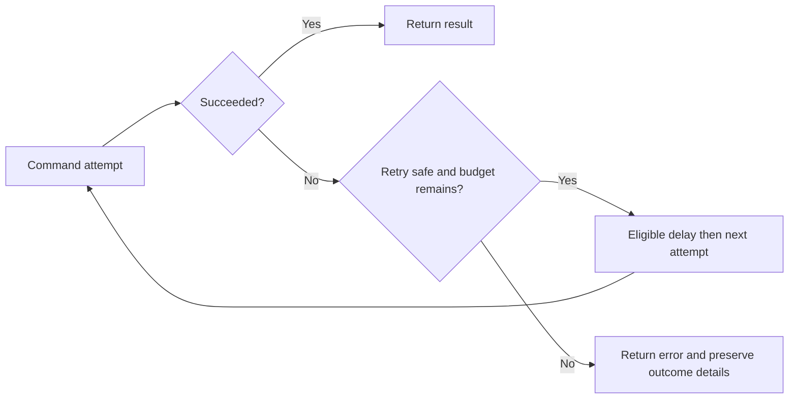

# Tune Aerospike Timeouts During Node Failure and Migration

Author: [nawazdhandala](https://www.github.com/nawazdhandala)

Tags: Aerospike, Java, Performance, Troubleshooting

Description: Set bounded Aerospike timeout and retry policies, distinguish safe reads from uncertain writes, and measure recovery during node failure and migrations.

A node restart produces a short burst of application timeouts. Increasing retries makes the errors less visible, but request latency rises and the remaining nodes receive more work. During migrations, that extra load can prolong the period you were trying to hide.

Timeout tuning starts with an application deadline and the meaning of each operation. Decide how long the caller can wait, whether repeating the operation is safe, and what evidence will distinguish a slow response from a failed node. Then test a small policy change under a controlled failure.

## Understand the four controls

This article uses the synchronous **Aerospike Java client 10.5.0**, specifically Maven artifact `com.aerospike:aerospike-client-jdk8:10.5.0`. The field names below are Java names. Other clients and asynchronous operations can behave differently.

| Setting | Meaning | Common mistake |
| --- | --- | --- |
| `socketTimeout` | Maximum idle time on the socket while processing a command | Treating it as the complete request deadline |
| `totalTimeout` | Total command timeout tracked by the client and sent to the server | Assuming every configured retry will fit |
| `maxRetries` | Retries after the initial attempt | Counting two retries as two total attempts |
| `sleepBetweenRetries` | Delay for eligible retry paths | Assuming it runs after every socket timeout |

The [tagged Policy source](https://github.com/aerospike/aerospike-client-java/blob/10.5.0/client/src/com/aerospike/client/policy/Policy.java) defines these settings. In particular, client socket-timeout retries do not use the same sleep behavior as connection errors and server timeouts. For synchronous operations, `sleepMultiplier` can increase eligible sleeps on later retries; it does not introduce random jitter.

A configured retry is permission to try again, not a promise that another attempt will happen. Remaining time, error type, and retry eligibility also matter. Setting both socket and total timeouts to zero removes important client limits; it is not a reliable fix for intermittent failure.

## Budget from the caller inward

Suppose a web request has a one-second response objective. Spending all of that on one database command leaves no room for authentication, serialization, other queries, or returning the response. Choose the database budget as part of the complete request budget.

For a staging experiment, a read policy with a 200 ms socket timeout, 800 ms total timeout, and two retries permits at most three attempts. It does not guarantee three attempts or an 800 ms end-to-end HTTP response. Connection creation and authentication have separate timeout considerations, and application scheduling adds overhead. Aerospike's [connection tuning guide](https://aerospike.com/docs/develop/connection-tuning-guide/) discusses the relationship between connection, socket, and total limits.

If a retry delay is longer than the remaining command budget, the client may stop without taking that retry. Check the implementation for your version rather than using a simplistic multiplication as a latency guarantee. The [10.5.0 synchronous command loop](https://github.com/aerospike/aerospike-client-java/blob/10.5.0/client/src/com/aerospike/client/command/SyncCommand.java) checks the remaining deadline before continuing.



“Retry safe” is an application decision as well as a client-policy decision. The library cannot infer whether repeating a business operation would charge a customer twice.

## Use separate policies for different operations

Here is a complete policy factory for the pinned Java artifact. It creates fresh policies so a caller cannot accidentally change a shared default used by another operation. Save it as `TimeoutPolicies.java` in a test project that has the dependency above:

```java
import com.aerospike.client.policy.Policy;
import com.aerospike.client.policy.WritePolicy;

public final class TimeoutPolicies {
    private TimeoutPolicies() {}

    public static Policy boundedRead() {
        Policy policy = new Policy();
        policy.connectTimeout = 300;
        policy.socketTimeout = 200;
        policy.totalTimeout = 800;
        policy.maxRetries = 2;
        policy.sleepBetweenRetries = 0;
        policy.readTouchTtlPercent = -1;
        return policy;
    }

    public static WritePolicy nonIdempotentWrite() {
        WritePolicy policy = new WritePolicy();
        policy.connectTimeout = 300;
        policy.socketTimeout = 200;
        policy.totalTimeout = 800;
        policy.maxRetries = 0;
        return policy;
    }
}
```

These numbers are illustrative staging values, not production recommendations. Pass the returned policy explicitly to the relevant client operation. The read policy disables read-touch TTL renewal so this diagnostic read does not extend record expiry; review that choice against your application's intended semantics.

An idempotent operation can be repeated without changing the intended final effect. Reading a record is usually suitable for bounded retries, subject to consistency and read-touch settings. Incrementing a counter or appending a list item is not automatically safe to repeat. The [Java policy documentation](https://aerospike.com/docs/develop/client/java/policies/) describes operation policies; the tagged source explicitly warns against retries for non-idempotent writes.

Keep automatic retries disabled for those writes unless the application has a proven deduplication or transaction design. Also check retry layers outside the client: a service framework, queue worker, or caller may repeat the whole operation after the client stops.

## Preserve uncertain write outcomes

A write timeout does not prove that the server rejected the write. The server might have applied it before the response was lost. Log the operation's correlation identifier, result code, attempt information, and whether the outcome is uncertain. Avoid logging record contents or credentials just to diagnose timing.

In the pinned Java client, `AerospikeException.getInDoubt()` indicates that a write may have completed. Its meaning is documented in the [exception implementation](https://github.com/aerospike/aerospike-client-java/blob/10.5.0/client/src/com/aerospike/client/AerospikeException.java). Treat that information as input to reconciliation, not as permission to repeat an increment.

For example, a business operation identified by a unique request ID can be reconciled against an application-maintained record of that operation. A read of the current counter alone may be insufficient when other writers are active. Define the recovery decision before the failure exercise, including what the caller sees while the outcome is unresolved.

## Distinguish node failure from migration load

A node failure changes cluster membership and partition ownership. Migrations move data as the cluster adjusts. Timeouts during those periods can also reflect overloaded survivors, saturated storage, connection churn, or a network path that only fails for one node.

Measure at least these dimensions together:

- Request rate, successful latency percentiles, and final error rate by operation type.
- Retry attempts and connection creation, not just the number of application calls.
- Errors and latency by destination node.
- Cluster membership changes, migration progress, and storage or CPU pressure.
- The number of writes whose result requires reconciliation.

If one logical read can create three database attempts, the worst-case attempt count is three times the logical request count. That is a capacity bound, not a prediction of observed traffic. Keep both quantities visible during the experiment.

Do not compensate for a persistently saturated node by adding retries indefinitely. Likewise, do not change consistency settings solely to make a timeout graph look better. Check the operation's availability and correctness requirements first.

## Rehearse one change at a time

Use a staging cluster with representative data and enough capacity to run the failure scenario. Establish a steady-state baseline using the existing policy. Then perform an approved single-node failure or restart exercise and record the recovery interval. Run migration-load tests separately so you can tell which condition changes latency.

Change one policy dimension, repeat the same workload, and compare results. A useful result reduces final failures without exceeding the caller's deadline or creating excessive retry traffic. Successful-request latency alone can mislead when the slowest requests have become errors.

For synchronous writes that are genuinely safe to retry, consider a delay sized to observed cluster recovery and a total budget that can accommodate it. Do not copy such a policy onto latency-sensitive reads. If your operation is asynchronous, verify its supported retry controls independently; the synchronous sleep field is not a universal backoff mechanism.

Finish by returning the cluster to its normal membership and confirming migrations have settled. Retain the tested client version, exact policies, load shape, error breakdown, and uncertain-write handling. A timeout policy is ready when it meets the application's deadline and correctness requirements under the failure you actually rehearsed.
