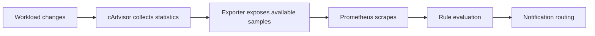

# Tune cAdvisor Housekeeping and Prometheus Scrape Intervals

Author: [nawazdhandala](https://www.github.com/nawazdhandala)

Tags: Prometheus, Docker, Monitoring, Performance

Description: Balance cAdvisor collection and Prometheus scraping with explicit timing, freshness checks, realistic rate windows, and a staged measurement plan.

Scraping cAdvisor every second does not guarantee a new container measurement every second. The exporter collects statistics on its own schedule, some subsystems refresh independently, and Prometheus fetches the resulting data on another schedule.

If you tune only one interval, you can increase collection cost without improving the signal you need. Start with the detection requirement, then measure the entire path from resource activity to an actionable alert. This guide uses cAdvisor 0.55.1 and Prometheus 3.7.3 as concrete references, not universal defaults for every kubelet or runtime.

## Separate collection, scraping, and evaluation

Housekeeping is cAdvisor's recurring work to collect and update container statistics. Scraping is Prometheus fetching the exporter endpoint. Rule evaluation is Prometheus calculating recording or alerting rules from stored samples.



Those stages introduce separate delays. An alert with a long evaluation interval or pending duration can remain slow even after scraping becomes faster. Conversely, a fast rule cannot detect a resource change that the collector has not observed.

Some cAdvisor activities have additional schedules. The Docker directory-usage handler, for example, has a separate refresh loop. Changing the main housekeeping interval does not turn every filesystem measurement into a fresh scan. [Versioned filesystem handler](https://github.com/google/cadvisor/blob/v0.55.1/container/common/fsHandler.go).

## Read the exact housekeeping behavior

In cAdvisor 0.55.1, `housekeeping_interval` establishes the base container collection interval. `allow_dynamic_housekeeping` controls adaptive scheduling, and `max_housekeeping_interval` bounds the adaptive interval before scheduling jitter. Global housekeeping is a different manager activity and should not be confused with each container's statistics loop. [Runtime options](https://github.com/google/cadvisor/blob/v0.55.1/docs/runtime_options.md), [manager flags](https://github.com/google/cadvisor/blob/v0.55.1/manager/manager.go).

The per-container implementation can adjust its base interval based on recent statistics and then adds jitter. Jitter is deliberate timing variation that avoids every collection occurring at once. Even with dynamic housekeeping disabled, the examined code still applies jitter. Therefore, a `10s` setting is not a promise of exactly one sample every ten seconds. [Collection scheduler implementation](https://github.com/google/cadvisor/blob/v0.55.1/manager/container.go).

Inspect the actual deployed flags before comparing hosts. A kubelet's embedded cAdvisor is configured through Kubernetes, so do not assume standalone command-line flags can be applied directly to it.

## Choose a bounded staging baseline

For a standalone deployment, the following Compose fragment establishes an explicit baseline for comparison:

```yaml
services:
  cadvisor:
    image: ghcr.io/google/cadvisor:0.55.1@sha256:e02855207ec07bb45ee41f720645945251f093f24c28f8c29cf718490f784922
    command:
      - --housekeeping_interval=10s
      - --allow_dynamic_housekeeping=false
```

Merge these arguments into the reviewed service; preserve required host mounts, access controls, and other arguments. This is a staging choice that makes adaptive behavior easier to separate from other effects. It is not a recommendation to disable adaptation throughout a large fleet without measuring overhead.

For Prometheus, an explicit minimal scrape configuration is:

```yaml
global:
  scrape_interval: 30s
  scrape_timeout: 10s
  evaluation_interval: 30s
scrape_configs:
  - job_name: cadvisor
    honor_timestamps: true
    static_configs:
      - targets: ["cadvisor:8080"]
```

The target assumes both services share an appropriate Docker network. Preserve the real discovery, authentication, and TLS settings when applying the timing choices. The timeout must not exceed the scrape interval. `honor_timestamps` makes Prometheus respect timestamps supplied by the exporter. [Prometheus scrape configuration](https://prometheus.io/docs/prometheus/latest/configuration/configuration/).

Validate the complete file with matching `promtool check config` before a controlled reload. A valid file establishes configuration consistency; it does not demonstrate acceptable CPU cost or detection latency on your hosts.

## Measure sample age separately from endpoint health

A successful scrape means Prometheus received a response, not that every subsystem produced new information. In the pinned exporter, many resource measurements use their collection timestamps. `container_last_seen`, however, is generated from the exporter's current time, so it is not a reliable proxy for resource-sample freshness. [Exporter timestamp construction](https://github.com/google/cadvisor/blob/v0.55.1/metrics/prometheus.go).

With exporter timestamps honored, inspect the age of a specific resource sample:

```promql
time() - timestamp(container_memory_usage_bytes{
  job="cadvisor", instance="node-a:8080", id="/docker/EXAMPLE"
})
```

Replace the target and container ID with observed labels. The result is seconds since the selected sample's timestamp. If timestamps are replaced with scrape time, this measures something different. Clock skew also affects the result. [Prometheus time and timestamp functions](https://prometheus.io/docs/prometheus/latest/querying/functions/#timestamp).

An absent result is not zero age. Lookback and staleness behavior can remove an old series from an instant query. Track absence and scrape failures separately, and do not extrapolate one memory sample's age to every metric family. [Prometheus staleness behavior](https://prometheus.io/docs/prometheus/latest/querying/basics/#staleness).

## Use windows that contain enough observations

For average CPU usage, retain a window with multiple successful observations:

```promql
rate(container_cpu_usage_seconds_total{
  job="cadvisor", instance="node-a:8080", id="/docker/EXAMPLE"
}[5m])
```

At a nominal thirty-second scrape interval, five minutes normally spans several scrapes, leaving some tolerance for missed observations. It also smooths short bursts. Choose a shorter window only when its responsiveness is useful and you have enough actual samples to support it.

Counter rates can preserve accumulated activity between observations when the counter survives. They cannot reconstruct an unobserved container lifetime or a gauge spike that rises and falls between collections. More frequent scraping alone does not eliminate those limits.

## Change one interval and compare the result

Capture a baseline that includes ordinary traffic, a deployment, and a quiet period. Record exporter CPU and memory, scrape duration, successful sample counts, resource-sample age, and the delay until a controlled workload change appears in a panel or alert.

Then change one timing setting on a small host group. Compare both freshness and cost:

| Observation | Next investigation |
| --- | --- |
| Faster scrapes, unchanged resource timestamps | Collector schedule or subsystem refresh |
| Scrape duration approaches timeout | Endpoint cost, host load, network, or excessive metrics |
| Lower collection cost, delayed short workload visibility | Collection interval or discovery behavior |
| Fresh metrics, slow notification | Rule evaluation, pending time, or receiver routing |
| Missing rate output | Too few usable samples, wrong labels, or stale series |

Do not solve timeouts by indefinitely extending the timeout. Reduce unnecessary metric groups or expensive collection work where appropriate, and retain enough margin for normal host load variation.

## Roll out the measured policy

Document the chosen collection behavior, scrape interval, rate windows, and accepted freshness range. Use observed distributions rather than an exact timestamp promise because jitter, scheduling delays, and workload size affect timing.

Keep the previous arguments and scrape configuration available for rollback. Repeat the measurement after runtime upgrades or major increases in container density. The examples here passed local configuration and query checks; only deployment measurements can establish whether the chosen balance meets your operational needs.
