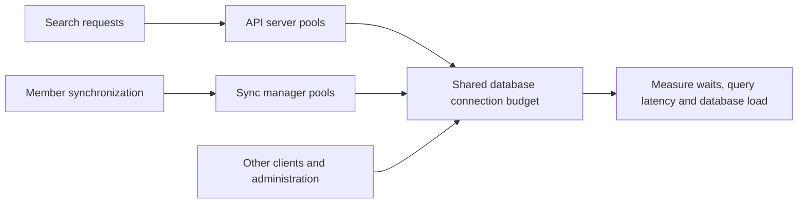

# Tune Clusterpedia Database Pools and Slow-Query Logging

Author: [nawazdhandala](https://www.github.com/nawazdhandala)

Tags: Kubernetes, Database, Performance

Description: Budget Clusterpedia database connections across processes, verify pinned pool behavior, and use slow-query logs to guide measured tuning.

Importing more clusters increases synchronization work, but increasing every database pool limit is not automatically the right response. A pool that is too small can make operations wait. A pool that is too large can let several Clusterpedia processes overwhelm the same database at once.

Tune the connection budget and query workload together. This guide uses **Clusterpedia v0.9.0**, **Helm chart 2.7.0**, and the internal PostgreSQL/MySQL storage implementation. Helm rendering and isolated configuration-rule checks were performed locally. No production throughput or database benchmark is claimed.

## Count database clients, not imported clusters

A pool belongs to a process's database handle. The [storage initialization code](https://github.com/clusterpedia-io/clusterpedia/blob/v0.9.0/pkg/storage/internalstorage/register.go) configures Go's SQL pool when the storage factory opens its database. Do not multiply a pool limit by the number of imported members as though each member necessarily owned a separate pool.

Instead, inventory the API server and synchronization-manager processes that open storage connections, including replicas and temporary overlap during rollout. Account for other tools sharing the database too.

For example, suppose a database connection budget reserves 160 connections for Clusterpedia after administration, other applications, and operational headroom. Five database-using processes capped at twenty connections each have a combined ceiling of 100; six overlapping processes have a ceiling of 120. These are planning ceilings, not predicted steady-state usage.



Use the maximum plausible concurrent process count, not only the healthy steady-state replica count. A failed rollout is a poor time to discover that the replacement Pods cannot acquire database connections.

## Understand the three pool settings

| Setting | What it limits | What it does not do |
| --- | --- | --- |
| `maxOpenConns` | Open connections for that database handle | Reserve that many connections immediately |
| `maxIdleConns` | Reusable idle connections retained by the pool | Cap concurrent work independently of the open limit |
| `connMaxLifetime` | How long a connection may be reused | Set a SQL statement timeout |

Go's [connection-management documentation](https://go.dev/doc/database/manage-connections) explains that requests wait when an open-connection cap is reached. An increase can reduce waiting only if the database has capacity to handle the added concurrency.

There are release-specific transformations before these values reach Go. In v0.9.0, nonpositive idle/open values are replaced with five and forty respectively. An idle limit greater than the open limit is rejected. A positive connection lifetime below one hour is raised to one hour. These rules appear in the [pinned configuration code](https://github.com/clusterpedia-io/clusterpedia/blob/v0.9.0/pkg/storage/internalstorage/config.go).

Consequently, setting `connMaxLifetime: 30m` does not produce a thirty-minute lifetime in this version. If your database proxy requires shorter recycling, resolve that compatibility issue explicitly rather than assuming the YAML took effect. Zero is also not a universal "use the documented default" instruction for every setting.

## Render a conservative pilot configuration

Save this values fragment as `pool-review.yaml` and merge it with your complete reviewed installation values:

```yaml
storageConfig:
  connPool:
    maxIdleConns: 5
    maxOpenConns: 20
    connMaxLifetime: 60m
  log:
    enabled: true
    stdout: true
    level: Warn
    slowThreshold: 500ms
    ignoreRecordNotFoundError: false
```

These are illustrative pilot settings, not a sizing recommendation for every fleet. Twenty open connections must fit your calculated process budget. The 500ms slow-query threshold should be adjusted to the latency question you are investigating.

With Helm 3.17.3 and the verified chart 2.7.0 archive:

```bash
helm template clusterpedia ./clusterpedia-2.7.0.tgz \
  --namespace clusterpedia-system \
  -f reviewed-installation-values.yaml -f pool-review.yaml \
  > rendered.yaml
```

Keep rendered files protected because complete installation values can include sensitive information. Inspect the `clusterpedia-internalstorage` ConfigMap and its `internalstorage-config.yaml` data. Confirm the intended pool and log fields, rather than merely checking that Helm exited successfully.

The chart's [ConfigMap template](https://github.com/clusterpedia-io/clusterpedia-helm/blob/clusterpedia-2.7.0/charts/clusterpedia/templates/internalstorage-configmap.yaml) includes the log block only when `storageConfig.log.enabled` is true. Setting a threshold while leaving that switch false does not enable logging. Local render checks confirmed both the enabled block and its absence with the switch disabled.

## Make the new settings reach running processes

The pinned storage factory configures its pool during initialization. Do not assume editing a mounted ConfigMap changes an existing database handle. Plan a controlled rollout of the affected components using your deployment process, and verify that each replacement process loaded the intended configuration.

Include rollout overlap in the connection budget. Test both ordinary activity and the initial synchronization work caused by restarting a manager. A quiet steady-state test can miss the load of rebuilding watches and handling initial object lists.

Keep the previous values available. If the pilot produces worse query latency, synchronization delay, or database pressure, restore those values and complete the corresponding controlled process rollout. Changing a ConfigMap back is not evidence that every process has reloaded it.

## Read pool pressure alongside database pressure

The [v0.9.0 storage metrics implementation](https://github.com/clusterpedia-io/clusterpedia/blob/v0.9.0/pkg/storage/internalstorage/metrics.go) exposes SQL pool statistics, including `storage_dbstats_open_connections`, `storage_dbstats_in_use`, `storage_dbstats_idle`, `storage_dbstats_wait_count`, and `storage_dbstats_wait_duration`.

Check the metrics actually scraped from each process and their units before writing alerts. Wait totals are cumulative process statistics; restarts reset their history. Compare changes over an observation interval rather than treating the lifetime total as current queue depth.

| Observation | Investigation direction |
| --- | --- |
| In-use connections reach the cap and waits grow, while database load is moderate | A cautiously larger pool may help |
| Waits and database CPU or I/O pressure grow together | More concurrency may worsen contention |
| Many idle connections but little useful work | Review the idle budget and replica count |
| Slow queries increase after a dashboard change | Inspect query scope, ordering, and frequency |
| Spikes mainly occur during synchronization restarts | Rehearse recovery load and rollout pacing |

These are diagnostic directions, not automatic tuning rules. Also measure search latency and whether a known member update appears within the required synchronization delay. Pool metrics alone do not describe user-visible performance.

## Use slow logs as evidence, not a substitute for measurement

`Warn` is useful for focusing on slow SQL and errors without choosing the much noisier `Info` level. The [GORM logger documentation](https://gorm.io/docs/logger.html) describes the levels and slow threshold; Clusterpedia's wrapper determines which options are exposed.

Do not assume SQL parameters are redacted. The pinned configuration does not expose every GORM logger option. Restrict log access and retention, and inspect a controlled example before sending detailed SQL logs into a widely accessible logging destination. With `stdout: true`, use your container log collection policy; file-rotation settings are not a replacement for that policy.

Correlate slow statements with request patterns and database observations. A broad JSON-field search, frequent total-count query, or large synchronization burst can need workload changes rather than a larger pool. Review execution plans through your normal database workflow before introducing indexes or changing query behavior.

A successful tuning change fits the connection budget, preserves synchronization, and improves a measured workload without exhausting the database. Record the process count, values, observation interval, and rollback result so the next fleet expansion starts from evidence rather than another guessed connection limit.
