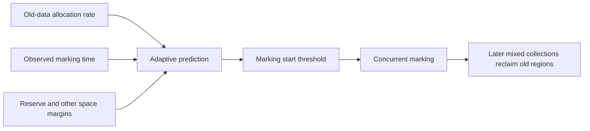

# Tune G1 IHOP and Reserve When Marking Starts Too Late

Author: [nawazdhandala](https://www.github.com/nawazdhandala)

Tags: Java, Garbage Collection, Performance

Description: Read adaptive IHOP evidence, distinguish reserve tuning from a fixed marking threshold, and test changes without assuming they solve an undersized heap.

G1 can start concurrent marking and still run out of evacuation space before it reaches useful old-region reclamation. Lowering a threshold may help, but only if late initiation is the real problem. Too much retained data, a sudden allocation burst, or insufficient CPU can produce similar symptoms.

First establish when marking starts, whether it finishes, and how much space disappears while it runs. This guide uses Azul Zulu OpenJDK 17.0.16+8 and local G1 allocation tests. The example flag values demonstrate behavior; they are not a recommended production preset.

## Understand the two controls

IHOP means Initiating Heap Occupancy Percent. It influences when G1 begins a marking cycle. With adaptive IHOP enabled, G1 learns from allocation and marking observations instead of using one fixed percentage forever. `InitiatingHeapOccupancyPercent` supplies the initial value while the prediction lacks enough observations.

`G1ReservePercent` affects the safety margin used to reduce the risk of evacuation failure. Increasing it does not add memory to the heap. It asks G1 to plan more conservatively within the existing budget, which can change when collection work begins and how much space is treated as available.

Oracle's [G1 tuning guide](https://docs.oracle.com/en/java/javase/17/gctuning/garbage-first-garbage-collector-tuning.html) presents reserve adjustment with adaptive prediction and a manually fixed IHOP as different approaches. Do not apply both changes simultaneously and then attribute the result to one of them.



The final step matters. Starting marking is not the same as immediately recovering all old-generation space. Compare the entire path through remark, cleanup, and subsequent reclamation with the application's demand for memory.

## Confirm the configuration you are actually testing

Inspect the JVM version and effective options from your deployment configuration. In the local JDK, a new default G1 JVM reported adaptive IHOP enabled, reserve 10, and initial occupancy 45. Those observations describe this build, not every existing service.

For a read-only check of a newly launched JVM's flags, run:

```bash
java -XX:+UseG1GC -XX:+PrintFlagsFinal -version > jvm-flags.txt 2>&1
```

Open the file and locate `G1UseAdaptiveIHOP`, `G1ReservePercent`, and `InitiatingHeapOccupancyPercent`. This command starts a separate JVM and exits; it does not inspect an already running service. To check the service, use its actual startup arguments and an appropriately scoped diagnostic inspection. The [JDK launcher manual](https://docs.oracle.com/en/java/javase/17/docs/specs/man/java.html) documents the relevant options.

Record heap size and CPU allocation alongside these values. A threshold comparison is difficult to interpret if the second run also receives a different heap or more processor time.

## Read adaptive evidence instead of guessing from one percentage

Add the following logging selector to a bounded staging run, preserving its existing memory settings. Create a writable `logs` directory first:

```bash
java '-Xlog:gc*,gc+ihop=debug:file=logs/gc.log:time,uptime,level,tags' \
  -jar service.jar
```

Replace `service.jar` and configure log rotation for longer runs. The local lab emitted both `Basic information` and `Adaptive IHOP information` records. Relevant fields included threshold bytes, target occupancy, predicted old-generation allocation rate, predicted marking length, and `prediction active`.

In one startup observation, the same threshold appeared as 45.00 percent in the basic record and 52.94 percent in the adaptive record. That did not mean the threshold suddenly changed. The two records used different denominators: target occupancy versus internal target occupancy. Compare threshold bytes and their context instead of joining percentages blindly.

The pinned [IHOP implementation](https://raw.githubusercontent.com/openjdk/jdk17u/jdk-17.0.16%2B8/src/hotspot/share/gc/g1/g1IHOPControl.cpp) explains those log fields and the use of predicted allocation during marking. It also shows why `prediction active: false` is important: the collector may still be using its initial value.

## Prove that the cycle is late

For several failing cycles, place these events on one JVM's uptime timeline: concurrent start, completed or aborted marking, remark, cleanup, mixed collections, evacuation failures, and Full GC. Identify whether the system runs out of room before marking finishes or after marking has already supplied candidates for reclamation.

If marking completes but mixed collections recover little space, an earlier start may not address the main issue. If the application retains nearly the whole heap, no threshold creates reclaimable objects. If processor contention stretches concurrent work, a timing change may mask rather than resolve the resource problem.

Use a rough planning estimate: allocation into old data during the cycle consumes approximately allocation rate multiplied by cycle duration, with additional space needed for evacuation and other buffers. This is a diagnostic estimate, not a replacement for G1's internal calculation. Bursts and changing object lifetimes make a simple average unreliable.

## Trial the adaptive reserve approach first

If the evidence supports insufficient planning margin, test a reserve change while retaining adaptive IHOP. For example, add this one option to the baseline staging command:

```text
-XX:G1ReservePercent=20
```

Twenty is an illustrative trial value. Keep the heap, workload, recording settings, and CPU constraints unchanged. Allow enough completed marking cycles for adaptive prediction to become active, then inspect threshold bytes, cycle completion, failures, pauses, and throughput.

A larger reserve reduces the space budget available before the safety margin is reached. It can increase collection activity. Ensure the retained workload still fits and check the surrounding container or host memory budget before considering a compensating heap increase.

## Test a fixed threshold as a separate hypothesis

If you need a controlled comparison against a manually chosen threshold, use both options together in a separate run:

```text
-XX:-G1UseAdaptiveIHOP
-XX:InitiatingHeapOccupancyPercent=30
```

The first option disables adaptive selection; the second supplies the fixed percentage. Setting only the second while leaving adaptation enabled does not promise that 30 remains the long-term threshold. Oracle describes this distinction in [G1's initiating occupancy discussion](https://docs.oracle.com/en/java/javase/17/gctuning/garbage-first-g1-garbage-collector1.html).

A fixed threshold gives up adjustment to changes in allocation rate and marking time. It may start too late for a burst or unnecessarily early during quiet periods. Keep it only if repeated representative tests justify that trade-off, and retain the original configuration for rollback.

## Judge the result by sustained behavior

The local experiment used a bounded retained-array workload with a 128-MiB heap. Reserve 20 retained adaptive log records and still produced 23 evacuation failures and nine Full GCs. Disabling adaptation with a fixed 30-percent threshold produced basic 30.00-percent records, no adaptive records, and still had 23 failures and eight Full GCs.

These single-run results verify option behavior and show that neither example eliminated pressure in that lab. They are not a statistical comparison or evidence that one configuration is faster. No production workload, CPU quota, sustained warm-up study, or latency improvement was tested.

Set acceptance criteria before the trial: cycles finish with usable space, failure recurrence falls under representative bursts, and throughput and latency remain acceptable. If the evidence does not support a threshold problem, return to allocation, retention, and CPU analysis rather than accumulating more collector flags.
