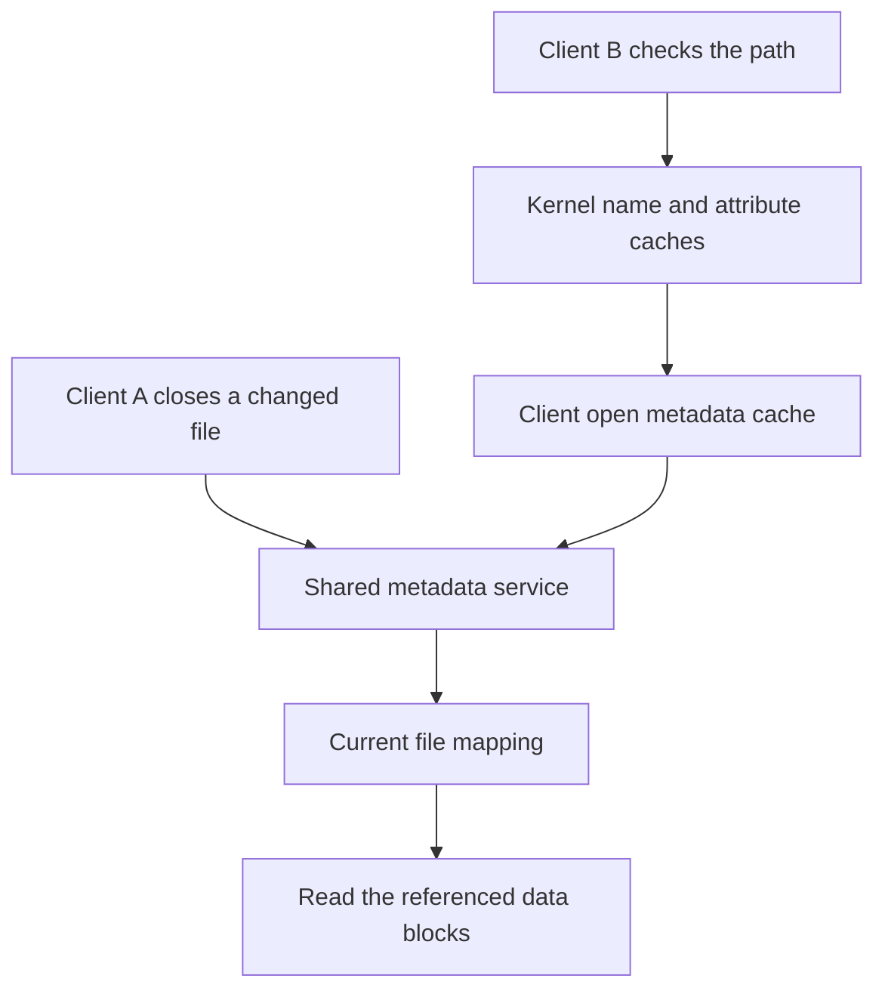

# Tune JuiceFS Metadata Caches for Git-Style Workloads Safely

Author: [nawazdhandala](https://www.github.com/nawazdhandala)

Tags: JuiceFS, Git, Performance

Description: Tune JuiceFS metadata cache lifetimes with a two-client visibility test, separating faster repository scans from delayed remote file changes.

A source tree can contain thousands of small files while occupying little storage. Commands that inspect that tree may spend more time checking names, sizes, and modification times than reading content. Extending metadata cache lifetimes looks attractive until another build worker changes a file and the first worker keeps seeing an old result.

Treat cache tuning as a performance experiment with a correctness requirement. Define how quickly a remote change must become visible, then measure both scan time and visibility. A faster scan that misses a required update is a failed experiment.

This guide targets **JuiceFS Community Edition 1.4.2 on Linux**. The examples assume two independently mounted clients accessing the same test filesystem, a working metadata service and object store, and Python 3. Use a disposable directory outside any real repository for the visibility experiment.

## Identify what the command actually checks

A Git working tree includes tracked files, untracked files, directories, and Git's own bookkeeping. The amount of scanning depends on the command and repository configuration. For example, `git status --untracked-files=no` excludes untracked files and therefore answers a different question from a complete status scan. Git documents these choices in its [status reference](https://git-scm.com/docs/git-status).

Record the exact command, Git version, repository revision, file count, and whether untracked files are included. Keep Git configuration unchanged between comparisons. Run the same command repeatedly, recording the first run separately from subsequent runs. Cache warmth can explain an improvement even when the mount configuration has not changed.

Prefer separate working trees for independent writers. Changing a filesystem cache setting does not coordinate simultaneous edits to a shared checkout or make an application workflow safe for concurrent writers.

## Separate the cache controls

TTL means time to live: how long an answer may be reused before it needs checking again. The [1.4.2 flag definitions](https://github.com/juicedata/juicefs/blob/v1.4.2/cmd/flags.go) specify these controls:

| Setting | Linux default | Question being cached |
| --- | --- | --- |
| `--attr-cache` | `1.0s` | What attributes does this object have? |
| `--entry-cache` | `1.0s` | Which object does this file name identify? |
| `--dir-entry-cache` | `1.0s` | Which object does this directory name identify? |
| `--negative-entry-cache` | Disabled | Does this name fail to exist? |
| `--open-cache` | `0s` | Can opening reuse client metadata without checking updates? |

Directory-name lookup is different from listing a directory's contents. The separate, disabled-by-default `--readdir-cache` option enables kernel directory-list caching on supported Linux kernels; its timeout follows `--attr-cache`. Leave it unchanged while investigating the other controls.



The changing client can invalidate its own cached metadata. That does not mean another mount receives the same immediate invalidation. Enabling `--open-cache` also relaxes the default close-to-open behavior. Close-to-open means reopening a file checks for changes made and closed elsewhere; it does not promise that every cached name lookup is instantly current. Deleting and recreating a name introduces a separate object-identity problem. These distinctions are covered in the [cache consistency notes](https://github.com/juicedata/juicefs/blob/v1.4.2/docs/en/guide/cache.md#consistency-exceptions).

## Establish a conservative staging baseline

First capture the existing mount options. For a new, empty staging mountpoint, explicitly reproduce the normal metadata-cache defaults:

```bash
juicefs --version
juicefs mount \
  --attr-cache 1s \
  --entry-cache 1s \
  --dir-entry-cache 1s \
  --negative-entry-cache 0s \
  --open-cache 0s \
  "$META_URL" /mnt/jfs-cache-test
```

`META_URL` must already hold the approved test filesystem's metadata address; obtain credentials through your normal protected mechanism. Replace the mountpoint with an existing empty directory. This foreground command remains running while the mount serves requests. Do not run it over an existing mount. Use your established service configuration if a supervisor manages the client.

Perform the baseline and each candidate on both independently mounted test hosts. Keep data-cache capacity, application concurrency, backend placement, and input data unchanged. The [mount implementation](https://github.com/juicedata/juicefs/blob/v1.4.2/cmd/mount.go) reads these options when constructing the client configuration; treat a change as a planned mount lifecycle operation, not an instantaneous edit to a running service.

## Test remote visibility before trusting a faster scan

Create a new, uniquely named test directory on client A and confirm it is visible on B. Inside it, create `probe.txt` containing `old`. On B, read that file once to populate relevant caches.

Save the following as `observe.py` outside JuiceFS. It polls a small test file, reopening it every time, and reports changes in content or existence:

```python
import argparse
import pathlib
import time

parser = argparse.ArgumentParser()
parser.add_argument("path", type=pathlib.Path)
parser.add_argument("--seconds", type=float, default=20)
args = parser.parse_args()
if not 0 < args.seconds <= 300:
    parser.error("seconds must be greater than 0 and at most 300")

start = time.monotonic()
previous = object()
while time.monotonic() - start < args.seconds:
    try:
        current = args.path.read_bytes()
    except FileNotFoundError:
        current = None
    if current != previous:
        print(f"{time.monotonic() - start:.3f}s {current!r}", flush=True)
        previous = current
    time.sleep(0.05)
```

Run it on B with the path through B's mount:

```bash
python3 observe.py /mnt/jfs-cache-test/REPLACE-TEST-DIRECTORY/probe.txt
```

While it runs, perform one controlled action on A. Repeat separately for each case:

1. Rewrite the existing file with `new`, then close it successfully.
2. Observe a previously absent name on B, then create it on A.
3. Delete and recreate the test name on A, using a different value.
4. Replace the test file by renaming a new file over it within the same directory.

Record A's successful completion and B's observations. Cross-host timing needs synchronized clocks or an independently recorded coordination method; the observer's elapsed time alone is not publication latency. Its 50-millisecond polling interval also limits timing precision. Permission and other I/O errors intentionally terminate the script instead of being mislabeled as absence.

A short create-delete event can occur between polls, so test sustained states first. This helper checks visibility, not durable recovery after a crash or correctness of an entire Git operation.

## Change one setting and keep an acceptance table

If attribute checks dominate, try a small staging increase such as `--attr-cache 2s` while leaving open caching disabled. If name lookups dominate, investigate entry caching separately. Avoid raising all lifetimes together: it becomes difficult to tell which tradeoff produced the result.

For each candidate, record scan duration, metadata operation rate, remote-change observations, and the acceptable visibility delay. Repeat the application's real status or build operation after each controlled mutation. An apparently clean Git result must match the expected file changes, not merely return exit status zero.

For immutable, versioned source snapshots, longer cache lifetimes may be acceptable because readers never expect an existing path to change. Document that immutability contract explicitly. For shared mutable trees, preserve stricter visibility unless measurements and application requirements justify relaxing it.

If the candidate violates the visibility requirement, return to the baseline through the normal mount procedure and repeat the test. If baseline behavior still fails, investigate writer close errors, backend health, name replacement, and application-level caches before blaming TTL alone. Keep the configuration whose measured performance and observed semantics both satisfy the workload.
