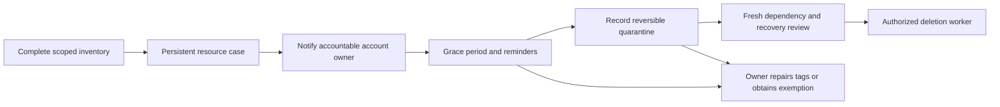

# Handle Untagged Cloud Resources with Notice and a Deletion Grace Period

Author: [nawazdhandala](https://www.github.com/nawazdhandala)

Tags: AWS, Cloud Automation, Governance

Description: Build a staged cleanup workflow for unowned cloud resources, with complete inventory, accountable notices, reversible quarantine, and fresh checks before deletion.

An absent `Owner` tag is a governance problem, not proof that a resource is disposable. A detached disk might contain the only recovery copy of an application. A resource created yesterday might belong to a deployment whose tagging step failed.

Automate the investigation and reminders first. Then give each resource type its own quarantine and deletion policy. This article uses unattached Amazon EBS volumes as a concrete example; it does not prescribe stopping databases, changing security groups, or deleting buckets merely because their tags are incomplete.

The workflow has three independently recorded facts: when noncompliance was observed, when an accountable owner was notified, and when deletion became authorized. Collapsing those into one timestamp makes a recurring scanner surprisingly dangerous.

## Start with an inventory that can see untagged resources

AWS Resource Groups Tagging API `GetResources` returns tagged or previously tagged resources. Its documentation explicitly says it [does not return untagged resources](https://docs.aws.amazon.com/resourcegroupstagging/latest/APIReference/API_GetResources.html). A scan based solely on that API can miss resources that have never had tags.

For EBS, enumerate volumes through the service API. These read-only commands use AWS CLI 2.38.1 syntax; replace the profile and region with an approved inventory account and region:

```bash
aws --profile inventory --region eu-west-1 ec2 describe-volumes \
  --include-managed-resources \
  --page-size 100 \
  --output json \
  --no-cli-pager > volumes.json
```

The CLI automatically follows pagination unless you disable it. `--page-size` controls service request size, not the total inventory returned. Managed volumes are included for visibility, but the cleanup policy must exclude them from generic deletion. See the [describe-volumes reference](https://docs.aws.amazon.com/cli/latest/reference/ec2/describe-volumes.html).

Run a separate inventory for every approved account and region. Record failed regions and denied API calls as incomplete coverage. Never interpret a partially collected list as a clean account. Protect the output as operational data, and do not replace the previous successful inventory if the command fails.

AWS Config's [required-tags rule](https://docs.aws.amazon.com/config/latest/developerguide/required-tags.html) can supply compliance findings for supported resources. It is a detection mechanism, not a universal create-time prevention rule or proof of ownership.

## Record a case rather than repeatedly rediscovering an object

Use account, region, resource type, and resource identifier as the case key. Persist the resource creation time as an additional identity check where available. Store policy version, first observation, current findings, notification attempts, acknowledged notices, exemptions, approvals, and final action results.

Keep this state outside resource tags. Tags can change or disappear, and [EC2 tags have no built-in operational meaning](https://docs.aws.amazon.com/AWSEC2/latest/UserGuide/Using_Tags.html). A tag reading `Quarantined=true` does not prevent attachment or access by itself.



Use a conditional state update or a per-resource lease so two scheduled workers cannot advance the same case independently. Include the case identifier and policy version in every event and audit record.

## Notify someone who can actually resolve the finding

When the resource lacks an owner, route the case to the account's registered platform or cost owner. Deployment records and creation audit events may help identify a team, but a provisioning service role is not necessarily the business owner. Resolve a responsible team through your ownership directory.

A useful notice includes the account, region, resource identifier, missing tags, evidence, required repair, deadline, exemption route, and proposed action. Distinguish “message submitted” from an accepted ticket or other notification outcome defined by your policy. Failed notification must not silently start the deletion clock.

Deduplicate notices using the case and escalation stage. Save the delivery receipt. Retries after an uncertain send result should reconcile with the notification system before generating another message. If the recipient cannot be resolved, escalate to the account owner and hold deletion.

## Make the grace policy executable

For this example, the owner has seven days after recorded notice before quarantine is recorded and fourteen days before deletion review can finish. Both deadlines run from that notice, not resource creation. Quarantine here is an administrative hold in the case system; it does not detach disks or change their data.

This Python 3.11 function chooses the next workflow step. `volume` is a fresh DescribeVolumes item; `case` is trusted workflow state, not user-controlled tags:

```python
from datetime import datetime, timedelta, timezone

def next_action(volume, case, now):
    if now.tzinfo is None:
        raise ValueError("Use a timezone-aware UTC clock")
    tags = {tag["Key"]: tag.get("Value", "") for tag in volume.get("Tags", [])}
    if tags.get("Owner", "").strip():
        return "recheck_owner_and_close"
    if case.get("exempt") or case.get("legal_hold"):
        return "hold"
    if volume.get("State") != "available" or volume.get("Attachments"):
        return "hold_in_use"
    if volume.get("Operator", {}).get("Managed"):
        return "hold_managed"
    notified = case.get("notified_at")
    if notified is None:
        return "notify_account_owner"
    notified = datetime.fromisoformat(notified)
    if notified.tzinfo is None or notified > now:
        raise ValueError("Invalid notification timestamp")
    if now < notified + timedelta(days=7):
        return "wait_for_owner"
    if not case.get("quarantine_recorded"):
        return "record_quarantine"
    if now < notified + timedelta(days=14):
        return "wait_in_quarantine"
    checks = ("backup_verified", "dependencies_reviewed", "deletion_approved")
    if not all(case.get(key) is True for key in checks):
        return "review_required"
    return "request_final_live_recheck"
```

The function performs no cloud mutation. At day six it requests waiting; at day seven it can request quarantine; at day fourteen it still requires all three review checks. An `Owner` value triggers verification against the ownership directory before closing the case. Arbitrary text is not automatically accepted as a legitimate team.

Give each stored approval an identity, timestamp, scope, and evidence reference. Revoke approvals when relevant facts change. A bare Boolean in this example represents that verified workflow state, not permission to skip its implementation.

## Define quarantine by resource type

For unattached volumes, a reversible quarantine can mean reserving the case for review and preventing deployment automation from selecting the volume through an enforced workflow rule. If that enforcement is not implemented, call it a recorded hold rather than claiming technical isolation.

For running compute, stopping an instance changes availability and can affect local data or dependent services. For networking resources, changing rules can break unrelated workloads. These need different, explicitly reviewed actions. A universal quarantine API is the wrong abstraction.

Exemptions should identify an approver, reason, and expiry. Reevaluate expired exemptions through notification and review rather than immediately jumping to deletion. Repairing tags should cancel the pending cleanup path and preserve its audit history.

## Recheck immediately before deletion

The deletion worker should have narrow permissions and a separate enable switch from discovery. Re-read the volume and case under the current lease, then verify account, region, identity, attachment state, ownership, holds, dependency review, and recovery evidence again.

[DeleteVolume requires an available, unattached volume](https://docs.aws.amazon.com/AWSEC2/latest/APIReference/API_DeleteVolume.html). That service check prevents deletion while attached; it does not prove the volume has no business value. A final read also cannot atomically lock tags against a competing update. Use controlled case transitions and any supported authorization conditions, and define how concurrent owner claims stop the worker.

Where recovery policy requires a snapshot, verify its completed state and restoration permissions, including encryption-key access. A submitted snapshot request is insufficient. AWS explains that [deleting an EBS volume removes its data](https://docs.aws.amazon.com/ebs/latest/userguide/ebs-deleting-volume.html); retention features or snapshots must be deliberately configured and verified.

An accepted deletion request is not yet a completed cleanup. Poll through the documented lifecycle, record the request identifier and final absence, and distinguish permission errors from confirmed deletion. Local tests for this article exercise policy branches and CLI input modeling only. No owners were messaged, resources quarantined, snapshots created, or cloud resources deleted.
