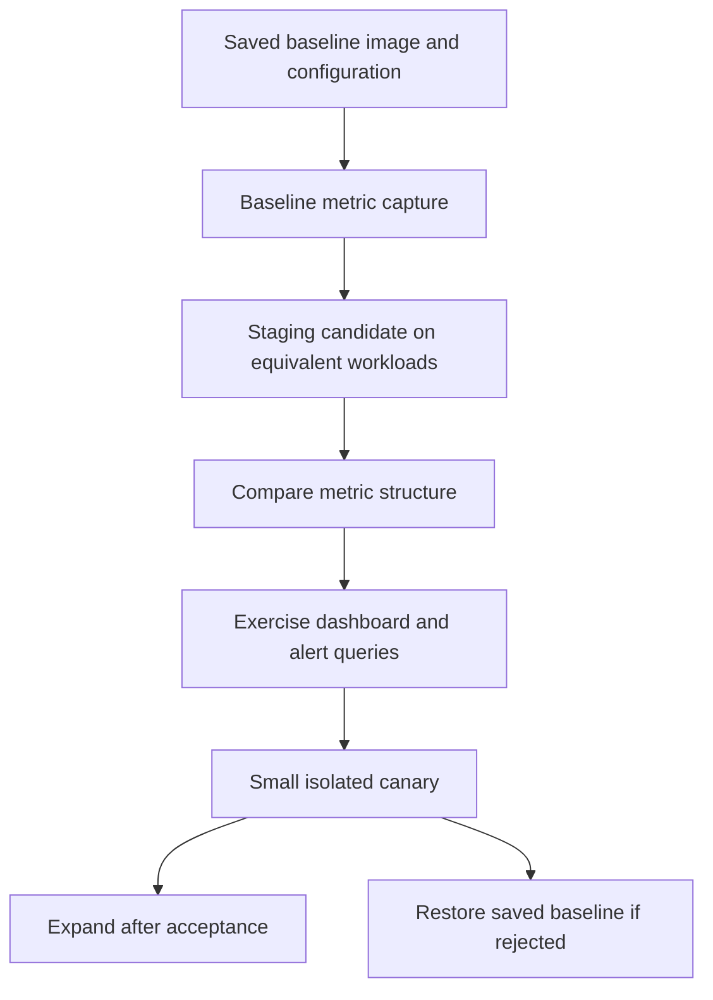

# Upgrade cAdvisor Without Breaking Metrics, Labels, or Dashboards

Author: [nawazdhandala](https://www.github.com/nawazdhandala)

Tags: Docker, Kubernetes, Prometheus, Monitoring

Description: Rehearse a cAdvisor upgrade with metric-shape comparisons, dashboard and alert checks, isolated canary collection, and a practical rollback plan.

A cAdvisor upgrade can start successfully and still break monitoring. A missing label can empty a dashboard filter. An additional label can split a time series. A collector that no longer reads the expected host path can leave a healthy HTTP endpoint serving incomplete data.

Treat the upgrade as a change to a data contract. That contract includes metric names, types, labels, units, and the workloads represented. The procedure below uses **cAdvisor 0.55.1** as a concrete candidate and **Prometheus 3.7.3** for local checks. It does not claim that a particular older release will upgrade without changes. The comparison helper was fixture-tested; no live host upgrade was performed.

## Identify which cAdvisor you are upgrading

A standalone cAdvisor deployment and the cAdvisor code embedded in a kubelet are different upgrade paths. Replacing a standalone image does not change the kubelet's metrics. Establish which endpoint your production scrape job actually uses, then follow the owning component's deployment process.

For standalone deployments, retain the exact old image digest and complete manifest. Record the candidate digest, platform architecture, arguments, host mounts, security settings, and scrape configuration. Do not rely on a mutable tag as the rollback artifact.

Read the [candidate release notes](https://github.com/google/cadvisor/releases/tag/v0.55.1) and the intervening releases from your installed version. The repository's old changelog file is not a substitute for current release notes. Also verify the registry and tag spelling: the [tagged installation README](https://github.com/google/cadvisor/blob/v0.55.1/README.md) documents the move to GHCR for releases from v0.53.0. Registry location is part of the deployment change, even when metric behavior is unchanged.

## Write down what must survive

Select a representative host and list the actual consumers of its metrics:

| Consumer | Acceptance evidence |
|---|---|
| CPU dashboard | Same workload selection and correct core-based rate |
| Memory alert | Required series present; threshold still means bytes |
| Service overview | Project, service, namespace, or pod labels remain usable |
| Storage panel | Expected device and filesystem series exist |
| Capacity report | Parent groups are not newly counted as application containers |

Include healthy, busy, idle, and newly created containers. An idle workload cannot demonstrate that an activity-dependent metric still works.

Keep flags fixed for the first trial. cAdvisor's [runtime options](https://github.com/google/cadvisor/blob/v0.55.1/docs/runtime_options.md) include collection selection, labels, housekeeping, and memory-history settings. Changing the image, scrape interval, and enabled collectors together makes a regression much harder to explain.



## Capture comparable text exposition

Use an authorized local listener or tunnel to the staging cAdvisor endpoint. The following Bash example needs curl and the matching `promtool` binary. Create a fresh working directory so existing evidence is not overwritten:

```bash
umask 077
capture_dir=$(mktemp -d)
cd "$capture_dir" || exit 1
CADVISOR_URL='http://127.0.0.1:8080'
curl --fail --silent --show-error --max-time 15 \
  -H 'Accept: text/plain; version=0.0.4' \
  "$CADVISOR_URL/metrics" -o baseline.prom
promtool check metrics < baseline.prom
```

Only proceed after the download succeeds. Adapt the URL and normal authentication for your environment; use trusted HTTPS for remote endpoints. Preserve headers and error information separately when investigating a failed request.

Deploy the candidate through your normal staging process, wait for discovery and collection to stabilize, and repeat the capture into `candidate.prom`. Keep the workload and enabled collectors comparable. The [promtool reference](https://prometheus.io/docs/prometheus/latest/command-line/promtool/) documents `check metrics`; it checks the exposed text and lint conventions, not dashboard compatibility.

Do not compare the entire raw files with a simple text diff and call every difference a regression. Values, timestamps, IDs, and ordering naturally change.

## Compare metric structure with a parser

In a disposable Python 3 virtual environment, install the pinned parser dependency:

```bash
python3 -m venv .venv
.venv/bin/python -m pip install prometheus-client==0.22.1
```

Save this as `compare-metrics.py`. It uses the official [Python text exposition parser](https://prometheus.github.io/client_python/parser/) and compares sample names, metric types, and the label-name sets actually observed:

```python
import sys
from pathlib import Path
from prometheus_client.parser import text_string_to_metric_families


def shapes(filename):
    result = set()
    text = Path(filename).read_text(encoding="utf-8")
    for family in text_string_to_metric_families(text):
        for sample in family.samples:
            result.add((sample.name, family.type,
                        tuple(sorted(sample.labels))))
    if not result:
        raise ValueError(f"No metric samples in {filename}")
    return result


before = shapes(sys.argv[1])
after = shapes(sys.argv[2])
for shape in sorted(before - after):
    print("REMOVED", shape)
for shape in sorted(after - before):
    print("ADDED  ", shape)
if before == after:
    print("Observed metric shapes match")
```

Run it after validating both captures:

```bash
.venv/bin/python compare-metrics.py baseline.prom candidate.prom
```

The expected output is either matching observed shapes or a list for review. A removed shape might mean a missing collector, changed labels, or simply a workload that no longer existed at capture time. The helper deliberately does not decide whether the change is acceptable.

It also does not compare label values, units, series counts, or duplicate samples. Check those separately for the representative containers. A service label changing from `checkout` to an empty string can break a dashboard while this structural check still passes.

## Exercise the queries and failure paths

Run the actual dashboard selectors against the candidate, not only a broad metric-name query. Check variable queries, recording rules, alert expressions, and any joins that expect one series per container. Compare the number of selected workloads with an independent inventory.

For counter-based panels, wait until the candidate has enough samples for the normal rate window. Do not mistake the immediate post-restart interval for a stable comparison. Verify units with a small known staging workload; a matching name and label set do not establish matching semantics.

Add fixtures for required labels, missing series, and duplicate identities to your existing rule tests. Run them with `promtool test rules` as described in the [rule-testing documentation](https://prometheus.io/docs/prometheus/latest/configuration/unit_testing_rules/). Test expected alert firing and expected non-firing. A configuration syntax check alone cannot tell you that an alert expression now returns an empty vector.

If a compatibility recording rule is necessary, document exactly which release behavior it translates. Do not rename a new metric to an old name without checking its meaning and units.

## Roll out without contaminating production totals

Use a dedicated canary job or isolated monitoring environment and ensure production queries exclude it. Two collectors reporting the same host into a broadly selected dashboard can look like a sudden doubling of resource usage. Keep that temporary duplication outside reports and paging rules.

Accept the canary only after collection, query results, application impact, and alert behavior meet the written criteria. Observe container creation and replacement as well as steady-state traffic. Then expand in small groups with a clear rollback trigger.

Rollback means restoring the saved image and configuration together. It does not erase samples already ingested under changed labels. Prometheus's [staleness behavior](https://prometheus.io/docs/prometheus/latest/querying/basics/#staleness) and dashboard time ranges still affect what users see during the transition. Retain the capture files and deployment timestamps so a temporary graph discontinuity can be explained.

The upgrade is complete when the monitoring questions still have correct answers, not merely when the candidate process is running. Keep the checked queries and comparison procedure with the deployment so the next upgrade starts from an explicit, reviewable contract.
