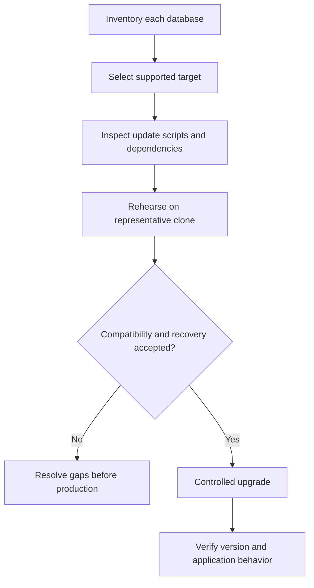

# Check Compatibility Before Upgrading Cloud PostgreSQL Extensions

Author: [nawazdhandala](https://www.github.com/nawazdhandala)

Tags: PostgreSQL, Extension, Database Upgrade

Description: Inventory installed extension versions, inspect supported update paths, rehearse application compatibility, and plan recovery before changing managed PostgreSQL.

An extension upgrade can look like one line of SQL while changing functions, operators, types, or behavior used throughout an application. The fact that a managed provider offers a newer version does not establish that your workload is ready for it.

Treat the upgrade as a database change with a specific source version, target version, dependency review, and recovery plan. Avoid a loop that updates every installed extension to whatever the service currently considers the default.

The diagnostic SQL below targets PostgreSQL 17. A narrowly scoped `hstore` 1.7-to-1.8 example is checked against PostgreSQL's `REL_17_7` source. It is an illustration of the review process, not a claim that every managed service exposes that exact path.

## Separate engine, package, and installed extension versions

A managed engine upgrade can change the extension files available on the server without updating the extension version installed in each database. RDS explicitly notes that most PostgreSQL extensions are not upgraded automatically with an engine version upgrade. [RDS extension upgrade guidance](https://docs.aws.amazon.com/AmazonRDS/latest/UserGuide/USER_UpgradeDBInstance.PostgreSQL.ExtensionUpgrades.html).

Keep these questions separate:

| Question | Evidence |
|---|---|
| Which database engine is running? | Server version and provider engine release |
| What is installed in this database? | `pg_extension` |
| What extension versions are available here? | `pg_available_extension_versions` and provider support documentation |
| Can the installed version reach the chosen target? | Available update path |
| Will the application still work? | Release-note review and rehearsal |

Extensions are installed within a database. Repeat the inventory across every application database in scope rather than checking only the default administrative database.

## Record the current installation and default separately

Run this read-only inventory in each database:

```sql
SELECT current_database() AS database_name,
       e.extname,
       e.extversion AS installed_version,
       e.extowner::regrole AS owner_name,
       e.extnamespace::regnamespace AS schema_name,
       a.default_version
FROM pg_catalog.pg_extension AS e
LEFT JOIN pg_catalog.pg_available_extensions AS a
       ON a.name = e.extname
ORDER BY e.extname;
```

The installed and default versions can differ. A missing available-extension row needs investigation; do not interpret it as permission to drop the extension. Preserve this output with the engine release and capture time. [Installed extension catalog](https://www.postgresql.org/docs/17/catalog-pg-extension.html), [available extension view](https://www.postgresql.org/docs/17/view-pg-available-extensions.html).

Inspect candidate versions for the extension under review:

```sql
SELECT name, version, installed, superuser, trusted, requires
FROM pg_catalog.pg_available_extension_versions
WHERE name = 'hstore'
ORDER BY version;
```

Replace `hstore` when reviewing another extension. The result describes available packages and their declared installation properties; it does not grant privileges or override a provider's restrictions. [Available version fields](https://www.postgresql.org/docs/17/view-pg-available-extension-versions.html).

Do not treat text sorting of version names as a compatibility decision. Select the target from the provider's supported matrix and the extension's documented upgrade instructions.

## Inspect the actual update path

For the illustrative `hstore` case, check the path from the installed version to the chosen target:

```sql
SELECT source, target, path
FROM pg_catalog.pg_extension_update_paths('hstore')
WHERE source = '1.7' AND target = '1.8';
```

A non-null path means the server has a sequence of update scripts connecting those versions. A missing row or null path is not a reason to edit catalogs manually. PostgreSQL can chain scripts, and version names themselves do not encode upgrade ordering. [Extension update paths](https://www.postgresql.org/docs/17/extend-extensions.html#EXTEND-EXTENSIONS-UPDATES).

The PostgreSQL `REL_17_7` source declares `hstore`'s default version as 1.8 and includes a 1.7-to-1.8 update script. That script adds subscripting support and removes two old operators, `@` and `~`. An application using those operators needs investigation before the change. [Tagged control file](https://github.com/postgres/postgres/blob/REL_17_7/contrib/hstore/hstore.control), [tagged update script](https://github.com/postgres/postgres/blob/REL_17_7/contrib/hstore/hstore--1.7--1.8.sql).

This is why “the upgrade path exists” and “the application is compatible” are different acceptance checks.

## Review dependencies beyond the catalog version

Search application queries, stored functions, views, migrations, and reporting jobs for extension-specific functions, operators, and types. Include dynamically generated SQL and external consumers. A database dependency graph cannot discover every string assembled in application code.

Review release notes for changed semantics, removed interfaces, required index rebuilds, preload settings, and companion extensions. Determine whether the provider requires an engine release or maintenance operation before the target package becomes available.

Keep extension-specific exceptions visible. RDS directs PostGIS users to its dedicated spatial upgrade procedure and documents a different update approach for `pg_repack`. Do not apply a generic `ALTER EXTENSION` recipe to every extension merely because it appears in the inventory. [RDS extension-specific guidance](https://docs.aws.amazon.com/AmazonRDS/latest/UserGuide/USER_UpgradeDBInstance.PostgreSQL.ExtensionUpgrades.html).

## Rehearse with representative data and the real role

Restore or clone into an isolated environment using the intended engine release, extension packages, schema, and representative data. Test with the same effective upgrade privileges planned for production. PostgreSQL requires extension ownership for `ALTER EXTENSION`; scripts and managed-service policy can impose additional requirements. [ALTER EXTENSION requirements](https://www.postgresql.org/docs/17/sql-alterextension.html).

Record duration, lock waits, failures, and application behavior. Exercise operations that depend on the extension rather than relying only on `SELECT 1`. Include both established queries and any new syntax the target version introduces.

Use a controlled workload to discover blocking and performance changes. A successful upgrade on an empty database does not establish its behavior when the production application is active.



## Execute only the reviewed version change

The following is a **mutating rehearsal example** for an installed `hstore` 1.7 with the reviewed 1.8 path available. Do not run it against another installed version or extension without adapting the plan. The timeout values are illustrative bounds, not performance promises.

```sql
BEGIN;
SET LOCAL lock_timeout = '3s';
SET LOCAL statement_timeout = '60s';
ALTER EXTENSION hstore UPDATE TO '1.8';
COMMIT;
```

An explicit target avoids relying on a default that may change with server packaging. `lock_timeout` bounds lock acquisition waits and `statement_timeout` bounds statement execution. A timeout leaves this transaction failed; issue `ROLLBACK`, preserve the error, and investigate before retrying. [ALTER EXTENSION target selection](https://www.postgresql.org/docs/17/sql-alterextension.html), [timeout behavior](https://www.postgresql.org/docs/17/runtime-config-client.html).

Verify the installed version again and run the rehearsed acceptance checks. Restore controlled test traffic before normal workloads if admission was paused. Keep unrelated extension changes outside this change window so failures remain attributable.

## Plan recovery before committing the change

A transaction rollback before a successful commit is different from reverting a committed extension upgrade. A reverse update is possible only when a suitable supported script exists; do not assume that requesting the old version reconstructs the old state safely. [Update-script semantics](https://www.postgresql.org/docs/17/extend-extensions.html#EXTEND-EXTENSIONS-UPDATES).

Keep a tested recovery artifact compatible with the old engine and extension environment. If restoration is the fallback, define the write boundary and how to reconcile changes made after the backup. Do not casually drop and recreate an extension containing application dependencies.

The final evidence should show the old and new versions, reviewed path, executed change, validation results, and any outstanding compatibility limits. That turns a one-line command into a controlled upgrade whose effects and recovery options are understood.
