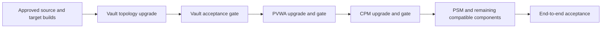

# Upgrade CyberArk PAM in Order and Rehearse the Rollback

Author: [nawazdhandala](https://www.github.com/nawazdhandala)

Tags: CyberArk, Disaster Recovery, Security

Description: Plan a CyberArk PAM 15.2 upgrade with explicit component dependencies, verified packages, functional gates, and a rollback rehearsal that preserves current state.

A PAM upgrade can finish successfully on one server while leaving the environment unusable. The new component may depend on a newer Vault, a restored server may hold an outdated component credential, or a shared configuration change may affect nodes that have not yet been upgraded.

Build the upgrade around supported intermediate states and evidence at each transition. This guide uses **15.2 as the target release family**, with the exact approved patch build selected before execution. It provides a rehearsal plan rather than claiming that a CyberArk upgrade was performed. The local package-checking example was tested separately from any product installation.

## Establish the version path before the maintenance date

Inventory the exact versions and patch levels of the Digital Vault, PVWA web portal, CPM password manager, PSM session servers, PSM for SSH, HTML5 gateways, and credential providers. Include operating systems, custom plugins, authentication integrations, load balancers, and disaster-recovery nodes.

Do not infer a direct upgrade path from the distance between version numbers. The [upgrade considerations](https://docs.cyberark.com/pam-self-hosted/latest/en/content/pas%20inst/considerations-before-upgrading.htm) list supported transitions. For example, the reviewed table identifies 14.6 as the last supported upgrade destination from 12.6; it also lists 15.2 as a destination from 14.6. Treat such a route as separate, validated transitions, not one installer jump.

Record the source and target build for every hop. Recheck the documentation when scheduling the change because support windows and patch recommendations can move. The same considerations page warns that 15.2 clients enforce compliant DNS SRV names. Resolve that prerequisite before the upgrade rather than investigating a naming change after components lose Vault communication.

## Follow the target release's component order

For an existing environment moving to 15.2, the [version-pinned compatibility reference](https://docs.cyberark.com/pam-self-hosted/15.2/en/content/pas%20sysreq/compatibility_component_versions.htm) requires Vault, then PVWA, then CPM, followed by the other components. CPM 15.2 specifically requires Vault and PVWA 15.2 or later. The [15.2 release notice](https://knowledgebase.paloaltonetworks.com/KCSArticleDetail?id=kA1hj0000000rp7CAA&lang=en_US) also lists PSM after CPM.



This diagram describes component dependencies, not the internal procedure for a Primary-DR, cluster, or Distributed Vault topology. Attach the matching Vault upgrade runbook to the plan. Do not invent a universal “DR first” or “primary first” rule from the component-level sequence.

Credential providers and synchronizers have their own compatibility references. Include them explicitly instead of assuming the four main components cover every consumer. A temporarily mixed environment must be supported at each stage, including the state you would return to after a failed step.

## Assemble a recovery package before starting

Keep approved installers for both the source and target builds, required dependencies, deployment records, and the applicable vendor procedures available independently of the servers being upgraded. Record package names and hashes in the change record.

This PowerShell example compares a staged package with a previously approved SHA-256 digest. Replace both placeholders. Obtain the expected digest through the approved package-intake process; hashing an untrusted download twice does not establish authenticity.

```powershell
$ErrorActionPreference = 'Stop'
$packagePath = '.\REPLACE_APPROVED_PACKAGE.zip'
$expectedHash = 'REPLACE_WITH_64_HEXADECIMAL_CHARACTERS'
if ($expectedHash -notmatch '^[0-9a-fA-F]{64}$') {
    throw 'Supply the approved SHA-256 digest before proceeding.'
}
$actualHash = (Get-FileHash -LiteralPath $packagePath -Algorithm SHA256).Hash
if ($actualHash -ne $expectedHash) {
    throw 'Package digest does not match the approved record.'
}
'Package matches the approved digest.'
```

Microsoft documents [Get-FileHash](https://learn.microsoft.com/en-us/powershell/module/microsoft.powershell.utility/get-filehash?view=powershell-7.5). The example stops on a missing file, invalid expected value, or mismatch. It neither installs the package nor verifies product compatibility.

Keep backups of the component systems and the relevant Vault-held configuration. The vendor's [component rollback guidance](https://live.paloaltonetworks.com/t5/pam-self-hosted-articles/how-to-roll-back-if-upgrade-fails-on-pvwa-cpm-psm/ta-p/1428074) specifically calls out preserving `PVConfiguration.xml` from the `PVWAConfig` Safe for PVWA or PSM recovery. Its discussion concerns those components; it is not a complete Digital Vault restoration procedure.

Protect recovery materials under the same access controls as the system they describe. Record where the required recovery keys and credentials are held and who can retrieve them during an outage. A backup is not operationally useful if access depends on the failed login path.

## Rehearse the failure path as well as the upgrade

Use an isolated environment representing the relevant topology, authentication methods, plugins, and connection components. Prevent its CPM instances from managing production targets. Restored systems must not join the live environment accidentally.

Complete one rehearsal of the supported upgrade path, then a deliberate stop at a chosen component boundary. Exercise the approved recovery procedure from that boundary and measure the elapsed time. The rehearsal should answer:

| Question | Required evidence |
|---|---|
| Can the previous component state be recovered? | Restored instance starts and authenticates correctly |
| Is shared configuration compatible? | Expected platform and session settings remain usable |
| Are credentials still aligned? | Component logs show fresh successful Vault authentication |
| Does the recovered service work? | Approved login, password-management, and session checks pass |
| Is the time budget realistic? | Measured recovery duration fits the maintenance decision point |

Do not mark a rollback “tested” because a virtual-machine snapshot exists. Component credentials can diverge from the Vault after the snapshot. The rollback guidance points to credential-file repair where required. Also distinguish restoring a component server from restoring Vault data: they have different consequences for changes made since the backup.

## Run the production change with explicit stop points

Before the window, define who can authorize continuation and who can invoke recovery. Record the latest time at which rollback remains feasible. Preserve installer logs and the exact observed failure; do not let repeated installation attempts consume the recovery window.

At each stage, admit controlled test traffic before resuming ordinary work. For PVWA, test the required authentication method and representative API consumers. The [PVWA upgrade guide](https://docs.cyberark.com/pam-self-hosted/latest/en/content/pas%20inst/pvwa-upgrade.htm) supports gradual upgrading but recommends a short transition because older instances can lose functionality. Test the selected node directly through an approved route before returning it to normal load-balancer service.

For CPM, verify a designated test account, then exercise an approved password-change case and any important dependency update. Confirm the password consumer works afterward. Resume routine scheduling only after those checks pass.

For PSM, test the required connection types, session recording, and playback. The [PSM upgrade procedure](https://docs.cyberark.com/pam-self-hosted/latest/en/content/pas%20inst/upgrading-the-psm.htm) requires restarting the server before use and includes follow-up configuration and hardening work. An installer completion screen is therefore not the acceptance gate.

## Decide recovery from the current state

If a gate fails, stop advancing the sequence. Determine which component and shared settings changed and whether any real password operations or configuration edits occurred afterward. Preserve that information before selecting repair, component restoration, or a broader vendor-supported recovery path.

Do not restore an older shared configuration file over newer legitimate changes without reviewing the difference. Do not assume that returning every server to a snapshot reverses target password changes outside the Vault. The rollback owner must account for the state that actually exists now.

Close the upgrade only when the final inventory matches the approved builds, functional checks pass, monitoring is restored, and recovery materials have been updated. Keep the rehearsal results alongside the production evidence so the next upgrade starts with a measured procedure rather than a remembered sequence.
