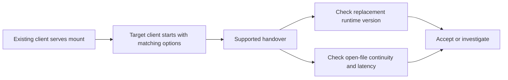

# Upgrade a Mounted JuiceFS Client with Smooth FUSE Handover

Author: [nawazdhandala](https://www.github.com/nawazdhandala)

Tags: JuiceFS, Linux, Storage

Description: Plan a JuiceFS client handover with matching FUSE options, a continuous open-file probe, retained binaries, and clear recovery criteria.

Replacing the JuiceFS executable on disk does not replace a client already serving a mounted filesystem. A conventional upgrade requires applications to stop using the mount, followed by unmounting and remounting. Smooth upgrade offers another path: start the new client against the existing mountpoint and let it take over.

FUSE, short for Filesystem in Userspace, connects the operating system's filesystem interface to the JuiceFS client process. Use the handover mechanism only after checking its constraints. A command returning successfully is not enough evidence that open files, locks, or application deadlines survived the transition.

## Check whether this mount is eligible

The **JuiceFS Community Edition 1.4.2** documentation requires both the old and new clients to be **1.2 or newer** for smooth upgrade. It also warns that different FUSE parameters, or enabling `--enable-xattr`, can cause the mount to be overwritten instead of following the intended smooth path. Extended attributes are additional file metadata; do not casually change their enablement during an upgrade. See the [versioned upgrade guide](https://github.com/juicedata/juicefs/blob/v1.4.2/docs/en/administration/upgrade.md).

This walkthrough is for a directly managed Linux mount. If a Kubernetes CSI driver owns the mount pod, use that driver's upgrade procedure. If a service manager supervises the current process, establish how it will handle that process exiting and the replacement process starting. An automatic restart of the old command can interfere with the handover.

Record the full effective mount configuration before proceeding:

| Record | Why it matters |
| --- | --- |
| Current and target client versions | Both ends must support the mechanism and volume features |
| Metadata URL and volume identity | A matching directory name does not identify the filesystem |
| Mountpoint and FUSE options | These determine whether the intended handover is possible |
| Service identity and secret delivery | The new process needs equivalent access |
| Cache, writeback, and log settings | Losing pending state or changing behavior complicates recovery |
| Supervisor and restart policy | A second old client must not restart unexpectedly |

Compare defaults as well as explicit options. A setting omitted from a command may change meaning across releases. Preserve the working configuration first; tune performance separately.

## Stage the target without losing the previous binary

Obtain the target executable for the host architecture from the [official 1.4.2 release](https://github.com/juicedata/juicefs/releases/tag/v1.4.2). Verify its release checksum through your normal artifact-review process and place it at a versioned path, such as `/opt/juicefs/1.4.2/juicefs`.

Keep the known-good executable at its own versioned path. Do not overwrite the only rollback artifact or assume an executable copied from another operating system is suitable.

```bash
/opt/juicefs/1.4.2/juicefs --version
/opt/juicefs/1.4.2/juicefs mount --help
```

These read-only commands verify the staged binary's identity and available options. They do not identify the version currently handling filesystem requests. Record the existing mount's runtime version separately from its logs and session information.

Review the exact source-to-target release path and any feature compatibility changes. Retaining an old executable does not guarantee that a downgrade remains supported after new volume features are enabled.

## Observe one open file throughout the transition

Use a dedicated test directory on the staging mount. The following Python 3.11-compatible probe creates a new file exclusively, keeps it open, and repeatedly writes and reads a fixed-width record through the same handle.

Save it as `handover-probe.py`:

```python
import argparse
import os
import time

parser = argparse.ArgumentParser()
parser.add_argument("path")
parser.add_argument("--iterations", type=int, default=120)
parser.add_argument("--interval", type=float, default=0.5)
args = parser.parse_args()
if args.iterations < 1 or args.interval < 0:
    parser.error("iterations must be positive and interval nonnegative")

with open(args.path, "x+b") as handle:
    for number in range(args.iterations):
        expected = f"handover-record-{number:012d}\n".encode()
        started = time.monotonic()
        handle.seek(0)
        handle.write(expected)
        handle.flush()
        os.fsync(handle.fileno())
        handle.seek(0)
        actual = handle.read(len(expected))
        if actual != expected:
            raise RuntimeError(f"readback mismatch at record {number}")
        print(number, f"{time.monotonic() - started:.6f}", flush=True)
        time.sleep(args.interval)
```

Run it as an application identity that can write in the test directory:

```bash
python3 handover-probe.py /mnt/jfs/upgrade-check/new-probe.bin
```

The directory must already exist, and the filename must not. The two output columns show the sequence number and elapsed I/O time in seconds. Start the handover while the probe is running. Extend the iteration count if the planned operation takes longer than one minute.

Exclusive creation prevents overwriting an existing file. The probe leaves its final test file for inspection. Python documents flushing and synchronization in its [OS interface](https://docs.python.org/3.11/library/os.html#os.fsync).

This is a continuity probe, not a full durability test. A same-client readback may use caches, and writeback settings affect when data reaches object storage. Include a separate reader and application-specific tests for locks, memory mappings, concurrent writers, and long-lived directory handles where those behaviors matter.

## Execute the reviewed mount command again

The documented mechanism is to run `mount` again at the same location with the target executable. The following is a deliberately minimal staging example:

```bash
/opt/juicefs/1.4.2/juicefs mount \
  rediss://metadata.example.internal:6379/9 \
  /mnt/jfs -d
```

Use it only when it reproduces the existing mount's complete effective configuration. Replace the endpoint and mountpoint and include all required existing options and credentials. The `-d` flag is appropriate here for a manually daemonized staging mount; it is not a recommendation to add daemonization inside a foreground service unit.

The [upstream upgrade tests](https://github.com/juicedata/juicefs/blob/v1.4.2/.github/scripts/command/graceful_upgrade.sh) exercise repeated mounts and changed non-FUSE settings. They are evidence of intended behavior, not proof that your kernel, process supervisor, and application workload will behave identically.

Do not add a forced unmount before this command. That would discard the condition you are trying to preserve: an existing filesystem connection and its active consumers.

## Verify the replacement and the application



Confirm the target runtime version from the replacement's startup evidence and the correct volume session. Check that the supervisor is healthy and no old configuration is being relaunched. Do not use a simplistic process-count check: daemonized operation can involve more than one process.

The probe must finish without exceptions, and any pause must fit the application's latency budget. Independently read the final record from another client. Run a representative application transaction and inspect client and application logs for I/O errors, disconnected endpoints, or lost locks.

Only then update the durable startup configuration to the accepted version and verify the next planned restart path. A successful in-place handover that reverts on reboot is an incomplete upgrade.

## Keep a recovery decision ready

If the new mount command fails, inspect the existing mount before repeating operations. Determine which client is serving requests and whether applications remain healthy. Avoid stacking blind remount attempts onto an uncertain state.

If reverting to the previous binary is supported for the current volume state, use the retained command and the same staged verification procedure. Otherwise, schedule a controlled application stop and normal unmount/remount. Preserve pending writeback data and investigate failed flushes; a forced unmount is not a rollback strategy.

The probe was tested locally for record verification, argument validation, and refusal to overwrite an existing file. No Linux FUSE handover was executed for this article. A representative staging transition remains the evidence required before upgrading production mounts.
