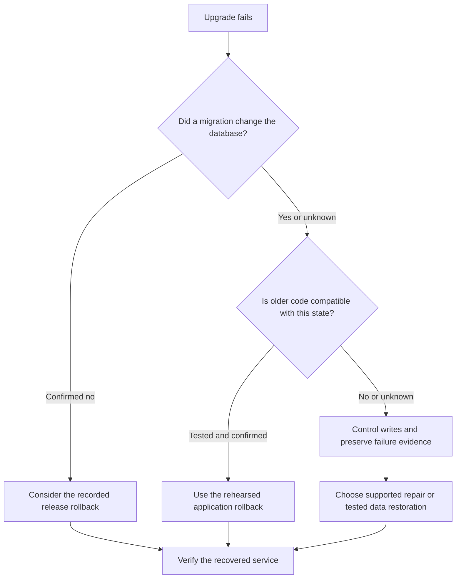

# How to Upgrade OneUptime in an Air-Gapped Kubernetes Cluster

Author: [nawazdhandala](https://www.github.com/nawazdhandala)

Tags: Air-Gapped, Monitoring, Observability

Description: Stage OneUptime upgrade and recovery artifacts, rehearse migrations offline, validate Helm changes, and distinguish release rollback from database restoration.

An air-gapped upgrade begins before the maintenance window. The target release, its changed dependencies, and the artifacts needed to recover must already be inside the network. If a migration fails halfway through, downloading yesterday's image is not a recovery strategy.

Treat the upgrade as a controlled transition between two recorded states: application artifacts, Helm configuration, database schemas, and stored data. This procedure is based on official documentation and source review. It does not claim a live upgrade or a tested production recovery.

## Establish the Supported Upgrade Path

Record the running application version, chart version, edition, database versions, and Helm revision. These are different identifiers: revision 12 does not mean OneUptime version 12.

OneUptime's [upgrade instructions](https://oneuptime.com/docs/en/installation/upgrading) require moving one major version at a time, reading the intervening release notes, and backing up before every upgrade. Minor and patch releases may be skipped subject to their notes. A deployment several major versions behind needs several independently verified transitions.

The examples below use target `17.0.0` only because its published migration template was reviewed. This is not authorization to upgrade an arbitrary older installation directly to 17. Replace placeholders with an approved source version, release name, namespace, and context.

```bash
KUBE_CONTEXT='REPLACE_WITH_STAGING_CONTEXT'
NAMESPACE='REPLACE_WITH_NAMESPACE'
RELEASE='REPLACE_WITH_HELM_RELEASE'

helm history "$RELEASE" --kube-context "$KUBE_CONTEXT" -n "$NAMESPACE"
helm get values "$RELEASE" --kube-context "$KUBE_CONTEXT" \
  -n "$NAMESPACE" -o yaml > current-user-values.yaml
```

[Helm history](https://helm.sh/docs/v3/helm/helm_history/) identifies release revisions; [get values](https://helm.sh/docs/v3/helm/helm_get_values/) captures supplied settings. Protect this file because values can contain secrets. Compare it with your controlled deployment configuration rather than blindly replaying obsolete keys into the new chart.

## Stage Both Forward and Recovery Artifacts

Retain the exact current chart, images by digest, values, secrets, trust material, and offline license records. Preserve Helm release history too, but do not treat it as an image repository or database backup. Exclude both release sets from registry garbage collection until the recovery window closes.

Use the reviewed [offline bundle script](https://github.com/OneUptime/oneuptime/blob/0de2d9ceac0a2404f5df7ad1f9ab1e22c56bea7e/HelmChart/AirGap/install.sh) on the connected preparation machine. The following assumes you already downloaded and reviewed that pinned script and installed Helm 3 and `crane`.

Prepare separate source-image values for each release. They must enable the intended features while retaining upstream image locations, not your destination registry.

```bash
CURRENT_VERSION='REPLACE_WITH_CURRENT_PINNED_VERSION'
TARGET_VERSION='17.0.0'
EDITION='community'

bash air-gap.sh images --version "$CURRENT_VERSION" \
  --edition "$EDITION" --values current-source-values.yaml > current-images.txt
bash air-gap.sh images --version "$TARGET_VERSION" \
  --edition "$EDITION" --values target-source-values.yaml > target-images.txt
diff -u current-images.txt target-images.txt

bash air-gap.sh save --version "$TARGET_VERSION" --edition "$EDITION" \
  --platform linux/amd64 --tool crane --values target-source-values.yaml
```

`diff` returning status 1 means differences were found. Review additions, removals, and changed tags, including migration and operator images. Also compare resolved digests: an unchanged mutable tag can hide changed content. Prefer the previously archived current bundle over recreating it from today's upstream tags. Match edition and architecture to your deployment.

Verify publisher provenance while connected, transfer the target bundle and associated configuration, then import it internally:

```bash
TARGET_VERSION='17.0.0'
TARGET_BUNDLE="oneuptime-air-gap-${TARGET_VERSION}"
REGISTRY='REPLACE_WITH_INTERNAL_REGISTRY'
bash air-gap.sh push --bundle "$TARGET_BUNDLE" --registry "$REGISTRY" --tool crane
```

The script verifies bundle checksums before import. Check registry availability for the current release as well. A complete target bundle is safer than relying on a hand-selected image delta; use the delta for review, not as proof that missing images are cached everywhere.

## Make Backups Match the Recovery Decision

Define how much post-backup data you could lose and how long restoration may take. Include PostgreSQL configuration/state, required ClickHouse telemetry, encryption secrets, external storage, and the databases' own software versions. Define whether queued work is drained, preserved, or intentionally discarded.

OneUptime's [backup documentation](https://oneuptime.com/docs/en/installation/backups) describes Enterprise backups: PostgreSQL uses a transaction-consistent dump, while ClickHouse captures tables as their parts are read. Those guarantees do not imply one atomic snapshot across both systems. Its restore process also runs migrations belonging to the server performing the restore.

For a coordinated recovery point, rehearse how to pause writes from ingestion, background workers, scheduled jobs, and configuration changes. Capture backups during that controlled interval, or document the consistency guarantees of your database-specific online method. Do not assume that pausing probes stops every writer.

Restore into an isolated recovery environment before approving maintenance. Verify representative monitors, incidents, users, and telemetry, with the correct encryption secret. The built-in backup feature requires the appropriate Enterprise entitlement; other editions need an independently tested database backup procedure.

## Review Migration Ordering and Validate the Target

In the [published 17.0.0 chart](https://helm-chart.oneuptime.com/oneuptime-17.0.0.tgz), `migrate.enabled` defaults to true and `migrate.hook` to false. A regular migration Job runs while new runtime pods wait for required schema migrations. Old pods may still serve during this transition.

With `migrate.hook: true`, the chart uses a pre-upgrade hook. That changes ordering; it does not stop old writers or prove backward compatibility. Keep migrations enabled and use the mode validated in rehearsal. Review data migrations and pending distributed database operations, not only pod readiness.

Build `target-values.yaml` as the complete reviewed target configuration: pinned `image.tag`, correct edition, internal image overrides, storage, secrets, and offline connection settings. Recheck renamed values against release notes. Do not combine a database engine upgrade with the application change unless that exact combination has been rehearsed.

```bash
TARGET_CHART="${TARGET_BUNDLE}/chart/oneuptime-${TARGET_VERSION}.tgz"
helm template "$RELEASE" "$TARGET_CHART" --namespace "$NAMESPACE" \
  --is-upgrade -f target-values.yaml > target-rendered.yaml
```

[Local rendering](https://helm.sh/docs/v3/helm/helm_template/) checks template generation, not cluster API acceptance. It also lacks live lookup results and the real release revision. Review image references, persistent claims, migration Jobs, hooks, and secret changes; protect the output.

On the staging cluster, use a separate API validation pass:

```bash
kubectl --context="$KUBE_CONTEXT" -n "$NAMESPACE" apply \
  --dry-run=server -f target-rendered.yaml
```

[Kubernetes server dry-run](https://kubernetes.io/docs/reference/kubectl/generated/kubectl_apply/) submits requests without persisting resources. It can expose API or admission failures, but does not execute migrations, reproduce Helm hook ordering, or prove image availability. Investigate name conflicts caused by a locally rendered revision rather than applying the file without dry-run.

## Rehearse Offline, Then Control the Window

Restore representative source-version data into staging and deny external egress there. Use fresh nodes without cached application images. Rehearse the upgrade, login, new telemetry, an internal probe, and notification receipt. Also rehearse the selected recovery path using the retained artifacts. Record migration duration, storage headroom, and restore time.

Approve the production window only after those results meet your recovery objectives. Freeze configuration changes, establish an independent operator communication route, and pause or buffer ingestion according to the tested procedure. Take and verify the final recovery backup. Rebind the context variables explicitly for the approved production execution.

```bash
helm upgrade "$RELEASE" "$TARGET_CHART" --kube-context "$KUBE_CONTEXT" \
  --namespace "$NAMESPACE" --reset-values -f target-values.yaml \
  --wait --wait-for-jobs --timeout 30m
```

This [Helm upgrade](https://helm.sh/docs/v3/helm/helm_upgrade/) uses a local archive. `--reset-values` requires your file to contain all intended overrides; it prevents implicit carryover from being your configuration strategy. The 30-minute timeout is illustrative: size it from rehearsal. `--wait-for-jobs` adds Job completion to readiness waiting when `--wait` is enabled.

Do not add `--atomic` as a substitute for a database recovery plan. Its automatic release rollback can restart older code after data has already changed. A client timeout also does not establish that a migration Job stopped; inspect its actual state before choosing a recovery action.

## Decide Between Rollback, Repair, and Restoration

Use database state to choose the recovery path. An application restart alone cannot undo a schema change.



| Observed state | Recovery decision |
| --- | --- |
| Image pull or scheduling failure, no migration changes | Consider the recorded release rollback after confirming database state |
| Migration finished, backward compatibility demonstrated | Rehearsed application rollback may be appropriate |
| Migration partially applied or compatibility unknown | Preserve evidence, control writers, and choose supported repair or restoration |
| Database engine or storage format changed | Use the tested database recovery procedure; reverting a container tag is insufficient |

[Helm rollback](https://helm.sh/docs/v3/helm/helm_rollback/) selects a prior release revision. It does not restore database contents or reverse arbitrary migration statements. Restoring an old backup through the newer OneUptime server may migrate that data forward again, so specify the recovery server version as well as the backup.

Preserve the failed state where practical and account for data received since the recovery point. After upgrading or recovering, verify the reported version and completed migrations. Allow controlled test traffic to check fresh sign-in, new telemetry, and acknowledged test alerts before resuming normal writers. Keep the old artifacts and backups until the agreed observation period ends.
