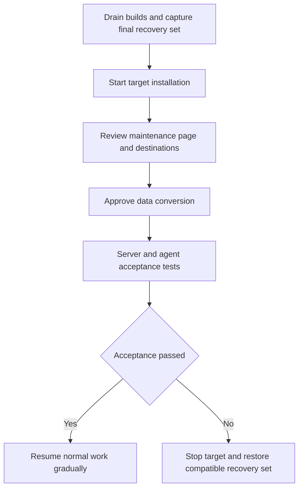

# Upgrade TeamCity Server and Agents with a Tested Rollback Plan

Author: [nawazdhandala](https://www.github.com/nawazdhandala)

Tags: CI/CD, DevOps, Backup

Description: Plan a TeamCity upgrade around data-format conversion, agent readiness, a restored rehearsal environment, and a clear point for rollback decisions.

A TeamCity upgrade is not finished when the login page loads. The server must read its existing data, agents must update and reconnect, and representative builds must still produce usable outputs. An upgrade plan should prove those outcomes before normal work resumes.

The most important rollback distinction is between replacing application files and restoring application data. Once an upgrade converts the database and data-directory formats, starting an older server against that converted state is not a rollback strategy. The old server needs a compatible recovery set.

This guide follows the TeamCity 2026.2 documentation. It describes a controlled single-server upgrade; multi-node installations need the separate node-by-node compatibility procedure for their exact release. No TeamCity upgrade or restore was executed for this article.

## Write a release-specific change record

Record the exact source and target versions, installation type, Java runtime, database and driver versions, installed plugins, and customized startup settings. Store the source and target installers or immutable container digests where recovery does not depend on the broken server.

Read every relevant section of the upgrade notes between the two versions. For example, the documented transition to **2026.1** requires Java 21 or newer for agents and Java 21 for the server. The notes also identify an agent-upgrade problem when coming from releases that cannot start with that Java version, and describe an intermediate upgrade path. This is a concrete reason to read transition notes instead of assuming every direct jump behaves identically. [TeamCity upgrade notes](https://www.jetbrains.com/help/teamcity/upgrade-notes.html)

Keep application build JDKs separate from the runtime used to launch TeamCity. Moving the agent runtime does not mean every project must compile against that same JDK. Check the exact supported runtime range for the selected server release. [Supported environments](https://www.jetbrains.com/help/teamcity/supported-platforms-and-environments.html)

| Check | Evidence before scheduling downtime |
| --- | --- |
| Target release | Verified installer or image digest and release notes |
| Database | Supported engine, driver, connectivity, and backup method |
| Plugins | Compatibility decision for each non-bundled plugin |
| Agents | Java, disk capacity, permissions, and replacement image readiness |
| External integrations | Staging tests for VCS, secrets, artifact storage, and callbacks |
| Recovery | Successfully restored source-version environment |

Check license eligibility for the target release through the server's license administration and the release's effective date. Do that during planning, rather than discovering a licensing problem in the maintenance window. [Upgrade prerequisites](https://www.jetbrains.com/help/teamcity/upgrading-teamcity-server-and-agents.html)

## Rehearse recovery before rehearsing the upgrade

Create an isolated copy from a coordinated backup of the database, data directory, artifacts, and required protected keys. First start that copy on the **source** TeamCity version and confirm it works. Only then upgrade the copy.

This sequence separates two questions: can you recover today's installation, and can the target version use its data? If the restored source version already lacks artifacts or cannot decrypt settings, an upgrade test will hide the real problem behind unrelated errors.

Keep the rehearsal database, data directory, artifact storage, and agents separate from production. Review the copied-server checklist before startup, including outbound integrations and cleanup that could affect external storage. [TeamCity server-copy guidance](https://www.jetbrains.com/help/teamcity/how-to.html#Copied+Server+Checklist)

Run the acceptance tests you intend to use in production, measure conversion and agent-update time, and then perform the rollback rehearsal: restore the pre-upgrade recovery set into clean isolated destinations and start the source release again. Do not merely point the old executable at the upgraded test database.

## Make the data-conversion boundary visible



TeamCity's maintenance page shows a required data conversion before it proceeds. Confirm the database and data-directory locations there. A maintenance authentication token is found in the server log; handle it as a credential rather than copying the surrounding log into a public issue. [Maintenance mode](https://www.jetbrains.com/help/teamcity/teamcity-maintenance-mode.html)

Set the rollback decision deadline before the maintenance window. Include the measured restore time and the business deadline for resuming builds. If the team waits until the end of the window to decide, a technically valid backup may still leave too little time for recovery.

## Control production writers during the change

Pause normal triggering and agent scheduling through your established operations process, then drain or explicitly account for running builds. Prevent a service manager or container orchestrator from restarting an old instance while the upgrade is underway.

For a Linux archive installation managed directly by the supplied scripts, the documented stop command can wait up to a specified number of seconds:

```bash
/opt/teamcity/bin/teamcity-server.sh stop 60
```

Replace the path with the source installation and run it as the service account during the approved window. Verify that the process actually stopped; reaching the timeout is not proof of shutdown. Use the service manager's procedure instead when it owns the process. Do not add the force option simply to make a slow stop disappear. [TeamCity startup and stop commands](https://www.jetbrains.com/help/teamcity/start-teamcity-server.html)

Capture the final coordinated recovery set after writers have stopped. Identify it explicitly in the change record and verify that its files are accessible from the recovery environment. TeamCity's built-in archive omits build artifacts, so an archive alone is not the whole set. [Backup scope](https://www.jetbrains.com/help/teamcity/teamcity-data-backup.html)

Use the official upgrade method for your installation type. Reapply reviewed customizations to the target defaults rather than blindly copying an old configuration file over a new one. For containers, rebuild custom images from the target base and use the documented manual replacement approach; the application's automatic updater is not the Docker upgrade mechanism. [Server upgrade methods](https://www.jetbrains.com/help/teamcity/upgrading-teamcity-server-and-agents.html)

For the same directly managed Linux installation model, start the prepared target with:

```bash
/opt/teamcity/bin/teamcity-server.sh start
```

This path must now refer to the intended target installation. Confirm the actual release and selected data locations before approving conversion.

## Treat agent convergence as an acceptance gate

Correctly installed connected agents normally update to match the server. They download the agent package, update while idle, and restart. Do not repeatedly restart an agent marked as waiting to upgrade; interrupting that process can create a repair job. [Automatic agent updates](https://www.jetbrains.com/help/teamcity/upgrading-teamcity-server-and-agents.html#Automatic+Build+Agents+Update)

Rehearse at least one agent from each meaningful class: Linux and Windows, different architectures, custom images, restricted network segments, and specialized toolchains. An agent appearing connected is not enough. Check its update state, authorization, enabled status, reported tools, and ability to accept a representative job.

For ephemeral agents, update the launch image too. An old image that repeatedly downloads updates at startup can conceal drift and make every new worker slow. For persistent agents, verify that the service identity can update the installation and that disk headroom is adequate.

## Run controlled builds before reopening the queue

Keep production deployment steps blocked while permitting a dedicated test build. Validate source checkout, secret retrieval, a compile/test step, artifact publication, and a downstream download from the intended producer. Check build logs and test results in the UI, not just the process exit code.

Also verify historical data: open an older build, retrieve a known package, and compare its checksum. Test one failure path so that alerts and build failures are reported correctly. Only after these checks should you re-enable normal triggers and integrations in stages.

## Restore state when rollback requires it

If acceptance fails after a data-format conversion, stop the target server and preserve diagnostic evidence. Restore the matching pre-upgrade database, data directory, and artifact state using the rehearsed procedure, then start the source release. JetBrains documents data restoration as the route back across incompatible formats. [Restore instructions](https://www.jetbrains.com/help/teamcity/restoring-teamcity-data-from-backup.html)

Some bugfix releases permit compatible downgrade, but verify the exact release notes before relying on that exception. Do not generalize it to a major-version transition.

Any builds or configuration changes accepted after the recovery point may be absent after restoration. Keeping normal writers paused until acceptance limits that loss. Record what happened, verify restored agents and artifacts, and resume service through the same controlled tests rather than treating an old login page as proof of recovery.
