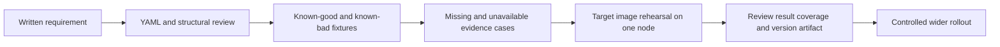

# Validate Custom kube-bench Controls Before Cluster Rollout

Author: [nawazdhandala](https://www.github.com/nawazdhandala)

Tags: Kubernetes, Security, Testing

Description: Test custom kube-bench YAML with explicit pass, fail, missing-field, and collection-error fixtures before trusting it across production nodes.

A custom kube-bench control can load successfully and still make the wrong security decision. A misspelled field may not be rejected, an empty selection may run no checks, or an audit command may turn a collection failure into reassuring output.

Validate the control in stages: parse the YAML, inspect its structure, test its decisions against known inputs, and then rehearse collection in the actual scanner image. Each stage answers a different question.

This tutorial pins **kube-bench v0.14.0**. Its example is a synthetic local control, not a new CIS requirement or a substitute for an official benchmark. It uses Python 3.8 or later, PyYAML for a small structural check, and a matching native kube-bench binary.

## Keep custom controls separate from upstream evidence

Use a distinct configuration revision and local identifiers. Preserve the original benchmark files so reviewers can distinguish an upstream requirement from your organization’s extension. Document the intended invariant in plain language before writing the command that checks it.

For this lab, the invariant is deliberately simple: a file must contain `configured=true`. The audit reads that file, and the test compares the observed value with the string `true`. This isolates control logic from Kubernetes permissions, host mounts, and distribution-specific paths.

The [controls documentation](https://github.com/aquasecurity/kube-bench/blob/v0.14.0/docs/controls.md) describes the hierarchy of targets, groups, checks, audits, and test items. Verify examples against the tagged implementation when exact indentation or behavior matters. The [loader](https://github.com/aquasecurity/kube-bench/blob/v0.14.0/check/controls.go) uses YAML unmarshalling and checks the target type; it is not a comprehensive semantic linter for every authoring mistake.

## Create an isolated fixture directory

Use a new empty lab directory. Put the verified v0.14.0 binary for your workstation at `./kube-bench`, and create `cfg/local/`. Do not reuse a directory containing real assessment evidence named `fixture.txt`: the test runner below deliberately creates and removes that file.

Save this minimal global configuration as `cfg/config.yaml`:

```yaml
node:
  components: []
target_mapping:
  local: [node]
```

The empty component list is appropriate for this synthetic lab because it does not inspect a running kubelet. Do not replace a production profile’s component configuration with this file.

Save the control as `cfg/local/node.yaml`:

```yaml
version: local-lab-1
id: LOCAL
text: Local control validation fixture
type: node
groups:
  - id: LOCAL.G
    text: Fixture configuration
    checks:
      - id: LOCAL.1
        text: Fixture must report configured=true
        audit: cat fixture.txt
        tests:
          test_items:
            - flag: configured
              compare:
                op: eq
                value: "true"
        remediation: Correct the fixture or collection path; not a cluster remediation.
        scored: true
```

Quoting `"true"` preserves the intended comparison value as a string. `scored: true` is a Boolean and makes a failed automated test produce FAIL in this example. Review the [test evaluator](https://github.com/aquasecurity/kube-bench/blob/v0.14.0/check/test.go) when selecting operators, required fields, and extraction methods for a real control.

## Check structure before executing audit commands

Run this Python snippet from the lab directory after installing PyYAML through your approved development environment:

```python
from pathlib import Path
import yaml

control = yaml.safe_load(Path("cfg/local/node.yaml").read_text())
if control["type"] != "node" or not control.get("groups"):
    raise SystemExit("Expected node controls with groups")
ids = set()
for group in control["groups"]:
    if not group.get("checks"):
        raise SystemExit("Empty group")
    for check in group["checks"]:
        if check["id"] in ids:
            raise SystemExit("Duplicate check ID")
        ids.add(check["id"])
        if not check.get("audit") or check.get("scored") is not True:
            raise SystemExit("Expected a scored automated fixture")
        if not check.get("tests", {}).get("test_items"):
            raise SystemExit("Missing nonempty test_items")
print("Fixture structure accepted")
```

This guard is intentionally limited to the example’s automated checks. It catches duplicate IDs and missing test items; it is not the full kube-bench schema, and it would need deliberate changes for manual checks or other audit methods. A generic YAML parser alone cannot establish that every key has a meaning to kube-bench.

Review audit commands as executable code before running them. They should collect evidence without modifying the target. Avoid shell fallbacks that translate permission errors, missing tools, or unavailable APIs into a value that satisfies the control.

## Execute positive and negative cases with the matching binary

Save the following as `verify-control.py` in the lab directory and run it with `python3 verify-control.py`:

```python
import json
from pathlib import Path
import subprocess

root = Path.cwd()
command = [str(root / "kube-bench"), "run", "--benchmark", "local",
           "--targets", "node", "--config", str(root / "cfg/config.yaml"),
           "--config-dir", str(root / "cfg"), "--check", "LOCAL.1",
           "--json", "--exit-code", "3"]
cases = [("good", "configured=true\n", "PASS", 0),
         ("bad", "configured=false\n", "FAIL", 3),
         ("absent-key", "other=true\n", "FAIL", 3),
         ("missing-file", None, "FAIL", 3)]
for name, contents, expected_state, expected_exit in cases:
    fixture = root / "fixture.txt"
    if contents is None:
        fixture.unlink(missing_ok=True)
    else:
        fixture.write_text(contents)
    result = subprocess.run(command, capture_output=True, text=True, timeout=30)
    (root / (name + ".json")).write_text(result.stdout)
    (root / (name + ".log")).write_text(result.stderr)
    report = json.loads(result.stdout)
    rows = [item for control in report["Controls"]
            for group in control.get("tests") or []
            for item in group.get("results") or []]
    actual = [(item["test_number"], item["status"]) for item in rows]
    if actual != [("LOCAL.1", expected_state)] or result.returncode != expected_exit:
        raise SystemExit(f"Unexpected result for {name}: {actual}, exit={result.returncode}")
    print(name, expected_state, expected_exit)
```

The expected four lines are one PASS followed by three FAIL cases. These failures are intentional test outcomes. The runner checks the control ID and count as well as status, so a typo that selects nothing cannot masquerade as a successful test.

The missing-file case should include a collection-error reason in its JSON. It is different from observing `configured=false`, even though both are FAIL here. Retain that distinction when designing operational alerts and remediation instructions.

The [check runner](https://github.com/aquasecurity/kube-bench/blob/v0.14.0/check/check.go) determines how audit errors and scoring affect results. An unscored or manual control can behave differently, so update the fixture expectations when deliberately changing those semantics.

## Add edge cases that reflect the real input

Before promoting an actual control, test whitespace variations, absent settings, multiple matching lines, unexpected values, malformed structured data, and denied collection access where relevant. Add a regression fixture for every false positive or false negative you discover.

For a command that reads an API, explicitly test a forbidden response and a network failure. For a file-based check, test the path actually visible inside the scanner container. A successful workstation fixture cannot verify hostPath mounts or Linux utility behavior.



## Promote an artifact, not an unreviewed edit

Package the tested control with its matching configuration, scanner version, fixture suite, and expected IDs. Record what differs from the upstream benchmark. Rehearse the actual image on one authorized node, verify the expected evidence, and expand only after reviewing results.

The local v0.14.0 binary produced the expected four outcomes for this lab. No real Kubernetes node was inspected. Passing these tests establishes the synthetic control’s decision behavior; production readiness still requires validating the real audit command, input source, permissions, and applicability.
