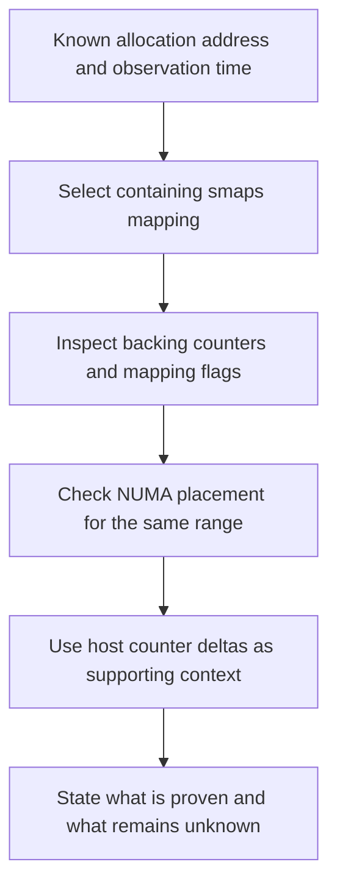

# Verify Linux THP Usage with smaps, numa_maps, and vmstat

Author: [nawazdhandala](https://www.github.com/nawazdhandala)

Tags: Linux, HugePages, Performance

Description: Verify Transparent Huge Page backing for a target mapping, distinguish policy from evidence, and interpret NUMA and VM counters without overclaiming attribution.

A process can request Transparent Huge Pages and still receive ordinary pages. A host can allocate THP successfully while the particular buffer you care about uses none. Even a mapping that used huge pages earlier can change after memory pressure or application activity.

To answer whether an allocation uses THP, connect evidence to its address range and observation time. A global policy setting is useful context, but it is not proof of the mapping's current backing.

This guide targets **Linux 6.12** and focuses on anonymous application memory. Shared-memory and file mappings have additional reporting fields. It distinguishes traditional PMD-sized THP from multi-size THP, because the same counter does not cover every form equally.

## Record the allocation, not just the process name

Start with the process ID, the buffer's address and length, the kernel release, and the point in the workload lifecycle. Obtain the address from application instrumentation in a controlled environment. Avoid assuming that every allocation appears as a separate mapping: an allocator can place many objects inside one larger arena.

After the application has touched the representative working set, save a mapping snapshot. Replace `12345` with its host-visible PID and run as an account allowed to inspect it:

```bash
app_pid=12345
snapshot_dir=$(mktemp -d)
uname -r > "$snapshot_dir/kernel.txt"
cat "/proc/$app_pid/maps" > "$snapshot_dir/maps.txt"
cat "/proc/$app_pid/smaps" > "$snapshot_dir/smaps.txt"
cat "/proc/$app_pid/numa_maps" > "$snapshot_dir/numa_maps.txt"
printf 'Saved snapshots in %s\n' "$snapshot_dir"
```

The files contain addresses and mapping names, not application memory contents. Store them with your incident evidence. These sequential reads are not an atomic view; an application that changes mappings during collection can produce mismatches. The [maps documentation](https://man7.org/linux/man-pages/man5/proc_pid_maps.5.html) describes the address ranges and access restrictions.

## Select the mapping containing the address

Save this Python 3 helper as `mapping-at.py`:

```python
import argparse
import re

parser = argparse.ArgumentParser()
parser.add_argument("smaps_file")
parser.add_argument("address", type=lambda value: int(value, 16))
args = parser.parse_args()
header = re.compile(r"^([0-9a-f]+)-([0-9a-f]+)\s")
selected = False
found = False
with open(args.smaps_file) as stream:
    for line in stream:
        match = header.match(line)
        if match:
            start, end = (int(value, 16) for value in match.groups())
            selected = start <= args.address < end
            found = found or selected
        if selected:
            print(line, end="")
if not found:
    parser.error("address is not present in this snapshot")
```

Run it against your saved file, substituting the actual hexadecimal buffer address for the example:

```bash
python3 mapping-at.py "$snapshot_dir/smaps.txt" 0x7f1000000000
```

The output is the complete smaps block containing that address. The helper treats the end address as exclusive, matching the mapping range. If the allocation spans several mappings, inspect every intersecting range. If several allocations share the selected mapping, its counters describe the whole mapping and cannot uniquely attribute huge pages to one small object.

The [smaps interface](https://man7.org/linux/man-pages/man5/proc_pid_smaps.5.html) documents the mapping block and page-related fields.

## Read evidence and hints separately

For an anonymous mapping, inspect these fields together:

| Evidence | What it establishes |
|---|---|
| Positive `AnonHugePages` | PMD-sized anonymous THP backing reported for this mapping |
| `THPeligible: 1` | Eligibility under the reported conditions, not current use |
| `VmFlags` containing `hg` | Huge-page advice, not successful allocation |
| `VmFlags` containing `ht` | Explicit HugeTLB mapping, a different mechanism |
| `KernelPageSize` and `MMUPageSize` | Mapping page-size reporting, not a complete THP census |

On a system with 2 MiB PMD-sized THP, an illustrative `AnonHugePages: 8192 kB` corresponds to 8 MiB of reported PMD-backed anonymous memory. If the mapping is 32 MiB, that is evidence of partial coverage, not a reason to label the whole mapping huge-page backed.

PMD means page middle directory, a level in the page-table structure. Multi-size THP can use smaller large allocations while remaining mapped through ordinary page-table entries, or PTEs. Linux 6.12 explicitly documents that `AnonHugePages` covers traditional PMD-sized THP. Therefore, a zero value cannot rule out every smaller THP allocation. See [THP monitoring documentation](https://www.kernel.org/doc/html/v6.12/admin-guide/mm/transhuge.html#monitoring-usage).

Likewise, `KernelPageSize: 4 kB` is not a reliable standalone rejection of anonymous THP. In [Linux 6.12's reporting implementation](https://raw.githubusercontent.com/torvalds/linux/v6.12/fs/proc/task_mmu.c), the anonymous THP tally and the VMA page-size fields come from different reporting paths. A VMA is the kernel's description of a virtual memory area; a single area can contain mixed backing.



## Use numa_maps to answer the placement question

Find the line with the same start address as the selected smaps block. Substitute the actual mapping start, without a `0x` prefix:

```bash
mapping_start=7f1000000000
awk -v start="$mapping_start" '$1==start {print}' "$snapshot_dir/numa_maps.txt"
```

Its policy and `N0=...`, `N1=...` fields describe where pages are mapped. This helps determine whether the relevant memory is local to the intended CPUs. It does not turn NUMA counts into a complete page-size inventory.

In particular, the `huge` marker in this interface identifies HugeTLB mappings; its absence is not proof that transparent huge pages are absent. Ordinary anonymous THP and explicit HugeTLB are handled differently in the kernel reporting path. The [NUMA interface documentation](https://man7.org/linux/man-pages/man7/numa.7.html) explains the policy, node counts, and correlation by starting address.

If the start address is missing, first consider a mapping change between snapshots. Recollect at a stable point before concluding that the process lost its allocation.

## Collect vmstat deltas around a controlled workload phase

Host-wide counters can explain whether THP allocation or collapse activity occurred during the experiment. Take a baseline before the selected workload phase:

```bash
awk '/^thp_/ {print}' /proc/vmstat > "$snapshot_dir/thp-before.txt"
```

Run the application's documented allocation and warm-up phase, then capture the same counters:

```bash
awk '/^thp_/ {print}' /proc/vmstat > "$snapshot_dir/thp-after.txt"
```

Compare matching counter names. `thp_fault_alloc`, `thp_fault_fallback`, and `thp_collapse_alloc` describe different events; they are not interchangeable measures of resident bytes. An increase from 120 to 128 is eight events over that interval, not proof that the target buffer owns eight pages now. Other processes can contribute, and pages can subsequently be split or released.

For multi-size THP, inspect available per-size counters as well:

```bash
for stats in /sys/kernel/mm/transparent_hugepage/hugepages-*kB/stats; do
    [ -d "$stats" ] || continue
    for name in anon_fault_alloc anon_fault_fallback; do
        [ -r "$stats/$name" ] || continue
        printf '%s=' "$stats/$name"
        cat "$stats/$name"
    done
done
```

These size-specific events narrow the host-wide evidence but still do not attribute a particular physical allocation to your buffer. Linux documents the counter meanings in its [THP statistics section](https://www.kernel.org/doc/html/v6.12/admin-guide/mm/transhuge.html). If exact smaller-THP attribution is required, record that these snapshots are insufficient and use a kernel-version-specific tracing or page-inspection investigation.

## Report a conclusion with the right limits

A defensible result might read: “After warm-up, the mapping containing the dedicated buffer reported 8 MiB of PMD-sized anonymous THP. The buffer occupied that entire mapping, and its NUMA placement matched the intended node.” For a small object inside a larger arena, narrow the conclusion to the arena.

Do not replace that evidence with “THP is enabled” or “`madvise` succeeded.” `MADV_HUGEPAGE` is advice; consult the [madvise contract](https://man7.org/linux/man-pages/man2/madvise.2.html) when interpreting what the application requested. Recheck after the workload phase that matters, because backing can change.

The address-selection helper passed synthetic start, interior, end-boundary, final-block, and missing-address tests. Shell snippets were syntax-checked. No Linux THP allocation, collapse, NUMA placement, or performance experiment was executed for this article. Avoid frequent full smaps polling in production; collect targeted evidence at meaningful checkpoints.
