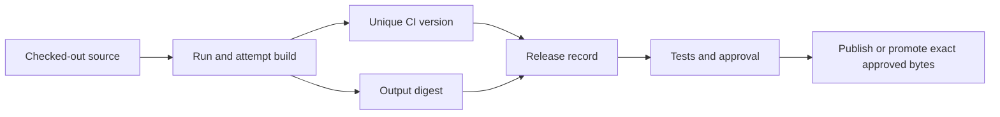

# Version CI Artifacts with SemVer Without Overwriting Builds

Author: [nawazdhandala](https://www.github.com/nawazdhandala)

Tags: Artifact Management, CI/CD, Versioning, DevOps

Description: Give CI builds unique prerelease versions, distinguish source commits from artifact digests, and handle reruns and release promotion without replacing published bytes.

Two CI runs build the same commit. The second uses a refreshed dependency cache and produces different bytes. If both publish as `1.4.0-dev` or use only the commit ID as their destination, the newer result can replace the one that passed review.

A useful artifact identity answers three separate questions: which compatibility version it belongs to, which build execution produced it, and which bytes were actually published. Semantic Versioning helps with the first question. A CI run identity helps with the second. A content digest answers the third.

## Do not overload one identifier

Keep these fields in your release metadata even when some also appear in a filename:

| Field | Example | Purpose |
| --- | --- | --- |
| Intended release | `1.4.0` | Compatibility and release planning |
| CI prerelease | `1.4.0-ci.12345.2.g<full-commit>` | One build execution in this policy |
| Source identity | Repository plus full Git commit ID | Trace the checked-out source |
| Build identity | Pipeline namespace, run ID, attempt and job | Distinguish executions |
| Artifact identity | SHA-256 of the output bytes | Verify the exact deliverable |

The commit ID is a digest of a Git object, not of the generated archive or container image. Toolchains, dependencies, generated timestamps, configuration, and build inputs can change output without changing the source commit. Record both identities rather than assuming one predicts the other.

Also give matrix jobs different output coordinates. Linux and Windows builds of the same run can share a release version while using separate platform paths or filenames. A run-level version does not uniquely name every file by itself.

## Use prerelease fields for CI identity

Under [Semantic Versioning 2.0.0](https://semver.org/spec/v2.0.0.html), prerelease identifiers follow a hyphen, and a prerelease sorts before the corresponding stable version. Numeric identifiers compare numerically and cannot contain leading zeroes. Build metadata follows a plus sign and does not affect precedence.

That makes these distinctions practical:

| Comparison | Result |
| --- | --- |
| `1.4.0-rc.9` versus `1.4.0-rc.10` | The second is later |
| `1.4.0-ci.12345.1` versus `1.4.0-ci.12345.2` | The second is later |
| `1.4.0-rc.10` versus `1.4.0` | Stable is later |
| `1.4.0+build.1` versus `1.4.0+build.2` | Equal precedence |

Do not use build metadata as your only promise of a distinct publishable package version. Artifact stores and package clients have their own identity and normalization rules. Verify those rules for the target format. Likewise, a valid SemVer string is not automatically a valid container tag or filesystem component.

The policy below uses `ci`, a run ID, an attempt number, and the full source commit in prerelease fields. The `g` prefix makes the commit token explicitly non-numeric, even if a particular hexadecimal ID contains only digits. No branch-name sanitization is needed, avoiding collisions such as two branch names that both become `feature-payments`.

## Generate the version with a pinned parser

This example was executed with **Node.js 24.1.0** and **`semver` 7.7.2**. In a small release-tools project, install the exact dependency and retain its lockfile:

```bash
npm install --save-exact semver@7.7.2
```

Save the following as `version.cjs`. The `.cjs` suffix makes the CommonJS module format explicit. Its checks reject already-prereleased bases, leading-zero IDs, abbreviated commits, and unexpectedly long numeric run identifiers.

```javascript
const semver = require("semver");

function ciVersion({ base, run, attempt, commit }) {
  const parsed = semver.parse(base);
  if (!parsed || parsed.version !== base || parsed.prerelease.length || parsed.build.length) {
    throw new Error("base must be a canonical stable version such as 1.4.0");
  }
  for (const value of [run, attempt]) {
    if (typeof value !== "string" || !/^[1-9][0-9]{0,14}$/.test(value)) {
      throw new Error("run and attempt must be positive decimal IDs, at most 15 digits");
    }
  }
  if (typeof commit !== "string" || !/^(?:[0-9a-f]{40}|[0-9a-f]{64})$/.test(commit)) {
    throw new Error("commit must be a full lowercase Git object ID");
  }
  const version = `${base}-ci.${run}.${attempt}.g${commit}`;
  if (!semver.valid(version)) throw new Error("generated version is invalid");
  return version;
}

module.exports = { ciVersion };
if (require.main === module) {
  console.log(ciVersion({
    base: process.env.BASE_VERSION,
    run: process.env.PIPELINE_RUN_ID,
    attempt: process.env.RUN_ATTEMPT,
    commit: process.env.GIT_COMMIT,
  }));
}
```

The [pinned node-semver documentation](https://github.com/npm/node-semver/blob/v7.7.2/README.md) describes parsing and comparison behavior. This generator enforces an organization policy on top of the parser; the 15-digit limit is a deliberate example constraint, not a SemVer rule.

For a local check, supply a real checked-out commit:

```bash
export BASE_VERSION='1.4.0'
export PIPELINE_RUN_ID='12345'
export RUN_ATTEMPT='2'
export GIT_COMMIT="$(git rev-parse HEAD)"
node version.cjs
```

Expect a version beginning `1.4.0-ci.12345.2.g`, followed by the full commit ID. The run and attempt above are examples, not values to reuse for every build. A detached checkout is fine. Record what was actually checked out; a pull-request workflow may build a merge commit rather than the contributor's head commit.

## Map CI identity deliberately

In GitHub Actions, `GITHUB_RUN_ID` identifies a workflow run and remains unchanged on a rerun, while `GITHUB_RUN_ATTEMPT` increments. The [GitHub variables reference](https://docs.github.com/en/actions/reference/workflows-and-actions/variables) documents that distinction. Map those values to the generator's run and attempt inputs rather than using a counter that resets per branch or job.

Define the namespace in which the run ID is unique. If several repositories or independent CI systems publish the same component coordinates, either allocate a shared identity scheme or partition their destinations. The example does not establish global uniqueness across unrelated pipelines.

Never silently truncate a run ID or commit to fit a registry limit. Choose a documented shorter coordinate scheme with a retained full metadata mapping, and add collision checks. Keep the full digest in the release record even if the user-facing name is shorter.

## Separate identity from release approval



A higher-sorting version is not necessarily approved. In particular, do not deploy “the greatest version string” as a substitute for selecting an approved release record. The default range behavior of node-semver excludes many prerelease matches; do not assume a stable dependency range automatically subscribes to every CI build.

Promotion needs care when the package embeds its own version. Changing an npm package's version field from a prerelease to a stable release changes package bytes. You cannot claim that modified package is the exact archive previously tested. Either test the final packaged bytes before release, or use a staging workflow where the final version is already embedded and approval changes visibility rather than rebuilding it.

For generic archives whose version is external metadata, publishing the same bytes under a release coordinate may be possible. Still compare the digest and preserve the link between build execution, test evidence, and final location. Do not rebuild solely to change a repository label and assume the result is identical.

## Make duplicate publication fail safely

Unique names reduce accidental collisions; repository enforcement prevents replacement. Configure release publishing so a different payload cannot overwrite an existing coordinate. A pre-upload existence check alone has a race between checking and writing.

On an ambiguous upload failure, read back the existing artifact identity. If it matches the expected digest, reconcile the release record. If it differs, stop and investigate. Do not retry with overwrite privileges or mutate the old version to make the job green.

Local tests verified distinct attempts, numeric prerelease ordering, stable-version precedence, equal build-metadata precedence, full 40/64-character commit handling, and nine invalid-input cases. They did not publish packages, exercise a CI provider, or prove registry immutability. Test those boundaries with your actual repository and package format before adopting the naming policy.
