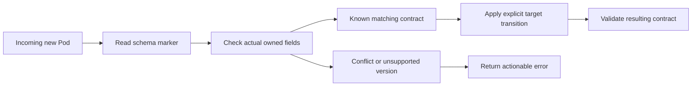

# Version Webhook-Injected Fields for Safe Upgrades and Rollbacks

Author: [nawazdhandala](https://www.github.com/nawazdhandala)

Tags: Kubernetes, DevOps

Description: Define explicit versions for injected fields, check for drift before migration, and test forward and reverse patches without overwriting user changes.

A webhook can remember that it injected something without knowing whether that something still matches its current contract. An annotation such as `injected: "true"` answers only a yes-or-no question. It cannot distinguish an older sidecar layout from a newer one, identify a partially edited configuration, or explain whether a downgrade is supported.

Treat injected fields as a small versioned interface. Define the fields each version owns, the values it expects, and the transitions it can perform. Keep that interface separate from the webhook's executable version: several executable releases may implement the same injection contract.

## Give the marker a precise meaning

Kubernetes [annotations](https://kubernetes.io/docs/concepts/overview/working-with-objects/annotations/) are appropriate for descriptive metadata that is not used to select objects. A marker such as `injector.example.com/schema: "1"` can record the expected injection layout. It should mean: “The owned fields match contract 1,” not merely “a webhook once ran.”

The annotation is not proof of provenance. A caller who can set metadata can supply the same string. Read the actual fields before using it to choose a migration. If the injection enforces security requirements, validate the final object independently rather than trusting the marker.

Define behavior for each state:

| Observed state | Recommended migration behavior |
|---|---|
| No marker and no owned fields | Use a separate, explicitly tested first-install path. |
| Known marker and matching fields | Apply a supported transition, or return no patch. |
| Known marker but changed owned fields | Report a conflict instead of silently overwriting them. |
| Unknown newer marker | Refuse an unsupported migration or use an explicitly documented compatibility rule. |
| Owned fields without a marker | Require an adoption decision; do not infer ownership from a familiar name alone. |

Keep the first-install and adoption rules distinct. A user may legitimately have a container, environment variable, or volume whose name resembles the injector's convention.

## Separate admission from workload migration

An admission webhook acts when a matching API request arrives. Deploying a newer webhook does not scan stored Pods and revise them. Kubernetes documents both [admission matching](https://kubernetes.io/docs/reference/access-authn-authz/extensible-admission-controllers/) and [Pod update restrictions](https://kubernetes.io/docs/concepts/workloads/pods/#pod-update-and-replacement). Many changes to a Pod's container configuration require replacement rather than an in-place update.

For an injector that runs on Pod creation, migrate the desired configuration used to create replacement Pods and roll out those replacements through their owning workload. For a template-mutating webhook, operate on the correct template path and let the workload controller manage replacement. Do not mix those paths accidentally.



## Build a guarded transition

This example migrates one deliberately fictional application setting, `PLATFORM_TRACE_MODE`, from `basic` in schema 1 to `detailed` in schema 2. It is not an OpenTelemetry SDK setting. The application must implement and accept these values for the example to have operational meaning.

The helper uses Python 3.11 and accepts an already-injected Pod object plus an explicit target schema. It returns JSON Patch operations for a Pod **before creation**. It does not implement first installation, a webhook server, authentication, or the AdmissionReview envelope.

```python
SCHEMA_KEY = "injector.example.com/schema"
MODES = {"1": "basic", "2": "detailed"}

def transition(pod, target):
    if target not in MODES:
        raise ValueError("unsupported target schema")
    annotations = pod.get("metadata", {}).get("annotations") or {}
    current = annotations.get(SCHEMA_KEY)
    if current not in MODES:
        raise ValueError("missing or unsupported current schema")

    containers = pod.get("spec", {}).get("containers", [])
    matches = [(i, c) for i, c in enumerate(containers)
               if c.get("name") == "app"]
    if len(matches) != 1:
        raise ValueError("expected exactly one app container")
    container_index, container = matches[0]
    entries = [(i, e) for i, e in enumerate(container.get("env", []))
               if e.get("name") == "PLATFORM_TRACE_MODE"]
    if len(entries) != 1:
        raise ValueError("expected exactly one owned environment entry")
    env_index, entry = entries[0]
    expected = {"name": "PLATFORM_TRACE_MODE", "value": MODES[current]}
    if entry != expected:
        raise ValueError("owned environment entry differs from its schema")
    if current == target:
        return []

    container_path = f"/spec/containers/{container_index}"
    env_path = f"{container_path}/env/{env_index}"
    marker_path = "/metadata/annotations/injector.example.com~1schema"
    return [
        {"op": "test", "path": marker_path, "value": current},
        {"op": "test", "path": container_path + "/name", "value": "app"},
        {"op": "test", "path": env_path, "value": expected},
        {"op": "replace", "path": env_path + "/value", "value": MODES[target]},
        {"op": "replace", "path": marker_path, "value": target},
    ]
```

The helper searches by name, then constructs array indexes from the current input. It does not assume that the app is always container zero or that the owned variable is the first environment entry. It rejects duplicates and an unexpected `valueFrom` reference rather than replacing configuration it cannot account for.

The three `test` operations assert the assumptions used to build the patch. [RFC 6902](https://www.rfc-editor.org/rfc/rfc6902.html#section-4.6) defines a failed test as a patch error. These guards are useful when patches are reused or tested against a changed fixture. They do not lock an object across separate API requests or coordinate competing injectors.

Notice that an object already marked with the target schema still has its fields checked. Returning immediately after reading the marker would hide drift. Drift means the actual value no longer matches the declared contract.

## Exercise upgrade, no-op, and rollback

With `jsonpatch==1.33` installed in a disposable Python environment, use the [upstream patch implementation](https://pypi.org/project/jsonpatch/1.33/) to apply the generated operations. Put the helper above in `migration.py`, then run this local example alongside it:

```python
import jsonpatch
from migration import transition

pod = {
    "metadata": {"annotations": {"injector.example.com/schema": "1"}},
    "spec": {"containers": [{
        "name": "app",
        "env": [
            {"name": "BUSINESS_REGION", "value": "west"},
            {"name": "PLATFORM_TRACE_MODE", "value": "basic"},
        ],
    }]},
}
upgraded = jsonpatch.apply_patch(pod, transition(pod, "2"), in_place=False)
assert transition(upgraded, "2") == []
restored = jsonpatch.apply_patch(upgraded, transition(upgraded, "1"), in_place=False)
assert restored == pod
print("Upgrade, repeated target, and rollback passed")
```

This is a structural fixture, not a deployable Pod; it intentionally has no image. The assertions check a reversible local configuration change and preservation of the unrelated environment entry. They do not prove that a real application can reverse its behavior safely.

Add negative tests for unknown versions, missing fields, duplicate names, edited values, and stale patches applied after array reordering. Verify that a conflict produces an actionable error with the owned field's path, without dumping the whole Pod into logs.

## Publish the rollback contract

A downgrade is supported only when you define and test it. Some transitions are inherently lossy: a newer injector may split one setting into several or remove a resource whose previous value was user-specific. Do not reconstruct that value from a generic default and call the result a rollback.

Retain the original desired configuration or a bounded record of prior owned values when recovery requires it. Avoid storing secrets in annotations. Keep rollback artifacts compatible with the target application and any attached data formats.

Release notes should identify supported schema transitions and the action for unsupported states. Roll out replacement workloads deliberately, observe their behavior, and keep stored object versions distinct from the currently serving webhook version. That distinction lets operators answer both questions during an incident: “Which injector is running?” and “Which contract does this workload actually contain?”
