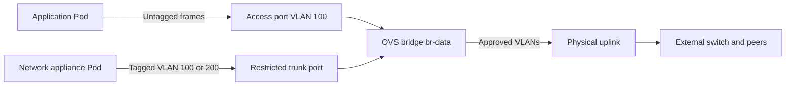

# Configure VLAN Access and Trunk Ports with Multus and OVS CNI

Author: [nawazdhandala](https://www.github.com/nawazdhandala)

Tags: Multus, Kubernetes, Networking

Description: Configure OVS access and restricted trunk attachments through Multus, then verify port settings, VLAN tagging, address placement, and the external switch path.

A Pod can have a healthy secondary interface and still send traffic into the wrong network. With Open vSwitch (OVS), the important question is what the switch expects on that interface: ordinary Ethernet frames for one VLAN, or tagged frames for several VLANs.

This guide uses the configuration fields from **OVS CNI v0.40.0**, with **Multus v4.3.1** as the attachment layer. CNI means Container Network Interface: plugins that create and configure a container's network connection. The examples were checked against source and parsed locally; they were not deployed to a Kubernetes cluster.

## Decide where tagging belongs

A virtual LAN, or VLAN, separates Ethernet traffic into numbered networks. An access port assigns ordinary, untagged traffic to one VLAN. A trunk carries VLAN-tagged traffic and can restrict which VLAN numbers it accepts. An application using an access attachment does not need to understand tagging. A network appliance using a trunk usually does. See the [OVS VLAN explanation](https://docs.openvswitch.org/en/latest/faq/vlan/).



These are two alternative Pod attachment designs sharing a bridge. The bridge's physical uplink has its own configuration. Setting a Pod port to VLAN 100 does not automatically allow VLAN 100 on the external switch.

| Requirement | Pod-facing configuration | Address placement |
| --- | --- | --- |
| Ordinary application in one network | Access port, VLAN 100 | On the secondary interface |
| Appliance handling two tagged networks | Trunk restricted to 100 and 200 | On appliance-managed VLAN interfaces, if IP addresses are needed |
| Unrestricted trunk | Avoid as an accidental default | Requires a separate reviewed design |

## Prepare the node and switch first

Use a dedicated staging node and a non-management data uplink. Install the reviewed OVS CNI binary in the directory actually searched by Multus. OVS must already be running, and `br-data` must already exist. The plugin connects the Pod to a bridge; it does not build the host's external network for you. This division of responsibility is described in the [pinned plugin documentation](https://github.com/k8snetworkplumbingwg/ovs-cni/blob/v0.40.0/docs/cni-plugin.md).

Before creating Pods, record the bridge, uplink, permitted VLANs, switch port, available IP ranges, and maximum packet size. Reserve the example address for exactly one test Pod, or substitute a reservation from your own staging network. Do not move the node's management interface into a bridge while following a Pod networking tutorial.

With host access and permission to read OVS's database, run:

```bash
sudo ovs-vsctl --timeout=5 br-exists br-data
sudo ovs-vsctl --timeout=5 list-ports br-data
sudo ovs-vsctl --timeout=5 --columns=name,tag,trunks,vlan_mode list Port
```

The first command succeeds silently when the bridge exists. The others show its ports and database settings. `list Port` includes ports on other bridges too, so correlate names with `list-ports`. These are read-only inspections; the [ovs-vsctl manual](https://www.openvswitch.org/support/dist-docs/ovs-vsctl.8.txt) documents the commands and timeout option.

## Give an application an access attachment

Create this NetworkAttachmentDefinition in an existing staging namespace named `network-lab`. This Kubernetes resource tells Multus which plugin configuration to use. It assumes the **CNI plugins v1.8.0 static IPAM binary** is also installed. IPAM means IP address management; here it assigns a fixed demonstration address rather than coordinating a shared address pool.

```yaml
apiVersion: k8s.cni.cncf.io/v1
kind: NetworkAttachmentDefinition
metadata:
  name: ovs-access-100
  namespace: network-lab
spec:
  config: |
    {
      "cniVersion": "0.3.1",
      "name": "ovs-access-100",
      "type": "ovs",
      "bridge": "br-data",
      "vlan": 100,
      "ipam": {
        "type": "static",
        "addresses": [{"address": "192.0.2.50/24"}]
      }
    }
```

The documentation-only address must be replaced for your environment. Never run multiple replicas with this same static assignment. There is no gateway or added default route here: retain the primary network's routing unless a separate routing design requires otherwise. The [static plugin documentation](https://cni.dev/plugins/current/ipam/static/) describes its address and route fields.

Add the following annotation to your test Pod's metadata, or to the Pod template in a workload controller:

```yaml
annotations:
  k8s.v1.cni.cncf.io/networks: '[{"name":"ovs-access-100","interface":"net1"}]'
```

This is a metadata fragment, not a complete Pod. Use an approved test image and constrain it to the prepared node through your normal scheduling controls. Multus's [v4.3.1 usage guide](https://github.com/k8snetworkplumbingwg/multus-cni/blob/v4.3.1/docs/how-to-use.md) documents this attachment syntax. Inside the resulting Pod, `net1` should carry the assigned address without a VLAN subinterface.

## Give an appliance a restricted trunk

For an appliance that explicitly handles tagged traffic, use a separate definition:

```yaml
apiVersion: k8s.cni.cncf.io/v1
kind: NetworkAttachmentDefinition
metadata:
  name: ovs-trunk-100-200
  namespace: network-lab
spec:
  config: |
    {
      "cniVersion": "0.3.1",
      "name": "ovs-trunk-100-200",
      "type": "ovs",
      "bridge": "br-data",
      "trunk": [{"id": 100}, {"id": 200}]
    }
```

Select this definition instead of the access definition in the annotation. The exact field is singular `trunk`, containing objects with `id`, or ranges using `minID` and `maxID`. Avoid specifying both `vlan` and `trunk`: the [v0.40.0 port configuration code](https://github.com/k8snetworkplumbingwg/ovs-cni/blob/v0.40.0/pkg/common/common.go) selects trunk mode when a nonempty trunk list is present.

This example intentionally omits IPAM. The [veth implementation](https://github.com/k8snetworkplumbingwg/ovs-cni/blob/v0.40.0/pkg/veth/plugin.go) only invokes IPAM when its type is configured. It provides the attachment without assigning an IP address through IPAM. It does not create `net1.100` or `net1.200`, assign their addresses, or configure the appliance's routing.

Those steps belong to the appliance's reviewed startup configuration. If it creates Linux VLAN interfaces, grant only the permissions that operation needs under your security policy. Do not add privileges to an ordinary application simply to make a trunk useful; an access attachment is usually simpler for that application.

## Verify the port and the complete path

After the staging Pod starts, repeat the OVS inspections. Identify its host-side port using the plugin's records and Pod identity, rather than guessing from an interface name. Expect access mode with tag 100 for the first definition, or trunk mode with allowed VLANs 100 and 200 for the second. OVS's [Port schema](https://www.openvswitch.org/support/dist-docs/ovs-vswitchd.conf.db.5.txt) explains these columns; an empty trunk set in trunk mode permits all VLANs, so it is not a restrictive substitute.

Test a known listening service in each intended network. Check traffic in both directions and confirm that an unapproved VLAN does not reach its test peer. A successful ping alone does not establish application connectivity or isolation. Record Pod identity, node, attachment, OVS port, destination, and result so a later recreation can be compared fairly.

If same-node traffic works but an external peer fails, examine the uplink and physical switch's allowed VLANs. If outbound traffic works but replies disappear, compare native VLAN settings: an external switch can return a VLAN's traffic untagged while OVS expects tagged frames. The [OVS FAQ](https://docs.openvswitch.org/en/latest/faq/vlan/) describes this mismatch.

If the trunk exists but the appliance has no usable IP connectivity, check its VLAN interfaces and address configuration before changing OVS. Finally, editing a definition is not evidence that existing Pod ports changed. Recreate only the controlled staging Pod and repeat the checks before rolling out the attachment to applications.
