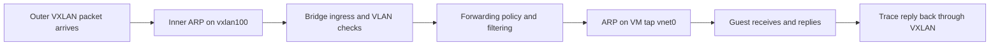

# Trace VXLAN ARP Requests That Never Reach the VM

Author: [nawazdhandala](https://www.github.com/nawazdhandala)

Tags: VXLAN, Linux, Troubleshooting

Description: Follow one ARP request from VXLAN decapsulation to the guest, separating bridge forwarding, VLAN policy, firewall rules, and IP neighbor state.

The remote host receives VXLAN traffic, but its virtual machine never answers an ARP request. Adding a static neighbor entry may make one test behave differently, yet leave the actual forwarding fault untouched.

ARP, the Address Resolution Protocol, discovers the Ethernet address associated with an IPv4 address on a local link. Before changing anything, identify whether the request reaches the guest and whether the reply returns. This article follows the receiving Linux host, using **Linux 6.12** and **iproute2 6.12.0** as reference versions. [ARP specification](https://www.rfc-editor.org/rfc/rfc826.html).

## Make one request identifiable

Assume a source workload at `10.20.0.11` is trying to reach a VM at `10.20.0.12`. On the receiving host, `vxlan100` and the VM's tap interface `vnet0` should belong to `br100`. Replace these names and addresses with your approved staging topology.

Record the source MAC, sender IP, target IP, and approximate test time. An initial address-discovery request normally has Ethernet destination `ff:ff:ff:ff:ff:ff`. Its target IP is the address being resolved. Do not mistake unrelated requests from other workloads for the same test.



Seeing a UDP packet on the underlay is not the same as seeing its inner ARP request after decapsulation. Confirm the latter before declaring the tunnel transport healthy for this specific packet.

## Capture at the two bridge ports

On the receiving host, use two terminals with permission to capture the staging interfaces:

```bash
sudo tcpdump -nn -e -i vxlan100 -c 20 'arp'
sudo tcpdump -nn -e -i vnet0 -c 20 'arp'
```

`-nn` keeps names and ports numeric, `-e` includes Ethernet addresses, and `-c 20` limits each capture to 20 matching packets. Stop with Ctrl-C if the count is not reached; it is not a timeout. Capture only the relevant staging traffic and keep the results in restricted troubleshooting evidence. [tcpdump option reference](https://raw.githubusercontent.com/the-tcpdump-group/tcpdump/tcpdump-4.99.5/tcpdump.1.in).

In a simple untagged path, the request's sender and target identities should agree at both observation points. These excerpts from a synthetic capture show the request and reply fields to recognize:

```text
Request who-has 10.20.0.12 tell 10.20.0.11, length 28
Reply 10.20.0.12 is-at 02:00:00:00:00:12, length 28
```

If your capture point carries an explicit VLAN header, adapt the capture filter to that encapsulation or take a short bounded capture without a protocol filter. Do not treat an unsuitable filter as proof that no frame crossed the interface. Hardware offloads and virtual-switch capture points also deserve confirmation when the evidence disagrees.

## Confirm membership, state, and VLAN treatment

Use read-only inspection in the namespace containing the bridge:

```bash
ip link show master br100
bridge -d link show dev vxlan100
bridge -d link show dev vnet0
bridge vlan show dev vxlan100
bridge vlan show dev vnet0
```

Both ports must belong to the expected bridge. Detailed bridge output exposes port state and policy. The `-d` details option is supported by the pinned iproute2 command parser. [iproute2 6.12 bridge command](https://raw.githubusercontent.com/iproute2/iproute2/v6.12.0/bridge/bridge.c).

With VLAN filtering enabled, compare the VLAN assigned at ingress with the permitted VLAN and tag treatment at the VM port. The port VLAN ID, or PVID, classifies untagged ingress traffic. An egress “untagged” setting controls whether that VLAN's header is removed when traffic leaves the port. These are related but different choices. [Versioned bridge VLAN documentation](https://raw.githubusercontent.com/iproute2/iproute2/v6.12.0/man/man8/bridge.8).

Check forwarding state before changing learning settings. The Linux bridge's delivery logic considers the destination port's forwarding eligibility, VLAN egress permission, and isolation. A tap device being administratively up does not bypass those checks. [Linux 6.12 bridge forwarding](https://raw.githubusercontent.com/torvalds/linux/v6.12/net/bridge/br_forward.c).

## Separate broadcast delivery from unicast lookup

The forwarding database, or FDB, maps Ethernet addresses to bridge ports. Inspect it without clearing it:

```bash
bridge fdb show br br100
bridge fdb show dev vxlan100
```

For a normal broadcast ARP request, the bridge is not trying to find the target IPv4 address in the host's neighbor table. It distributes the frame to eligible ports according to broadcast and bridge policy. Adding a static destination MAC entry cannot repair a VLAN rejection or a port that is not allowed to receive broadcasts.

Inspect `bcast_flood` on the VM-facing port. Do not confuse it with `flood`, which controls unknown unicast flooding. Also examine isolation and neighbor-suppression settings if the design uses them. These settings may be intentional, especially when a controller supplies endpoint information; correct the owning configuration rather than disabling every restriction. [Bridge port policy](https://raw.githubusercontent.com/iproute2/iproute2/v6.12.0/man/man8/bridge.8).

The reply introduces a different test. After the VM transmits, its source MAC should be associated with the expected tap port when ordinary learning is enabled. A conflicting static entry or a MAC learned on an unexpected port deserves investigation. The bridge learns from source addresses subject to ingress policy; a missing entry is evidence to correlate with the capture, not automatic proof of an FDB bug. [Linux 6.12 bridge input handling](https://raw.githubusercontent.com/torvalds/linux/v6.12/net/bridge/br_input.c).

## Do not confuse the host's ARP table with the bridge FDB

This command inspects the host's IP-to-link-address neighbors on the bridge interface:

```bash
ip neigh show dev br100
```

A host acting only as a layer-two bridge may have no neighbor entry for the guest. That can be normal because the host itself has not needed to resolve the guest's IP address. The source workload's neighbor table is more relevant to whether its own request was answered. [Linux neighbor objects](https://man7.org/linux/man-pages/man8/ip-neighbour.8.html).

If the source workload is Linux, inspect its neighbor state inside its own namespace and on its own interface. `INCOMPLETE` or `FAILED` indicates unresolved or unsuccessful neighbor validation there; it does not identify which bridge port dropped the request or reply. Keep the table's owner and namespace in every evidence note.

Avoid a broad neighbor or FDB flush as the opening step. It erases useful evidence and can trigger additional traffic. First establish whether the problem is the request path, the guest response, or the return path.

## Inspect bridge filtering when the ports look correct

nftables has a `bridge` family for filtering bridged Ethernet traffic. Its forward hook can affect frames moving from one bridge port to another, including ARP. Checking only an IP routing firewall policy can miss that path. [nftables bridge filtering](https://wiki.nftables.org/wiki-nftables/index.php/Bridge_filtering).

An authorized administrator can read the active rules and handles:

```bash
sudo nft -a list ruleset
```

Look for the relevant bridge-family chains, interfaces, VLAN conditions, ARP matches, and existing counters. A counter is meaningful only when correlated with the controlled test; busy background traffic can also increment it. The command lists state and does not change rules. [nft command reference](https://www.netfilter.org/projects/nftables/manpage.html).

If the platform uses another filtering framework, inspect its equivalent bridge path too. Do not empty the ruleset to make a single ping succeed. Propose a narrow correction with the policy owner and test it in staging.

## Close the trace in both directions

| Observation | Investigation to continue |
| --- | --- |
| Outer packet arrives, no matching inner ARP | Decapsulation, VNI, endpoint configuration, or capture placement |
| Inner request appears on VXLAN but not tap | Bridge membership, ingress/egress VLANs, broadcast policy, filtering |
| Request reaches guest but no reply appears | Guest address, interface state, and guest-side policy |
| Reply leaves guest but source remains unresolved | Return bridge path, tunnel forwarding, and source-side reception |

The local check for this article decoded a synthetic Ethernet broadcast ARP request and unicast reply with tcpdump 4.99.1 on macOS. Shell snippets were syntax-checked, but no Linux bridge or VXLAN topology was exercised. Acceptance on your staging system requires matching request and reply identities across the relevant points, successful neighbor resolution in the source workload, and the intended application traffic after the repair.
