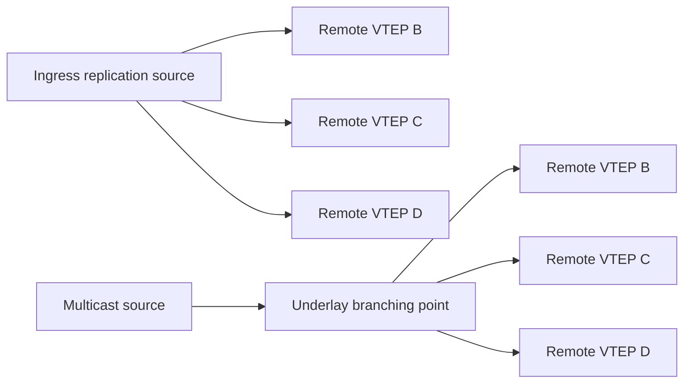

# Choose a VXLAN BUM Replication Method That Fits Your Scale

Author: [nawazdhandala](https://www.github.com/nawazdhandala)

Tags: VXLAN, BGP, Networking

Description: Compare VXLAN ingress replication and multicast, understand where EVPN fits, and calculate a realistic replication budget before choosing a design.

A small broadcast rate can become a large uplink load when a VXLAN tunnel endpoint must send the same packet to dozens of peers. Conversely, introducing multicast into an otherwise simple fabric can create an operational burden larger than the traffic problem it solves.

Start with two separate questions: how does a switch discover the other members of a network, and where does the network make copies of flooded packets? Answering them separately prevents the misleading choice between “multicast, ingress replication, or EVPN.”

This guide develops a planning model, not a switch configuration. The calculation runs locally with Python 3 and does not contact network devices. Actual platform limits and supported combinations must come from the documentation for your deployed switch release.

## Separate membership from packet replication

BUM means broadcast, unknown unicast, and multicast. Unknown unicast is traffic whose destination MAC address is absent from the relevant forwarding table. A VTEP, or VXLAN tunnel endpoint, puts an Ethernet frame inside a VXLAN packet. A VNI identifies the overlay network.

With ingress replication, the originating VTEP creates separate copies addressed to remote VTEPs. With underlay multicast, it sends a multicast packet and the routed network distributes copies along a tree. RFC 7348 describes mapping VXLAN networks to multicast groups and maintaining group membership. [RFC 7348, section 4.2](https://www.rfc-editor.org/rfc/rfc7348.html#section-4.2)

EVPN, Ethernet VPN, distributes overlay information through BGP. It can accompany ingress replication or multicast transport; it is not a third packet-copying algorithm. Its Inclusive Multicast Ethernet Tag, or IMET, routes describe participation and tunnel information. Check implementation support before assuming every standards-defined combination is available. [RFC 8365, section 9](https://www.rfc-editor.org/rfc/rfc8365.html#section-9)

| Candidate design | How remote membership is maintained | Where copies are made | Planning question |
| --- | --- | --- | --- |
| Static ingress replication | Explicit peer lists | Originating VTEP | Can peer lists stay correct as tenants move? |
| EVPN with ingress replication | EVPN control plane | Originating VTEP | Can replication and uplinks handle the largest membership set? |
| Multicast-based VXLAN | Configured network/group mapping and multicast membership | Underlay distribution tree | Can the team operate and troubleshoot multicast? |
| EVPN with multicast | EVPN plus the selected multicast transport procedures | Underlay distribution tree | Does the platform support this combination at the required scale? |

The following diagram shows the same three remote receivers. It deliberately omits discovery to make the copying locations visible.



A real multicast tree can have several branching points. The diagram does not promise one physical hop or a particular path.

## Count members of each VNI, not all switches

For an initial budget, consider one VNI with `N` participating VTEPs. Assume each originating BUM packet needs delivery to every other member, with no selective pruning, no multihoming adjustment, and no further retransmission by a receiving VTEP.

If one origin produces `r` Mbps of already-encapsulated BUM traffic before replication, its remote-copy egress demand is:

```text
one origin: (N - 1) * r
all N origins sending at that rate: N * (N - 1) * r
```

The second expression sums traffic emitted by originating VTEPs. It is not the sum across every physical fabric link, because packets traverse paths of different lengths. It also excludes local access-port delivery and Ethernet wire overhead beyond the rate definition you choose.

Use this runnable Python example to check the arithmetic. Python 3.11.13 was used for the local calculation; no external packages are required.

```python
# Example inputs, not measured switch performance.
bum_mbps_per_origin = 10
for members in (4, 16, 64):
    copies = members - 1
    origin_mbps = copies * bum_mbps_per_origin
    total_mbps = members * origin_mbps
    print(f"{members:2} VTEPs: {origin_mbps:3} Mbps/origin, "
          f"{total_mbps:5} Mbps across all origins")
```

Expected results are 30, 150, and 630 Mbps per origin, with all-origin totals of 120, 2,400, and 40,320 Mbps. These are scenario estimates, not benchmark results or recommended limits.

For multicast, the originating VTEP can send one copy into the tree instead of those separate remote copies. The delivery work still exists downstream. Map the tree onto actual uplinks before concluding that a fabric has enough capacity.

Repeat the calculation for each VNI on the busiest leaf. A fabric with 100 switches but four members per VNI can present a different replication problem from a 20-switch fabric where every VNI spans every switch. Include burst packet rates: many tiny packets can stress replication resources even when the Mbps total looks modest.

## Measure what suppression actually removes

Address resolution is often a visible part of BUM traffic. Proxy ARP and Neighbor Discovery can answer eligible requests using learned IP-to-MAC bindings, reducing flooding. This relies on appropriate state and policy; it does not justify assuming that every broadcast disappears. [RFC 9161, sections 3 and 4](https://www.rfc-editor.org/rfc/rfc9161.html)

Build separate traffic categories for address resolution, DHCP, application multicast, and unknown unicast. Measure normal operation and a controlled cold-start event. A quiet network with warm tables may conceal a substantial startup burst.

For the budget, retain the traffic that remains after your verified suppression policy. Do not subtract a guessed percentage. Also record which applications intentionally need broadcast or multicast delivery. Dropping those packets can make utilization look excellent while breaking the service.

## Choose based on the constraint you can demonstrate

Static ingress replication can be a reasonable starting point for a small, stable network when peer-list ownership is explicit. Its risk is often change management: an omitted peer can leave part of a tenant isolated. Include a membership comparison in every provisioning change.

Consider EVPN with ingress replication when dynamic membership and host information are useful and measured fan-out fits the platform. Budget control-plane resources separately from replication bandwidth. A successful BGP session does not prove that a switch has installed every required forwarding entry or can replicate traffic at the required rate.

Consider multicast transport when a measured replication bottleneck justifies its additional operating requirements. Before selecting it, ask the network team to demonstrate group membership, tree establishment, and recovery from a failed underlay path in staging. Include the chosen multicast mode and any rendezvous-point dependency in the support plan; different modes have different requirements.

There is no portable “switch to multicast at 32 leaves” rule. Document an internal decision threshold in terms of headroom, supported replication entries, packet rate, and recovery objectives. Base those thresholds on your equipment and workload.

## Rehearse the decision before changing production

Create one staging VNI with representative membership and an explicitly bounded traffic rate. Record expected receivers and excluded tenants. Check both successful delivery and absence of delivery outside that membership set.

Exercise a new member joining, an old member leaving, and an underlay link failure. Measure loss duration and duplicate delivery, alongside uplink utilization and replication counters. Repeat with cold forwarding state and then with the normal suppression policy enabled. Keep the application workload identical so that a changed result has an interpretable cause.

For migration, use the vendor-supported transition procedure for the exact release. Do not assume that enabling two flooding methods simultaneously is a safe overlap strategy. Preserve a reviewed prior configuration and define rollback conditions before the test.

The useful outcome is a short capacity record: membership per VNI, observed BUM rates, calculated copy demand, measured recovery behavior, and remaining headroom. That record explains why the chosen replication method fits this network and gives the team a concrete signal for revisiting the decision as it grows.
