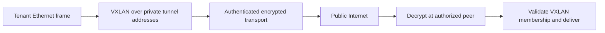

# Should You Carry VXLAN Across the Public Internet?

Author: [nawazdhandala](https://www.github.com/nawazdhandala)

Tags: VXLAN, Networking, Security

Description: Assess Internet-carried VXLAN with an authenticated encrypted transport, an explicit nested-tunnel MTU budget, and tests for NAT, packet loss, and route changes.

VXLAN can carry Ethernet frames over an IP network, but that does not make any IP network a good substitute for a data center fabric. Across the public Internet, packet size, latency, endpoint reachability, and trust all become design inputs you must verify.

For a small, justified Layer 2 extension, VXLAN inside a managed encrypted tunnel may be workable. If the requirement is simply communication between IP subnets, start by evaluating a routed VPN. It avoids carrying Ethernet broadcasts and learning behavior across the link.

This article evaluates the nested-tunnel option. It provides read-only inspections and a local capacity calculation, not an Internet-facing deployment recipe. No live VPN, VXLAN forwarding, or carrier-path test was performed.

## VXLAN does not supply the trust boundary

A VXLAN Network Identifier, or VNI, selects a virtual network. Knowing that number is not proof of identity. VXLAN encapsulation does not itself provide confidentiality or cryptographic peer authentication. RFC 7348 discusses traffic injection risks and identifies mechanisms such as IPsec for protecting tunneled traffic. [RFC 7348, section 7](https://www.rfc-editor.org/rfc/rfc7348.html#section-7)

Place the VXLAN transport inside an authenticated encrypted service whose endpoints you operate. WireGuard is one example of a UDP-based encrypted tunnel; its protocol includes authenticated encryption and peer key exchange. This does not make it the only choice or automatically satisfy your organization's cryptographic requirements. [WireGuard protocol](https://www.wireguard.com/protocol/)



The diagram shows the order of encapsulation. A packet entering the public interface should be protected by the outer transport. The remote host must still enforce the permitted VNI, tenant membership, and forwarding policy after decryption.

Keep raw VXLAN reception off the public interface. Restrict the secure transport's exposure to its intended peers and protect endpoint credentials. Encryption protects traffic in transit; it cannot prevent a compromised authorized endpoint from sending unwanted Ethernet traffic into an overly broad bridge.

## Define the packet-size contract at each layer

MTU, Maximum Transmission Unit, is a packet-size limit. There are at least three relevant limits here: the public path's outer packet limit, the encrypted tunnel's usable IP MTU, and the tenant's IP MTU inside VXLAN.

Do not subtract a universal “VPN overhead” constant. The result depends on the secure transport, outer address family, padding, and any additional encapsulation. Tunnel fragmentation is a separate engineering problem, with tradeoffs involving reassembly and path-MTU discovery. [RFC 4459](https://www.rfc-editor.org/rfc/rfc4459.html)

Instead, first establish a safe usable IP MTU for the encrypted tunnel on the actual carrier path. Then budget the VXLAN packet that travels inside it. For ordinary VXLAN carrying an untagged inner Ethernet frame, the overhead above the tenant IP packet is 50 bytes with an IPv4 VXLAN transport header, or 70 with IPv6. That transport header is inside the encrypted tunnel; it may use a different address family from the Internet-facing packet. [RFC 7348 frame format](https://www.rfc-editor.org/rfc/rfc7348.html#section-5)

Run this Python 3 calculation locally. The example value `1420` is an assumed, already-validated tunnel IP MTU, not a WireGuard default, carrier guarantee, or recommendation.

```python
# Replace only after measuring the encrypted tunnel's usable IP MTU.
tunnel_ip_mtu = 1420
inner_ethernet = 14  # No inner VLAN tag; no Ethernet FCS.
udp = 8
vxlan = 8
for family, ip_header in (("IPv4", 20), ("IPv6", 40)):
    tenant_ip_mtu = tunnel_ip_mtu - inner_ethernet - udp - vxlan - ip_header
    print(f"VXLAN transport {family}: tenant IP MTU <= {tenant_ip_mtu}")
```

Expected output is 1370 for IPv4 and 1350 for IPv6. The calculation was checked with Python 3.11.13. It does not test whether the outer encrypted packets fit the carrier path.

If a workload requires an unchanged 1500-byte tenant MTU, document how the complete encapsulated packet fits. If it does not fit, choose a supported transport design, a smaller tenant MTU that the workloads can accept, or a different connectivity model. Do not let a successful small ping settle the question.

## Inspect where the VXLAN traffic actually goes

On Linux with iproute2 6.12.0, inspect an existing staging setup using these read-only commands. Replace `wg0`, `vxlan100`, and `10.200.0.2` with the encrypted interface, VXLAN device, and remote VTEP address inside your tunnel. A VTEP is a VXLAN tunnel endpoint.

```bash
ip -d link show dev wg0
ip -d link show dev vxlan100
ip route get 10.200.0.2
```

The first two commands display link parameters, including MTU and VXLAN settings where applicable. The route lookup should select the intended encrypted transport for the remote VTEP. If policy routing depends on source address or packet marks, repeat the lookup with those actual selectors; a destination-only lookup may be incomplete. [iproute2 6.12.0 link manual](https://raw.githubusercontent.com/iproute2/iproute2/v6.12.0/man/man8/ip-link.8.in), [route manual](https://raw.githubusercontent.com/iproute2/iproute2/v6.12.0/man/man8/ip-route.8.in)

The secure tunnel's public endpoint must also remain reachable through the physical underlay. A route that sends the transport endpoint back into its own tunnel can prevent establishment. Verify both routing decisions separately, particularly after changing default routes.

The Linux VXLAN documentation describes both learned endpoints and explicit forwarding entries. Decide how your remote membership is maintained; a working encrypted tunnel does not populate the correct VXLAN forwarding state by itself. [Linux VXLAN documentation](https://docs.kernel.org/networking/vxlan.html)

## Test idle periods and changed paths

Network Address Translation, or NAT, can expire mappings while a tunnel is idle. For WireGuard, persistent keepalives can preserve a mapping when the peer needs to receive traffic after silence. The official guide suggests 25 seconds as a useful interval for many firewalls, but also says not to enable the feature when it is unnecessary. It does not make an otherwise unreachable pair of endpoints universally connectable. [WireGuard quick start](https://www.wireguard.com/quickstart/)

Test initial connection establishment, a realistic idle interval, and subsequent inbound traffic. Include any carrier-grade NAT or address changes present in the real access network. Record which endpoint can initiate and what happens when its public address changes.

Also test the backup Internet circuit. Its usable MTU can differ from the primary path. IPv6 path-MTU discovery relies on Packet Too Big information; filtering needed control messages can create failures that only appear with larger traffic. [RFC 8201](https://www.rfc-editor.org/rfc/rfc8201.html)

TCP tuning alone is insufficient evidence. Test representative UDP traffic and application transactions too. Confirm that observed success does not depend on unexpected outer fragmentation, and distinguish packets rejected locally from packets lost after transmission.

## Decide using operational evidence

Use a bounded staging workload rather than broadcasting an unrestricted traffic generator into production. Measure small-packet rate, encrypted throughput, endpoint CPU usage, latency variation, and recovery after transport interruption. Include legitimate broadcast and multicast activity because a quiet two-host ping test misses those costs.

Choose the design only if its owners can explain the security boundary, nested MTU limits, remote membership, and failure behavior. Keep a routed alternative available when Layer 2 extension is merely convenient. The Internet can provide reachability, but the encryption, packet-size contract, and operational limits are responsibilities of the overlay you build on top of it.
