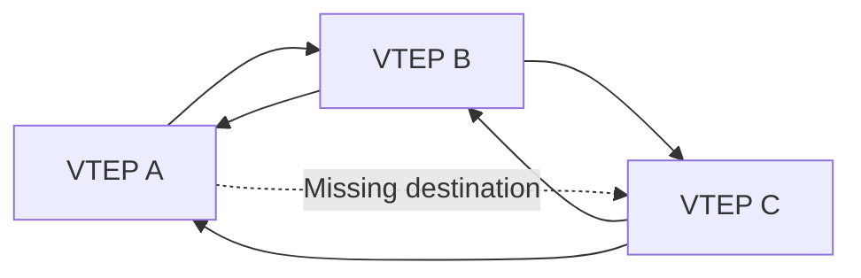

# Fix a Missing Third VXLAN Peer in a Static Flood List

Author: [nawazdhandala](https://www.github.com/nawazdhandala)

Tags: VXLAN, Linux, Networking

Description: Audit every VTEP's static flood destinations, distinguish learned unicast from broadcast reachability, and repair missing peers without replacing the list.

Two VXLAN hosts communicate. After adding a third, some workloads remain unreachable, or traffic works only after the new host initiates a connection. A working pair does not prove that every endpoint has the destination information needed to reach the new member.

This article examines a specific design: a manually managed Linux VXLAN device carrying one network identifier over IPv4, using static unicast flood destinations. The references are **Linux 6.12** and **iproute2 6.12.0**. A controller-managed EVPN fabric, multicast underlay, or device carrying multiple VNIs needs its own control-plane checks instead of this manual repair.

## Understand which traffic needs the list

A VTEP is a VXLAN tunnel endpoint. It wraps an inner Ethernet frame in an outer packet addressed to another VTEP. The VNI, or VXLAN network identifier, separates overlay networks. [VXLAN specification](https://www.rfc-editor.org/rfc/rfc7348.html).

Known unicast can use a learned MAC-to-VTEP mapping. Broadcast, unknown unicast, and multicast traffic are commonly grouped as BUM traffic. With head-end replication, the sending endpoint creates separate copies for the remote destinations that should receive a flooded frame.

In the scoped Linux design, the all-zero MAC FDB entry supplies default remote destinations when no more specific forwarding entry matches. The FDB is the forwarding database. The pinned kernel code searches the specific destination first, falls back to the zero-MAC entry, and sends copies to its remote list. [Linux 6.12 VXLAN forwarding](https://raw.githubusercontent.com/torvalds/linux/v6.12/drivers/net/vxlan/vxlan_core.c).

That difference explains misleading success. Existing learned unicast traffic may work while a new ARP exchange fails because its broadcast request never reaches the missing peer. Treat warm-cache success and initial discovery as separate observations.

## Write the expected matrix before editing

For VNI 100 with three participating hosts, the intended static flood destinations are:

| Local VTEP | Expected remote destinations |
| --- | --- |
| A: `192.0.2.10` | `192.0.2.20`, `192.0.2.30` |
| B: `192.0.2.20` | `192.0.2.10`, `192.0.2.30` |
| C: `192.0.2.30` | `192.0.2.10`, `192.0.2.20` |

These are documentation addresses. Replace them with the actual participants in this VNI. Do not include the local address or every host in the underlay regardless of tenant membership.



This example has one missing direction, A to C. Do not assume B will relay A's broadcast back through the same VXLAN bridge port to C. A bridge normally does not forward a received frame back to its ingress port unless hairpin behavior is enabled, and enabling that behavior is not a substitute for a deliberate replication design. [Linux bridge delivery logic](https://raw.githubusercontent.com/torvalds/linux/v6.12/net/bridge/br_forward.c).

## Collect the device configuration and FDB

On each Linux host, in the namespace that owns the VXLAN device, collect:

```bash
ip -d link show dev vxlan100
bridge fdb show dev vxlan100
bridge -j fdb show dev vxlan100 > /review/host-a-fdb.json
```

Use a different output filename per host and an existing private review directory. Check the command exit status before analyzing the file. Confirm VNI 100, the intended local VTEP, UDP port, and device ownership. JSON from a failed command or the wrong namespace is not evidence that the remote list is empty.

The `self` flag identifies entries owned by the VXLAN device rather than the bridge's own forwarding table. The pinned implementation emits `mac`, `dst`, and `flags` fields in JSON; these are the fields used below. [iproute2 6.12 FDB output](https://raw.githubusercontent.com/iproute2/iproute2/v6.12.0/bridge/fdb.c).

## Compare expected and observed destinations

Save this Python 3.11 script as `check_peers.py`. It reads a saved, device-scoped FDB listing and reports differences without changing the network:

```python
from collections import Counter
import ipaddress
import json
from pathlib import Path
import sys

if len(sys.argv) < 3:
    raise SystemExit('Usage: check_peers.py fdb.json PEER_IP [PEER_IP ...]')
def address(value):
    ip = ipaddress.IPv4Address(value)
    if ip.is_multicast or ip.is_unspecified or ip.is_loopback or int(ip) == 2**32 - 1:
        raise ValueError('Expected a remote IPv4 unicast address')
    return str(ip)
expected = {address(value) for value in sys.argv[2:]}
rows = json.loads(Path(sys.argv[1]).read_text())
if not isinstance(rows, list):
    raise SystemExit('Expected an array from bridge -j fdb show')
peers = []
for row in rows:
    if not isinstance(row, dict):
        raise SystemExit('Invalid FDB row')
    if row.get('mac') != '00:00:00:00:00:00':
        continue
    flags = row.get('flags', [])
    if not isinstance(flags, list):
        raise SystemExit('Invalid FDB flags')
    if 'self' in flags:
        peers.append(address(row['dst']))
counts = Counter(peers)
report = {
    'missing': sorted(expected - counts.keys()),
    'unexpected': sorted(counts.keys() - expected),
    'duplicate_rows': sorted(ip for ip, count in counts.items() if count > 1)
}
print(json.dumps(report, indent=2))
raise SystemExit(1 if any(report.values()) else 0)
```

The address parser rejects malformed addresses and values outside this example's remote IPv4 unicast scope. The script considers only zero-MAC entries marked `self`; ordinary learned workload MACs do not count as flood destinations. [Python IPv4 address parsing](https://docs.python.org/3.11/library/ipaddress.html).

For host A, run:

```bash
python3.11 check_peers.py /review/host-a-fdb.json 192.0.2.20 192.0.2.30
```

Empty lists in the JSON report and exit zero mean the observed destination set matches the requested set. A missing C entry produces `192.0.2.30` under `missing` and exits nonzero. `unexpected` identifies destinations that need an ownership review; the tool does not delete them. Duplicate rows are also flagged for investigation.

Repeat with the corresponding expected peers for B and C. This checker does not verify VNI overrides, destination ports, entry persistence, routing, or packet delivery. Review those separately. Do not use it as a complete validator for external-mode or multi-VNI devices.

## Append only the confirmed missing destination

After verifying that A lacks C, that C belongs to the same overlay, and that no controller owns the entries, an administrator can apply this change in the isolated staging setup:

```bash
sudo bridge fdb append 00:00:00:00:00:00 dev vxlan100 \
  dst 192.0.2.30 self permanent
bridge fdb show dev vxlan100
```

The use of `append` matters: the intent is to retain the existing destination for B and add C. The bridge command supports multiple remote destinations for flooding. Do not replace the entire list with the new host, which can make the newly added peer work while breaking the original pair. [Versioned bridge FDB operations](https://raw.githubusercontent.com/iproute2/iproute2/v6.12.0/man/man8/bridge.8).

Review and repair the other rows of the matrix as needed. A change on C alone does not populate A or B. If the command fails or an entry already exists, inspect the current state rather than retrying a sequence of add, replace, and delete operations until traffic changes.

Once the staging result is accepted, express the destination list through the host's persistent network configuration system. A successful imperative command is not evidence that the setting survives reboot or a controller reconciliation.

## Validate discovery as well as existing traffic

Use disposable staging workloads with unique test addresses to exercise fresh discovery from each host. Avoid flushing shared production neighbor or forwarding tables just to make the test cold. Record whether the request reaches both intended remote endpoints, whether the target replies, and whether the reply returns to the original workload.

Test A to B, A to C, and B to C in both initiating directions. A one-way observation can hide an asymmetric flood list. If discovery still fails after the matrix matches, inspect underlay reachability to C, the actual UDP port, VNI membership, bridge VLAN policy, and endpoint addresses. The list is one dependency, not a universal explanation for every third-host failure.

For larger groups, a complete static matrix has `N × (N - 1)` directed peer relationships, and one flooded frame may require `N - 1` outgoing copies at its origin. This arithmetic describes the configured topology, not a throughput benchmark. Review whether static maintenance still fits your network before adding more peers.

The local checker passed eight synthetic cases covering complete, missing, unexpected, duplicate, unrelated, multicast, malformed, and empty input. No live FDB was modified and no VXLAN topology was deployed for this article. Keep the packet-level staging evidence separate from the configuration comparison so a matching list never gets mistaken for a successful connectivity test.
