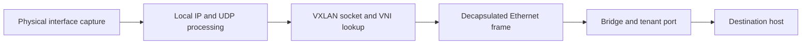

# VXLAN Reaches UDP 4789 but Drops: Trace the Receive Path

Author: [nawazdhandala](https://www.github.com/nawazdhandala)

Tags: VXLAN, Linux, Troubleshooting

Description: Locate VXLAN receive-path drops by comparing outer captures, local VTEP addressing, VNI membership, firewall rules, and the decapsulated Ethernet path.

You can see UDP packets arriving on port 4789, yet the destination host sees nothing. That observation narrows the problem, but it does not prove that the receiving system accepted the packet as VXLAN or delivered its inner Ethernet frame.

On Linux, packet sockets can observe incoming traffic before it reaches the normal protocol handlers. A capture therefore provides evidence of visibility at a capture point, not successful completion of every later processing stage. [Linux packet socket manual](https://man7.org/linux/man-pages/man7/packet.7.html)

Follow one identifiable packet from the physical interface to the VXLAN device and then to the tenant port. This guide uses Linux 6.12 receive-path source, iproute2 6.12.0 inspection syntax, and tcpdump 4.99.5 documentation. Commands are source-reviewed; only offline capture-filter checks were executed locally.

## Establish the expected packet identity

Write down the expected outer source and destination IP addresses, UDP destination port, VNI, and inner source/destination MAC addresses. The VNI identifies the virtual network; the outer IP addresses identify the VXLAN tunnel endpoints, or VTEPs.

For an illustrative staging flow, use remote VTEP `192.0.2.10`, local VTEP `192.0.2.20`, and VNI `100`. Replace all addresses and interface names below with the actual test environment. Do not infer a VNI from a device name such as `vxlan100`; inspect its configuration.



Filtering can occur at multiple stages. The diagram is a troubleshooting sequence, not an exhaustive Linux hook ordering chart. Hardware-offloaded paths can require switch or NIC-specific observations instead of host captures.

## Capture the outer packet without assuming acceptance

Use a permitted staging capture point on the receiving VTEP. This example captures up to 30 matching IPv4 packets and prints decoded output without writing a capture file:

```bash
sudo tcpdump -ni eth0 -e -vv -s 0 -c 30 \
  'ip and dst host 192.0.2.20 and udp dst port 4789'
```

`-n` avoids name resolution, `-e` includes link-layer details, and `-vv` requests more decoding detail. `-s 0` uses a full-sized snapshot. Stop with Ctrl-C if 30 packets do not arrive; the packet count is not a timeout. Run only for the intended observation window. [tcpdump 4.99.5 manual](https://raw.githubusercontent.com/the-tcpdump-group/tcpdump/tcpdump-4.99.5/tcpdump.1.in)

Record the decoded VNI and inner addresses, not just the outer UDP port. The filter is scoped to an untagged IPv4 capture point; VLAN tags, IPv6, or another capture link type may require a different expression. Non-initial IP fragments do not contain the UDP header, so this filter is not a complete fragmentation investigation.

If the capture's destination is an address formerly owned by this node, finding the packet on its NIC does not make that address local again. If the VNI differs from the planned value, investigate sender encapsulation before changing receiver membership.

## Verify the local endpoint and listening configuration

Run these read-only commands in the network namespace that owns the receiving tunnel:

```bash
ip address show
ip route show table local
ip -d link show dev vxlan100
ip -s link show dev vxlan100
```

Compare the actual outer destination against local addressing and routing. On systems using VRFs, also inspect the relevant VRF tables and interface associations; the default namespace's local table alone may not describe the complete setup. Review address translation rules if the packet is intentionally translated before local delivery.

The detailed link output should identify the configured VNI, destination port, local address if explicitly configured, and associated device settings. Check the administrative state as well. A wildcard or automatically selected local endpoint needs interpretation according to that configuration; do not assume every working tunnel must display an explicit `local` address. [iproute2 6.12.0 link manual](https://raw.githubusercontent.com/iproute2/iproute2/v6.12.0/man/man8/ip-link.8.in), [address manual](https://raw.githubusercontent.com/iproute2/iproute2/v6.12.0/man/man8/ip-address.8.in), [route manual](https://raw.githubusercontent.com/iproute2/iproute2/v6.12.0/man/man8/ip-route.8.in)

Linux historically uses a VXLAN default port different from the IANA-assigned 4789, so inspect the actual configured port instead of assuming it. The kernel documentation explicitly uses `dstport 4789` in its example. [Linux VXLAN documentation](https://docs.kernel.org/networking/vxlan.html)

For conventional per-VNI devices, the receiver must find the expected VNI under the applicable VXLAN socket. Linux 6.12 checks the required VXLAN VNI flag, looks up the VNI, and drops the packet when that lookup fails. Socket matching also depends on context such as namespace, address family, and device binding. Metadata-based devices and VNI filtering have different lookup details. [Linux 6.12 VXLAN source](https://raw.githubusercontent.com/torvalds/linux/v6.12/drivers/net/vxlan/vxlan_core.c)

Scope the initial investigation to the device model you actually use. A single external-metadata tunnel managed by a controller should not be diagnosed as though it were a collection of independently configured per-VNI interfaces.

## Check filtering without disabling it

If nftables manages the host policy, inspect the active rules and rule handles:

```bash
sudo nft -a list ruleset
```

This is a read-only listing. Review existing counters, if configured, before and after the bounded test. Look for rules affecting the outer local UDP traffic as well as the later bridged or routed tenant traffic. Also check earlier ingress filtering, firewall-manager policy, and host reverse-path checks where applicable. The exact processing path depends on the deployment. [Official nftables manual](https://netfilter.org/projects/nftables/manpage.html)

An `established,related` allowance is not proof that a new encapsulated flow is permitted. Inspect the actual rule that should admit the new traffic from the authorized VTEP. Do not broaden access to every sender or flush the ruleset as a troubleshooting shortcut.

If counters are insufficient, nftables supports packet tracing when an appropriately scoped rule sets `nftrace`. Enabling that trace is a policy change: have the policy owner select the exact flow, observation window, and cleanup procedure. Running a trace monitor without enabling trace selection does not automatically show all packets. [nftables tracing documentation](https://wiki.nftables.org/wiki-nftables/index.php/Ruleset_debug/tracing)

## Locate the first missing inner frame

Once the outer packet is visible and its receive settings look correct, inspect the inner path. In separate terminals during the same short staging test:

```bash
sudo tcpdump -ni vxlan100 -e -c 30
sudo tcpdump -ni tenant0 -e -c 30
```

Here `tenant0` is the actual host-facing port, not a literal required name. Narrow these captures with the test's inner MAC or IP filter on a busy network. Correlate a sequence number or application marker so that unrelated traffic cannot be mistaken for the missing packet.

If the frame appears on the VXLAN device but not the tenant port, move downstream:

```bash
bridge link show
bridge vlan show
bridge fdb show br br100
```

For the example, `br100` is the relevant bridge. Check port state, VLAN admission and egress mapping, and the destination MAC's forwarding entry. A frame that has already been decapsulated needs a bridge/tenant investigation, rather than another change to UDP 4789 policy. [iproute2 6.12.0 bridge manual](https://raw.githubusercontent.com/iproute2/iproute2/v6.12.0/man/man8/bridge.8)

Treat missing captures cautiously when hardware forwarding or offloads bypass the observation point. Use supported hardware counters or mirroring before declaring a software drop. Likewise, a bad-checksum annotation can require offload-aware interpretation; it is not enough by itself to identify the fault.

Change only the setting supported by the first confirmed divergence. Repeat the same test, verify the destination receives the intended packet, and check that an unauthorized VNI remains excluded. That provides a stronger resolution than simply making the UDP capture busier.
