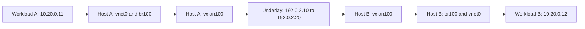

# VXLAN Is Up but Bridged Workloads Cannot Connect

Author: [nawazdhandala](https://www.github.com/nawazdhandala)

Tags: VXLAN, Linux, Networking

Description: Trace a Linux bridged VXLAN path through endpoint addresses, bridge ports, VNI settings, and static flood entries before changing the network.

A VXLAN interface shows `UP`, and the two hosts can ping each other's physical addresses. Yet virtual machines attached to their bridges cannot communicate. The interface status proves much less than it appears to: VXLAN carries Ethernet frames over UDP, and a usable local interface does not establish a remote workload connection.

Start with the path a frame must take. This walkthrough uses a plain Linux bridge and static unicast VXLAN, with **Linux 6.12** and **iproute2 6.12.0** as source references. It does not describe an EVPN-controlled fabric or Open vSwitch. EVPN is a control plane that can program endpoint and forwarding information; manual entries can conflict with its configuration.

## Separate the outer network from the inner network

The underlay is the routed network carrying VXLAN packets. The overlay is the Ethernet network carried inside those packets. A VXLAN tunnel endpoint, or VTEP, encapsulates and decapsulates the frames.

Use this two-host example, replacing every address and interface name with your staging topology:

| Role | Host A | Host B |
| --- | --- | --- |
| Underlay VTEP address | `192.0.2.10` | `192.0.2.20` |
| Linux bridge | `br100` | `br100` |
| VXLAN device | `vxlan100` | `vxlan100` |
| Workload-facing bridge port | `vnet0` | `vnet0` |
| Workload address | `10.20.0.11/24` | `10.20.0.12/24` |
| VXLAN network identifier | `100` | `100` |



VNI means VXLAN network identifier. Matching it is necessary, but not enough: both endpoints also need compatible destination ports and reachable outer addresses. Linux's VXLAN documentation explicitly sets UDP port 4789 because the implementation retains an older default for compatibility. Inspect the configured port instead of assuming it. [Linux 6.12 VXLAN documentation](https://docs.kernel.org/6.12/networking/vxlan.html).

## Inspect both hosts before changing either one

Run these read-only commands on each Linux host in the network namespace that owns the interfaces:

```bash
ip -d link show dev vxlan100
ip link show master br100
bridge link show master br100
bridge vlan show
```

The VXLAN details should show the intended VNI, local address, underlying device where configured, and UDP destination port. The membership output should place both the workload-facing port and `vxlan100` on `br100`. Check that the ports are usable and in the expected forwarding state. A port attached to another bridge cannot participate in this path merely because its own link is up. [ip link](https://man7.org/linux/man-pages/man8/ip-link.8.html).

If VLAN filtering is enabled, confirm that the workload port and tunnel port carry the intended VLAN, including the treatment of untagged traffic. Also review any deliberately disabled flooding or neighbor suppression. Preserve the policy's purpose; enabling every forwarding option is not a diagnosis. [iproute2 6.12 bridge interface](https://raw.githubusercontent.com/iproute2/iproute2/v6.12.0/man/man8/bridge.8).

## Put addresses on the actual endpoints

A bridge forwards Ethernet frames according to destination MAC addresses. It does not need an IP address just to switch traffic between a virtual machine port and a VXLAN port. [Linux bridge behavior](https://docs.kernel.org/networking/bridge.html).

In this example, the overlay addresses belong inside the workloads. If the host itself must participate in the overlay, its layer-three address normally belongs on the bridge device, while the attached VXLAN interface acts as a bridge port. Do not duplicate the workload's address on the host, or use an address on the bridge as evidence that the guest interface is configured correctly.

Inspect addresses on the host and inside each workload:

```bash
ip address show dev br100
ip address show dev vxlan100
```

These commands inspect the host namespace. Inside the workload, inspect its own interface and route to the peer. Confirm the address, subnet length, and chosen interface there. Two endpoints intended to be on the same subnet should not accidentally send traffic to unrelated gateways. The Linux address command reports addresses per device; it does not infer the network design for you. [ip address](https://man7.org/linux/man-pages/man8/ip-address.8.html).

If you find an address on the wrong host device, plan the move through the host's network configuration system with console access and a rollback plan. Do not flush addresses or reattach the physical management interface while connected through it.

## Check the underlay route independently

On host A, inspect the route to host B's VTEP address:

```bash
ip route get 192.0.2.20 from 192.0.2.10
```

Use the reciprocal addresses on host B. Expect the intended underlay device, source, and next hop. The command resolves a route without sending a probe packet, so a result is not proof that a firewall permits VXLAN traffic. [ip route get](https://man7.org/linux/man-pages/man8/ip-route.8.html).

An underlay ping tests a different protocol from UDP VXLAN. If captures later show encapsulated packets leaving one host without arriving at the other, inspect routing and the actual UDP-port policy between those addresses. Keep overlay subnet routing separate from this outer transport check.

## Find the forwarding destination for the first frame

There are two related forwarding decisions. The bridge decides which port should receive an Ethernet frame. The VXLAN device decides which remote VTEP should receive the encapsulated frame. The forwarding database, or FDB, contains the mappings used for these decisions.

```bash
bridge fdb show br br100
bridge fdb show dev vxlan100
```

Inspect `master` bridge entries separately from `self` entries owned by the VXLAN device. A MAC learned on the bridge does not, by itself, establish a remote tunnel destination. [Bridge FDB documentation](https://raw.githubusercontent.com/iproute2/iproute2/v6.12.0/man/man8/bridge.8).

The first IPv4 conversation commonly needs an ARP request to discover the peer's Ethernet address. In this static unicast design, traffic without a specific VXLAN FDB match needs a default remote destination. Linux's pinned implementation falls back to the all-zero MAC entry and drops the frame if that lookup also fails. A configured default remote can create this entry automatically. [Linux 6.12 forwarding implementation](https://raw.githubusercontent.com/torvalds/linux/v6.12/drivers/net/vxlan/vxlan_core.c).

For an isolated two-host staging setup, after confirming the intended flood entry is missing and no controller manages the device, an administrator can append the remote destination on host A:

```bash
sudo bridge fdb append 00:00:00:00:00:00 dev vxlan100 \
  dst 192.0.2.20 self permanent
bridge fdb show dev vxlan100
```

Host B needs the reciprocal destination `192.0.2.10`. Inspect existing entries first; do not blindly add duplicate destinations or replace a multi-peer flood list. `self` targets the device's forwarding table. The pinned command parser supports `append`, `dst`, `self`, and `permanent`. Persist an accepted repair through the system's normal configuration owner. [iproute2 6.12 FDB implementation](https://raw.githubusercontent.com/iproute2/iproute2/v6.12.0/bridge/fdb.c).

## Observe where the frame stops

With permission to capture staging traffic, compare a workload-facing capture with the underlay capture while generating one controlled test from the workload:

```bash
sudo tcpdump -ni vnet0 -e -c 20 'arp or icmp'
sudo tcpdump -ni UNDERLAY_INTERFACE -c 20 'udp port 4789'
```

Run them in separate terminals, replace the interface and port, and stop with Ctrl-C if fewer than 20 packets arrive. The count is a packet limit, not a time limit. Repeat on the remote host. [tcpdump 4.99.5 manual](https://raw.githubusercontent.com/the-tcpdump-group/tcpdump/tcpdump-4.99.5/tcpdump.1.in).

If the workload frame never reaches its local bridge port, investigate the guest path. If it reaches the port but no outer packet leaves, inspect bridge eligibility and the VXLAN FDB. If outer packets arrive remotely but the guest sees nothing, continue with the remote bridge path. Trace replies too; one-way delivery is not connectivity.

The examples were reviewed against pinned sources and checked locally for shell syntax; capture filters were compiled without capturing traffic. No Linux VXLAN topology was deployed for this article. Validate the proposed repair on the actual staging path, then record the matching addresses, memberships, flood destinations, and successful bidirectional workload test before changing production configuration.
