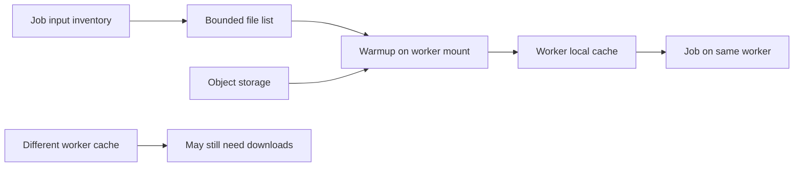

# Warm JuiceFS Cache for a Job Without Downloading Its Entire Dataset

Author: [nawazdhandala](https://www.github.com/nawazdhandala)

Tags: JuiceFS, Performance, Storage

Description: Select a bounded JuiceFS warmup set, run it on the client's actual cache, and compare total transfer cost with job speed before adjusting prefetch.

A scheduled job can start faster when its inputs are already cached. But warming a directory containing terabytes to accelerate a job that reads a few gigabytes may consume more bandwidth and time than the job itself.

JuiceFS has two related but distinct mechanisms: explicit `warmup` reads selected files into cache, while prefetch fetches additional data during application reads. This guide uses **JuiceFS Community Edition 1.4.2** to choose a small warmup set, verify placement, and measure the complete cost.

## Start with the job's actual access pattern

Identify the inputs the job will read, the bytes it expects to consume, and the client where it will run. Prefer a job-generated file inventory over guessing from a parent directory. Freeze or version that inventory if inputs can change between preparation and execution.

A whole-file warmup is useful when the job will reuse much of each file. It is less attractive for a query that reads only a few columns or a footer from large files. The pinned warmup command reads the target files' objects; it is not a byte-range warming interface. [JuiceFS warmup implementation](https://github.com/juicedata/juicefs/blob/v1.4.2/cmd/warmup.go).

For example, warming a 100 GiB file so a job can read 10 MiB from it moves far more data than the application requested. That is planned overfetch even if all reads complete successfully. The goal is to shorten useful work without buying an unnecessary full-file download.

## Keep warmup local to the consuming client

The command talks to the mounted client's control interface and populates that client's cache. Running it on an administrative workstation does not automatically warm a worker node with its own cache.



Check that the warmup process and job see the same mount, volume, cache directory, and host. In a scheduler, node placement or rescheduling can invalidate that assumption. Record the placement with the job rather than treating warmup completion as a cluster-wide property.

The cache must also have room for the selected data while retaining other valuable blocks. Preparing more data than fits can evict the earliest warmed files before the job starts. Local cache capacity and free-space limits still apply. [JuiceFS cache guidance](https://github.com/juicedata/juicefs/blob/v1.4.2/docs/en/guide/cache.md#client-read-cache).

## Build a bounded, unambiguous file list

The warmup file-list format is one path per line. In this release the parser trims whitespace and resolves paths relative to the command's working directory. Use absolute paths and reject filenames that cannot be represented faithfully in that format.

Here is a Python 3 example for a small reviewed inventory. Replace the root, relative filenames, size budget, and output path. The output location should be outside JuiceFS:

```python
from pathlib import Path

root = Path("/mnt/jfs/job-inputs").resolve(strict=True)
selected = ["part-000.parquet", "part-001.parquet"]
budget = 8 * 1024 ** 3
paths = []
total = 0
for relative in selected:
    p = (root / relative).resolve(strict=True)
    p.relative_to(root)  # Reject paths or symlinks escaping the input root.
    text = str(p)
    if not p.is_file() or text != text.strip() or "\n" in text or "\r" in text:
        raise ValueError(f"Unsupported warmup path: {p}")
    if p not in paths:
        paths.append(p)
        total += p.stat().st_size
if not paths or total > budget:
    raise ValueError("Empty selection or logical-size budget exceeded")
with Path("/var/tmp/job-warmup-paths.txt").open("x") as output:
    output.write("".join(f"{p}\n" for p in paths))
print(f"Selected {len(paths)} files, {total} logical bytes")
```

The exclusive output-file creation prevents accidental replacement of an earlier list. The size sum is an upper-level planning measure, not a prediction of transferred bytes: compression, block reuse, existing cache, and changing files can alter actual traffic.

This guard does not create a filesystem snapshot. Run it against stable inputs and inspect the resulting selection. Resolving paths prevents accidental traversal outside the chosen root, but administrators must still verify that the root is the correct mounted dataset. [Python path operations](https://docs.python.org/3/library/pathlib.html).

## Warm a small set with limited concurrency

After reviewing the generated list and confirming the correct client, run:

```bash
juicefs warmup --threads 8 --file /var/tmp/job-warmup-paths.txt
juicefs warmup --check --file /var/tmp/job-warmup-paths.txt
```

Eight workers is a conservative experiment setting, not a universal recommendation; the pinned default is 50. Start low enough to avoid disrupting other users, then measure. The first command performs warmup in the foreground. The second reports cache coverage rather than requesting eviction.

Review the reported files, bytes, and warnings as well as command completion. A list error, missing file, or insufficient capacity can undermine the intended preparation. Do not add `--background` when the job must wait for warmup to finish. [Pinned warmup options](https://github.com/juicedata/juicefs/blob/v1.4.2/cmd/warmup.go).

A high coverage percentage is a momentary observation. It does not reserve the blocks until job execution. Keep the delay short and account for other workloads that share the cache.

## Compare end-to-end cost, not just job duration

Run a baseline and a selective-warmup experiment on isolated, comparable clients or datasets. Record:

| Measurement | What it answers |
| --- | --- |
| Warmup duration and downloaded bytes | How much preparation cost |
| Job duration and application bytes read | Whether the actual work improved |
| Total object traffic across both phases | Whether downloads were merely moved earlier |
| Cache coverage before the job | Whether preparation survived until use |
| Other workloads' latency | Whether concurrency harmed neighbors |

Do not clear shared production caches to manufacture a cold baseline. A job that becomes faster after warming might otherwise have benefited from an earlier reader or kernel memory cache. Keep the experiment's initial conditions in the record.

Consider success only when the total preparation plus execution cost fits the schedule and resource budget. Warming can still be valuable when total bytes are unchanged but an expensive download moves outside a latency-sensitive window; document that tradeoff explicitly.

## Tune prefetch separately when reads are sparse

JuiceFS prefetch can download a whole block after a small random read. When later reads do not use the remaining bytes, object traffic grows faster than useful application traffic. The cache guide distinguishes this from sequential readahead.

For an isolated sparse-read experiment, the mount option `--prefetch 0` disables that prefetch mechanism. Apply it through the client's normal mount configuration and compare the same workload. It does not disable explicit `warmup`, and it is not a promise to disable every form of read-ahead buffering. [Prefetch and readahead distinction](https://github.com/juicedata/juicefs/blob/v1.4.2/docs/en/guide/cache.md#client-read-cache).

If selective warmup still fetches mostly unused data, remove those whole files from the list rather than trying to repair the decision with more concurrency. For recurring jobs, store the accepted inventory rules, client placement, and transfer budget with the job definition.

The list builder was tested locally for valid selection, deduplication, size rejection, and escaped paths. JuiceFS options were checked against the official 1.4.2 binary and source. No FUSE warmup, cache coverage, object transfer, or workload speedup was measured here; those remain the required staging experiment.
