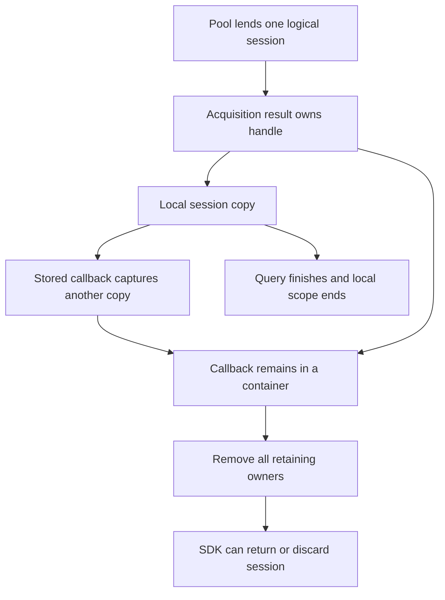

# Fix YDB Session-Limit Errors Caused by Retained C++ Handles

Author: [nawazdhandala](https://www.github.com/nawazdhandala)

Tags: C++, Database, Troubleshooting

Description: Find copied YDB C++ session handles retained by acquisition results, callbacks, and containers, then release ownership without merely raising pool limits.

“Active sessions limit exceeded” can appear even when the application is running very few queries. The missing distinction is between a query that has finished and a session that has returned to its pool. A finished query can leave the session checked out if application objects still own it.

In C++, copying a YDB session handle can extend that ownership. The copy is small enough to look harmless, and it may hide inside a callback, result object, or container. This guide uses **YDB C++ SDK v3.27.0** to trace those references and test a scoped ownership pattern.

## Count checked-out sessions, not current queries

The [YDB SDK FAQ](https://ydb.tech/docs/en/faq/sdk) calls out copied session objects as a reason the active-session limit can be reached unexpectedly. Returning the logical session depends on releasing the relevant handles, not simply completing the last SQL statement.

The Query client provides useful diagnostic counters:

```cpp
std::cout << "acquired=" << client.GetActiveSessionCount()
          << " limit=" << client.GetActiveSessionsLimit()
          << " idle=" << client.GetCurrentPoolSize()
          << '\n';
```

Here `client` is a live `NYdb::NQuery::TQueryClient`; include `<iostream>` in the surrounding program. The [tagged client header](https://github.com/ydb-platform/ydb-cpp-sdk/blob/v3.27.0/include/ydb-cpp-sdk/client/query/client.h) describes acquired sessions, the acquisition limit, and idle pooled sessions separately.

Measure the same client instance that reports the error. Aggregating different pools or processes can obscure which pool is exhausted. Also check whether the error really concerns the local acquisition limit or another server-side quota before changing settings.

## Understand the copies that keep ownership alive

In the pinned source, `TSession` holds shared ownership of its implementation. `TCreateSessionResult` contains a session, and its `GetSession()` method returns a session by value. The [implementation](https://github.com/ydb-platform/ydb-cpp-sdk/blob/v3.27.0/src/client/query/client.cpp) makes that behavior explicit.

Consider this shape:

```cpp
auto acquired = client.GetSession().GetValueSync();
if (!acquired.IsSuccess()) {
    // Report the failed acquisition and return from this operation.
    return;
}
auto session = acquired.GetSession();
```

There are now multiple owners of the same logical session. This does not create an extra server session for each C++ copy. Instead, it can keep one checked-out session alive longer than expected.

If `acquired` remains in a long-lived structure, releasing only `session` may not return the session. Similarly, retaining the acquisition future or result can retain the object it contains. Examine actual object lifetimes rather than counting variable names near the query.

The SDK's [session deleter](https://github.com/ydb-platform/ydb-cpp-sdk/blob/v3.27.0/src/client/impl/session/kqp_session_common.cpp) decides whether a released implementation can return to the pool or needs deletion. A healthy session normally becomes reusable; broken or unsuitable session state may be handled differently.



## Keep the complete acquisition scope short

The accompanying [scoped_query.cpp](./scoped_query.cpp) places acquisition, query execution, and result inspection in one function:

```cpp
bool RunScopedProbe(NYdb::NQuery::TQueryClient& client) {
    auto acquired = client.GetSession().GetValueSync();
    if (!acquired.IsSuccess()) return false;
    auto session = acquired.GetSession();
    auto result = session.ExecuteQuery(
        "SELECT 1 AS one;", NYdb::NQuery::TTxControl::NoTx(),
        NYdb::NQuery::TExecuteQuerySettings()
            .ClientTimeout(TDuration::Seconds(5))).GetValueSync();
    return result.IsSuccess();
}
```

All local handles leave scope before the caller continues. Returning a Boolean avoids exporting a session-owning object to the next layer. Production code should report the failed status through its normal error handling rather than discard diagnostic details.

The example is a synchronous read-only probe. For asynchronous work, the lifetime must cover the actual asynchronous completion; immediately destroying the scope is not a substitute for waiting. For streaming reads, include the response stream's lifetime in the investigation. For interactive transactions, also release the transaction and its results after completion.

Do not replace a safe by-value capture with a dangling reference just to reduce ownership. The repair is to give the asynchronous operation a bounded, explicit lifetime and destroy its retained state when it is finished.

## Inspect callbacks that have already run

A stored callback can continue to own its captures after invocation:

```cpp
callbacks.emplace_back([session] {
    // Work that uses this session.
});
```

Calling that function does not erase it from `callbacks`. If the container is used as a history, retry queue, or cache, the session may survive until the container is cleared or destroyed. Capture ordinary result data for history records instead of the live session.

Moving a handle is not a universal fix. It may transfer ownership to an equally long-lived location, and it does not remove copies already held by an acquisition result or another callback. Audit queues, cancellation paths, exception paths, and completed-task registries together.

The included [ownership_model.cpp](./ownership_model.cpp) demonstrates these cases with standard C++ shared pointers. It models one checked-out lease, a result that owns it, and a callback container that retains it. It deliberately does not pretend to implement YDB networking.

From the article directory, compile and run the model:

```bash
c++ -std=c++17 -Wall -Wextra -Werror ownership_model.cpp \
  -o /tmp/ydb-ownership-model
/tmp/ydb-ownership-model
```

It passes silently when releasing a local copy leaves the result's lease alive, invoking a stored callback leaves its capture alive, and destroying the last owner releases the lease. These checks ran locally; the actual SDK probe was source-reviewed, not compiled or executed against a database.

## Verify release before increasing the limit

In staging, stop new submissions and let known work finish. Watch the affected client's acquired count settle. It need not be zero while legitimate work, streams, or transactions remain, but it should agree with the ownership you can account for.

Then run a bounded sequential loop of the scoped probe and sample the counters between iterations. With no other activity, acquired sessions should not accumulate indefinitely. Idle pooled sessions are expected and are not themselves evidence of a leak.

Test success, acquisition failure, query failure, callback cancellation, and exception paths. Track session IDs carefully enough to correlate ownership, while avoiding unnecessary identifiers in high-cardinality monitoring labels.

Raising the pool limit may temporarily hide a retained-handle problem while consuming more server resources. Explicitly deleting a server session is also not a repair for dangling application ownership. Fix the retaining scope first, confirm the count recovers, and then size the pool for legitimate concurrent work.
