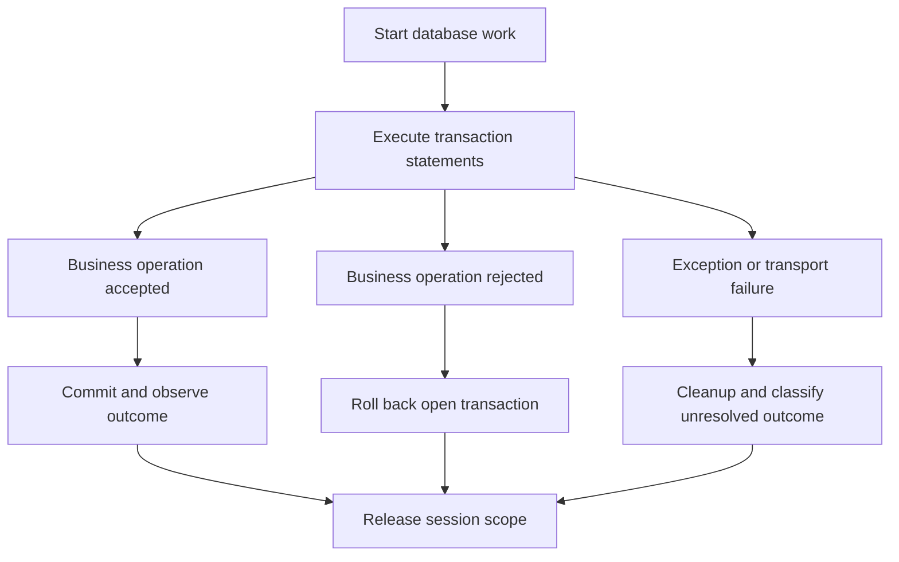

# Prevent YDB Active-Transaction Limits with Explicit Lifetimes

Author: [nawazdhandala](https://www.github.com/nawazdhandala)

Tags: Database, Python, Troubleshooting

Description: Find YDB transactions left open after successful queries or early returns, commit one-shot work explicitly, and verify cleanup across failure paths.

A query can finish successfully while its transaction remains open. If an application repeatedly begins work without a matching commit or rollback, it can eventually encounter `Exceeded maximum allowed number of active transactions` even when each individual query looks small.

Start by tracing transaction lifetimes. Increasing the session pool or restarting the service may temporarily remove the symptom, but neither explains which execution path left transactions unfinished.

The [YDB error FAQ](https://ydb.tech/docs/en/faq/errors) documents a limit of ten active transactions per session and recommends short transactions with explicit completion. Confirm the applicable limits for your deployed server and API, but do not design a normal workflow around keeping as many transactions open as the limit permits.

## Separate sessions, statements, and transactions

A session is a reusable client/server context. A transaction groups database work under a consistency boundary. A statement is one query submitted within that boundary. These objects have related lifetimes, but they are not interchangeable.

A successful statement says that statement completed. Unless its transaction control also commits the transaction, more work may still be expected. Returning a session handle to application code or dropping a local variable is not a portable substitute for explicitly deciding the transaction outcome.

The [transaction-mode recipe](https://ydb.tech/docs/en/recipes/ydb-sdk/tx-control) distinguishes implicit one-shot transactions from explicitly controlled transactions. For a simple operation that does not need multiple client round trips, use a supported one-shot pattern rather than opening a transaction and leaving its completion to a distant caller.

## Trace every path after the first database operation

Begin with one failing workflow and write down its branches:

| Path | Required outcome |
| --- | --- |
| All business checks and writes succeed | Commit and observe the result |
| A business rule rejects the operation | Roll back an open transaction |
| Application code raises an exception | Perform supported cleanup and preserve the original failure |
| Client loses the commit response | Record an uncertain outcome and reconcile safely |
| Caller abandons the request | Apply the service's cancellation and transaction-cleanup policy |

Pay special attention to early returns. A branch that returns “item not found” after a transactional read may leave the transaction open if cleanup was written only for the successful write path.

Also inspect retry loops. Each attempt needs its own complete transaction lifecycle. Starting another transaction after a failed attempt without dealing with the previous state can turn a transient error into a resource leak.



## Commit a one-shot operation in its request

The included [execute_once.py](./execute_once.py) targets Python SDK **3.35.0**. Its caller supplies an authenticated, ready `QuerySessionPool`; endpoint, credentials, and TLS trust remain part of the application's driver setup.

```python
def execute_once(pool, query, parameters=None):
    with pool.checkout(timeout=1) as session:
        with session.transaction(ydb.QuerySerializableReadWrite()) as tx:
            return list(tx.execute(
                query,
                parameters=parameters,
                commit_tx=True,
                settings=ydb.BaseRequestSettings().with_timeout(3),
            ))
```

The helper acquires one session, executes the supplied query in Serializable Read/Write mode, and requests commit with that execution. `list(...)` consumes the response before returning. Use typed parameters for application values; the helper does not turn string interpolation into safe SQL.

A staging connectivity call is:

```python
result_sets = execute_once(pool, "SELECT 1 AS one;")
assert result_sets[0].rows[0].one == 1
```

This verifies only the small probe when run against your database. It does not replace a business transaction test. The helper buffers results, so it is intended for small results rather than an unbounded export.

The [tagged transaction implementation](https://github.com/ydb-platform/ydb-python-sdk/blob/3.35.0/ydb/query/transaction.py) documents `commit_tx` and the transaction context behavior. The first execution can begin the transaction without a separate `begin()` round trip. Merely entering the Python context does not mean that a server transaction has already started.

## Do not mistake a context manager for automatic commit

In this SDK version, context-manager exit attempts to roll back certain unfinished transactions as a safety net. It is not an instruction to commit successful work automatically. The source even warns about potentially leaked transactions when that fallback is needed.

For a multi-step operation, keep its reads and writes within one short scope and explicitly call `commit()` on acceptance or `rollback()` on a normal rejection. Consume pending response streams before the next operation. When a transport or server error has invalidated the transaction, follow the SDK's error state handling; cleanup calls themselves can fail.

Do not hide the primary failure behind a secondary rollback exception. Preserve both pieces of evidence. Conversely, do not catch every exception and report success merely because a cleanup attempt ran.

The [session implementation](https://github.com/ydb-platform/ydb-python-sdk/blob/3.35.0/ydb/query/session.py) and transaction implementation should be reviewed together when changing ownership. A transaction context is not designed for concurrent manipulation by multiple application threads.

## Keep external waits outside the transaction

Do request-only validation before starting database work. Avoid waiting for an external service, a human decision, or a long retry delay while keeping a transaction open. If a workflow spans those boundaries, use a durable application state machine with short database transactions around each transition.

That design still needs concurrency and replay protection. Breaking a transaction into smaller pieces is not automatically safe when the original operation required atomicity. Preserve the business guarantee or document and implement its replacement explicitly.

A timeout also does not prove that a commit failed. The [YDB status reference](https://ydb.tech/docs/en/reference/ydb-sdk/ydb-status-codes) distinguishes confirmed aborts from uncertain outcomes. Use a stable operation identity and reconciliation when necessary rather than blindly starting a new logical write after losing the response.

## Observe transaction age and terminal outcomes

Instrument application transaction start, accepted commit, rollback, and unresolved outcome events. Measure the age of currently owned work, not just how many queries completed in the last minute. Keep identifiers in diagnostic traces rather than creating an unbounded metric label for every transaction.

A useful investigation compares transaction starts with known terminal outcomes within the same workflow. The difference is not automatically a server-side active count: crashes, lost responses, and incomplete instrumentation can leave uncertainty. Use it to identify suspicious paths, then correlate with SDK/server evidence.

If the count grows during repeated business rejections, inspect that branch first. If it grows only after timeouts, examine error cleanup and retry ownership. If it rises during slow external calls, shorten the transaction window before changing limits.

## Verify the wire flag and the live lifecycle separately

Local review used SDK3.35.0's request builder to construct Serializable Read/Write requests with commit enabled and disabled. The generated protocol messages contained the corresponding commit flag. Python syntax also passed. No messages were sent to YDB.

That check verifies request construction, not server transaction cleanup. In staging, repeat successful one-shot operations, normal rejections, application exceptions after a read, and interrupted commit responses. Confirm that sessions remain usable where expected, active work does not grow without explanation, and unresolved writes are recorded rather than silently retried.

The acceptance criterion is a complete lifecycle for every accepted unit of work. A restart that temporarily clears the error is useful incident relief only when followed by evidence that the leaking path has been corrected.
