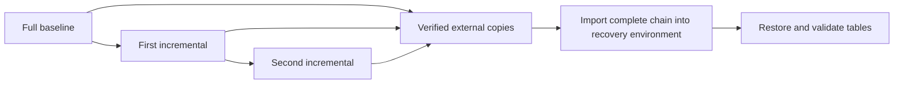

# Back Up YDB with Local Dumps, S3, and Incremental Collections

Author: [nawazdhandala](https://www.github.com/nawazdhandala)

Tags: Database, Backup, Disaster Recovery

Description: Choose a YDB backup method, preserve consistent snapshots and incremental chains, and rehearse recovery into an isolated destination before an incident.

A backup job is useful only if you know what it contains and can recover it after losing the original system. A directory of files, a successful export submission, and an incremental collection still stored inside the source cluster provide different kinds of evidence.

Start with two requirements: how much recent data you can afford to lose, and how long recovery may take. These are the recovery point objective and recovery time objective. Measure both through a restore rehearsal, including provisioning, credentials, data loading, application checks, and the decision to resume traffic.

This guide uses CLI **2.35.0** command syntax. Backup-collection SQL is checked against YDB **26.2.1.16** documentation source. Confirm support in your deployed server and service offering before adopting the examples. No backup or restore was executed during this article's review.

## Choose the recovery artifact deliberately

| Method | Where the copy goes | Important recovery dependency |
| --- | --- | --- |
| `tools dump` | Filesystem of the client running the CLI | Complete dump directory and a compatible restore client |
| `export s3` | S3-compatible object storage | Completed export, object access, and a working destination database |
| Backup collection | Source cluster until exported | A full backup and every required incremental in its chain |

The [backup concepts guide](https://ydb.tech/docs/en/concepts/backup) compares these mechanisms. Incremental collections cover selected row tables; do not treat them as an automatic backup of every cluster setting or every kind of database object.

Keep infrastructure configuration, authentication recovery procedures, and encryption-key access in the recovery plan. A data export does not recreate a Kubernetes cluster or make unavailable credentials usable.

## Make a consistent local dump

Assume `backup_source` is an existing YDB CLI profile for the source database, with verified TLS and authorized credentials. Replace all uppercase placeholders. Choose a new local directory on storage with enough free space:

```bash
ydb -p backup_source tools dump \
  --path=REPLACE_WITH_SOURCE_DIRECTORY \
  --output=REPLACE_WITH_NEW_LOCAL_DIRECTORY \
  --consistency-level=database
```

The output directory must be absent or empty. Database consistency requests one consistent snapshot across the selected tables. Table consistency takes independent table snapshots, which may not represent the same application state. The [dump reference](https://ydb.tech/docs/en/reference/ydb-cli/export-import/tools-dump) documents both choices.

Do not add `--avoid-copy` merely to make a slow backup faster. It changes the snapshot behavior. Some object types or server versions require special handling; assess that limitation explicitly instead of silently weakening consistency for related tables.

After a successful exit, retain the complete directory structure and a manifest recording source database, selection, CLI/server versions, start and completion times, and exclusions. Store a verified copy outside the source host's failure domain. A partial dump retained for troubleshooting is not automatically a usable recovery point.

## Restore local files into a rehearsal destination

Prepare an isolated, empty destination database and a separate profile named `recovery_test`. Confirm that profile's endpoint and database before any write. The following loads a complete directory dump into that destination's root:

```bash
ydb -p recovery_test tools restore \
  --path=. \
  --input=REPLACE_WITH_COMPLETE_DUMP_DIRECTORY \
  --restore-acl=0 \
  --in-flight=4
```

This example intentionally excludes saved access-control entries so a rehearsal can use reviewed test permissions. Recreate the intended application permissions separately and test them before declaring recovery complete. Four concurrent requests are an illustrative staging limit, not a throughput recommendation.

The [restore reference](https://ydb.tech/docs/en/reference/ydb-cli/export-import/tools-restore) explains restore options. In CLI 2.35.0, `--dry-run` checks that dumped tables already exist and their schemas match. It does not perform a full simulated restore into an empty destination, nor does it verify restored row contents. Avoid `--replace` in an ordinary rehearsal: it removes matching existing objects before restoring them.

## Export directly to object storage

S3 export runs on the server. The database nodes therefore need connectivity to the object endpoint, not just the machine running the CLI. Configure a least-privilege object-storage credential profile named `backup_writer` using the provider's supported credential process; do not place secret keys in the command line.

For a staging table called `orders`, this creates a uniquely named export:

```bash
ydb -p backup_source export s3 \
  --s3-endpoint=REPLACE_WITH_S3_HOST \
  --scheme=https \
  --bucket=REPLACE_WITH_BACKUP_BUCKET \
  --aws-profile=backup_writer \
  --item='src=orders,dst=rehearsal-2026-11-20/orders'
```

Use a fresh prefix for each run. The [export reference](https://ydb.tech/docs/en/reference/ydb-cli/export-import/export-s3) describes the asynchronous operation: successful submission does not prove the export is finished. Save the returned operation ID and inspect it:

```bash
ydb -p backup_source operation get 'REPLACE_WITH_OPERATION_ID'
```

Wait for completed success and inspect any reported issues. Preserve the operation result with the backup manifest before removing operation history.

To rehearse recovery, the destination profile must point to the isolated database, and `backup_reader` must have access to the exported objects:

```bash
ydb -p recovery_test import s3 \
  --s3-endpoint=REPLACE_WITH_S3_HOST \
  --scheme=https \
  --bucket=REPLACE_WITH_BACKUP_BUCKET \
  --aws-profile=backup_reader \
  --item='src=rehearsal-2026-11-20/orders,dst=orders_recovered'
```

Monitor the import's returned operation ID using the destination profile. The [import reference](https://ydb.tech/docs/en/reference/ydb-cli/export-import/import-s3) describes its server-side execution. Keep checksum validation enabled and inspect the restored schema, data, and access rules after completion.

## Preserve the entire incremental chain

For existing staging row tables, a collection can capture related tables together:

```sql
CREATE BACKUP COLLECTION rehearsal_backups (
    TABLE orders,
    TABLE order_items
) WITH (
    STORAGE = 'cluster',
    INCREMENTAL_BACKUP_ENABLED = 'true'
);
```

Create and complete a full baseline first:

```sql
BACKUP rehearsal_backups;
```

After later application changes, create an incremental:

```sql
BACKUP rehearsal_backups INCREMENTAL;
```

These statements follow the tagged [collection definition](https://github.com/ydb-platform/ydb/blob/26.2.1.16/ydb/docs/en/core/yql/reference/syntax/create-backup-collection.md) and [backup syntax](https://github.com/ydb-platform/ydb/blob/26.2.1.16/ydb/docs/en/core/yql/reference/syntax/backup.md). Track asynchronous completion before scheduling dependent work.



An incremental contains changes since the previous backup, including deletions. Keeping only the newest incremental discards its required history. Export completed chain members to independent storage and preserve their ordering and identities. The [external-storage recipe](https://ydb.tech/docs/en/recipes/backup-collections/exporting-to-external-storage) recommends exporting full and incremental backups individually and verifying the exports before deleting cluster copies.

`RESTORE rehearsal_backups;` applies the current chain through its most recent backup. The [tagged restore documentation](https://github.com/ydb-platform/ydb/blob/26.2.1.16/ydb/docs/en/core/yql/reference/syntax/restore-backup-collection.md) says it fails when destination table paths already exist; it does not restore to an arbitrary instant between backups. Rehearse collection import and path handling in a dedicated recovery environment. Do not drop production tables merely to make a restore command succeed.

## Decide whether recovery actually passed

Check more than row counts. Compare key ranges, representative records, business totals, secondary indexes, and permissions. Include a record inserted after the full backup and a record deleted before an incremental; both are useful evidence that the intended chain was applied.

Run the recovered application with normal writers disabled, then allow controlled test writes and verify results before considering a traffic switch. Record the recovered data timestamp and measured recovery duration. Retain the original backup until the rehearsal evidence, external-copy integrity, and retention requirements have been reviewed.
