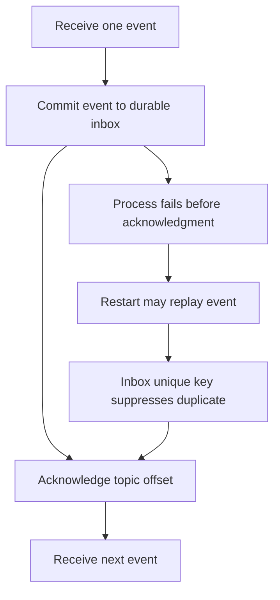

# Build a YDB Changefeed Consumer That Handles Ordering and Restarts

Author: [nawazdhandala](https://www.github.com/nawazdhandala)

Tags: Database, Python, Data Streaming

Description: Consume YDB row changes sequentially, persist events before acknowledging offsets, and handle replay with a durable inbox and explicit ordering limits.

A changefeed consumer has two responsibilities that are easy to confuse: applying events in the right order and remembering enough progress to survive failure. Reading messages in order does not help if workers apply them out of order. Saving an offset does not help if the corresponding side effect was lost before the process crashed.

Start with a sequential consumer and a durable destination. The example below stores row-change events in a local SQLite inbox before acknowledging them to YDB. It is a deliberately small, single-worker design for learning the failure boundaries, not a distributed ingestion service.

## Know the ordering guarantee you inherit

YDB Change Data Capture, or CDC, publishes changes to table rows through a changefeed topic. Its documented guarantee is ordering for changes to the same primary key. That is not a single total order for all rows across the database. The [CDC concepts](https://ydb.tech/docs/en/concepts/cdc) also describe the JSON record format.

A topic partition has its own offsets. An offset is a position in that partition's stream; comparing offset 100 in one partition with offset 100 in another does not establish which business change happened first.

A consumer name identifies saved read progress. Reuse the same intended consumer when restarting. Creating a different consumer is not equivalent to resuming the previous one's position.

## Create a deliberately scoped feed

For an existing disposable row table named `orders_cdc_lab`, this source-reviewed YQL creates a JSON feed with row images:

```sql
ALTER TABLE orders_cdc_lab ADD CHANGEFEED changes WITH (
    FORMAT = 'JSON',
    MODE = 'NEW_IMAGE',
    RETENTION_PERIOD = Interval('PT24H')
);
```

Review the [changefeed options](https://ydb.tech/docs/en/yql/reference/syntax/alter_table/changefeed) for your server release. The example targets the documented YDB 26.2 family and does not request an initial scan or barrier records. It captures subsequent changes, not an automatic complete copy of existing data.

Add a consumer using an authorized CLI profile:

```bash
ydb -p REPLACE_WITH_PROFILE topic consumer add orders_cdc_lab/changes \
  --consumer=lab_inbox
```

The feed path is the table path followed by the changefeed name. That convention and consumer setup are documented in the [CDC development guide](https://ydb.tech/docs/en/dev/cdc). The command syntax was checked with CLI 2.35.0. These setup commands mutate the staging environment and were not executed during review.

## Persist first, acknowledge second



Acknowledging before durable storage can lose an event from the destination: YDB may consider it consumed even though the destination never saved it. Persisting first creates the opposite possibility, replay after a crash. The inbox handles that replay through a unique event identity.

The accompanying [inbox_consumer.py](./inbox_consumer.py) identifies an event using a stable stream incarnation identifier, partition ID, and offset. The stream identifier must change if you delete and recreate the source feed; otherwise, reused offsets can collide with unrelated historical events.

The processing order is explicit:

```python
def consume_one(reader, inbox, stream_id):
    message = reader.receive_message(timeout=5)
    if not message.alive:
        raise RuntimeError('Partition ownership changed; stop and recreate the reader')
    event = json.loads(message.data)
    if not isinstance(event, dict) or 'key' not in event:
        raise ValueError('Expected a JSON row-change event')
    payload = json.dumps(event, separators=(',', ':'), ensure_ascii=False)
    with inbox:
        inbox.execute('''INSERT INTO inbox VALUES (?, ?, ?, ?)
                         ON CONFLICT(stream_id, partition_id, offset) DO NOTHING''',
                      (stream_id, message.partition_id, message.offset, payload))
    reader.commit_with_ack(message, timeout=5)
```

Use the complete file, which imports the modules and creates the inbox table and its composite primary key. The SQLite connection context commits successful work and rolls back on an exception, as documented in [Python's sqlite3 reference](https://docs.python.org/3.14/library/sqlite3.html#how-to-use-the-connection-context-manager). The file must live on persistent local storage that survives the worker restart; a temporary container filesystem does not meet that requirement.

The helper stores the JSON event, including deletes, rather than interpreting every event as a row update. Downstream processing must handle `erase` and row-image semantics explicitly. The small parser rejects non-row records; enabling barriers or changing the feed format requires extending the consumer first.

## Use the actual SDK acknowledgment API

This example targets Python SDK **3.35.0**. Its synchronous reader exposes `receive_message()` and `commit_with_ack()`. The latter waits for the server's acknowledgment, while `commit()` merely puts a commit request into a buffer. These differences are explicit in the tagged [reader implementation](https://github.com/ydb-platform/ydb-python-sdk/blob/3.35.0/ydb/_topic_reader/topic_reader_sync.py).

Given a driver already configured for your endpoint, database, TLS trust, and authentication, wire the loop like this:

```python
from inbox_consumer import open_inbox, consume_one

inbox = open_inbox('/REPLACE_WITH_PERSISTENT_PATH/inbox.sqlite')
try:
    with driver.topic_client.reader(
        'orders_cdc_lab/changes', consumer='lab_inbox'
    ) as reader:
        while True:
            consume_one(reader, inbox, stream_id='orders-feed-generation-1')
finally:
    inbox.close()
```

The driver is an existing application object, not defined by this fragment. Its owner must close it after the reader. The SDK's [reader examples](https://github.com/ydb-platform/ydb-python-sdk/blob/3.35.0/examples/topic/reader_example.py) show the context-manager lifecycle.

In this minimal loop, an idle receive timeout or acknowledgment timeout stops the loop and closes the reader. A service supervisor can restart it with backoff. A production loop may handle idle receive timeouts separately, but must not accidentally swallow a failed acknowledgment or destination write and advance to later work.

## Preserve order beyond the reader

The example processes one message at a time. That preserves delivery order at the inbox boundary without an out-of-order worker pool. Read stored records by partition and offset when processing them later; SQL tables have no implicit result order.

If you parallelize, preserve sequencing for the same key and commit only a contiguous completed prefix of each partition. Completing offset 12 does not justify acknowledging past offset 11 while its write is still pending.

Partition ownership can change. The `alive` check is useful but is not a distributed fencing mechanism: ownership may change immediately afterward. This tutorial assumes one active worker and one owned SQLite inbox. Multi-worker deployments need a shared durable destination, ownership handling, and protection against stale workers applying older state.

## Test failure windows and retention

The local test used a fake reader with real SQLite persistence. It stored an event, simulated a lost acknowledgment, reopened the database, and replayed the same event. The inbox retained one copy. It also checked ordered stored offsets and that malformed events were not acknowledged.

That proves the helper's local storage sequence, not live YDB delivery, rebalancing, or exactly-once external side effects. An email or payment triggered after reading the inbox still needs its own idempotency design.

Finally, monitor lag against retention. If downtime exceeds retained history, restarting with the same consumer cannot reconstruct already removed events. Plan reconciliation or a fresh snapshot and a new stream identity where necessary. Test that recovery before relying on the consumer as the only copy of a business event stream.
