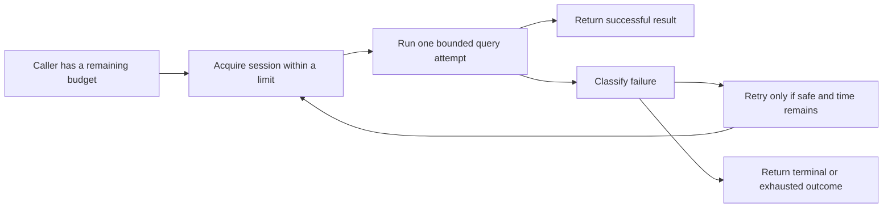

# Set YDB Client Timeouts That Bound Failed-Node Delays

Author: [nawazdhandala](https://www.github.com/nawazdhandala)

Tags: Database, C++, Performance, Troubleshooting

Description: Bound YDB query attempts, session acquisition, and retries separately so failed nodes cannot consume an application's entire response budget.

A failed node does not always close its connections promptly. A network path can stop carrying responses while the client still has an outstanding request. If that request has no useful deadline, a healthy application thread can remain occupied waiting for a result that will not arrive in time to help its caller.

YDB's [SDK FAQ](https://ydb.tech/docs/en/faq/sdk) recommends client timeouts for this failure mode. The practical work is deciding which timeout covers which stage and making the stages fit inside the application's response budget.

This guide uses **YDB C++ SDK v3.27.0**. Its example is a source-reviewed read-only probe, not a measured production timeout recommendation.

## Define the caller's budget first

Suppose an API must normally respond within three seconds. That time includes more than the SQL operation: admission, session acquisition, database calls, retries, application processing, and response delivery all consume it.

A possible staging allocation reserves two seconds for the logical database operation and one second for other work and scheduling margin. This is an illustrative budget. Derive actual values from your latency objective, measured query distribution, and acceptable failure behavior.

The [gRPC deadline guide](https://grpc.io/docs/guides/deadlines/) distinguishes a timeout, which is a duration, from a deadline, which is an absolute point in time. It recommends realistic limits validated by load tests. A timeout that is shorter than ordinary healthy latency creates failures rather than resilience.

Do not reset the full caller budget every time a downstream component begins work. Pass or calculate the remaining budget so later stages cannot spend time that earlier stages already consumed.

## Separate three database waiting stages

| Limit | What it controls | What it does not establish |
| --- | --- | --- |
| Session acquisition timeout | Waiting to obtain or establish a usable session | Maximum duration of all later queries |
| Query client timeout | Waiting for one client request | Total time spent across every retry |
| Retry maximum timeout | Budget for the logical retry operation | A deadline for arbitrary application code outside the SDK |

Keep an application admission limit as well. If all worker threads are waiting for a pool slot, reducing only the query timeout misses the queue in front of the query.



A failed attempt can consume most of the available time. The next attempt must not receive a fresh, unlimited budget just because it uses another session or endpoint.

## Configure the pinned C++ APIs explicitly

[bounded_read.cpp](./bounded_read.cpp) accepts a caller-owned, authenticated Query client. It uses a two-second retry budget, a 200-millisecond session-acquisition limit, and a 500-millisecond per-query limit:

```cpp
auto retries = NYdb::NRetry::TRetryOperationSettings()
    .MaxRetries(2)
    .MaxTimeout(TDuration::Seconds(2))
    .GetSessionClientTimeout(TDuration::MilliSeconds(200))
    .Idempotent(true);
```

The settings come from the tagged [retry header](https://github.com/ydb-platform/ydb-cpp-sdk/blob/v3.27.0/include/ydb-cpp-sdk/client/retry/retry.h). Two retries permit at most three attempts, subject to status classification and the time budget. They do not require all three attempts to run.

The callback performs a single read-only probe:

```cpp
return client.RetryQuerySync(
    [](NYdb::NQuery::TSession session) -> NYdb::TStatus {
        return session.ExecuteQuery(
            "SELECT 1 AS one;",
            NYdb::NQuery::TTxControl::NoTx(),
            NYdb::NQuery::TExecuteQuerySettings()
                .ClientTimeout(TDuration::MilliSeconds(500)))
            .GetValueSync();
    },
    retries);
```

The five-hundred-millisecond value is easy to see at the call site. Returning the status lets the SDK classify the outcome. `SELECT 1` is useful for a connectivity rehearsal but does not represent a table scan, transaction, or production query's latency.

The [request-settings source](https://github.com/ydb-platform/ydb-cpp-sdk/blob/v3.27.0/include/ydb-cpp-sdk/client/types/request_settings.h) defines `ClientTimeout` and `Deadline`. The [retry implementation](https://github.com/ydb-platform/ydb-cpp-sdk/blob/v3.27.0/src/client/impl/internal/retry/retry.h) propagates its deadline into session acquisition and the session. The [Query client implementation](https://github.com/ydb-platform/ydb-cpp-sdk/blob/v3.27.0/src/client/query/client.cpp) applies that propagated deadline to session requests.

Treat the budget as a control on SDK work, not a hard real-time guarantee. Thread scheduling, cleanup, and callback code can affect the observed return time. Keep enough margin for the caller to report an orderly failure.

## Do not confuse keepalive with query deadlines

Connection keepalive probes help detect some broken connections. They do not express the business rule that this API request is no longer useful after a particular time. A busy but reachable server can pass connection checks while a query is too slow for the caller.

Likewise, a server-operation timeout and a client wait limit are different controls. Check the exact request type and SDK API before copying `OperationTimeout` or cancellation settings from another operation. Query settings in this example are not a generic container for every timeout option offered by the SDK.

The [gRPC keepalive guide](https://grpc.io/docs/guides/keepalive/) explains its connection-level role. Change keepalive settings only with the server's supported policy and a demonstrated need; shorter pings are not a replacement for bounded query calls.

## Retry failures without duplicating writes

The example declares idempotency because repeating a constant read has no database side effect. Do not carry that declaration unchanged into an increment, reservation, or external payment instruction.

A timeout means the client stopped waiting. It does not prove that a transaction failed to commit. YDB's [status-code reference](https://ydb.tech/docs/en/reference/ydb-sdk/ydb-status-codes) distinguishes aborted work from an uncertain outcome. Preserve that distinction in application responses and reconciliation.

Use the SDK's bounded retry mechanism rather than adding an unbounded outer loop. For interactive transactions, retry the full transaction with fresh reads when the outcome permits it. Record unresolved writes under a stable operation identity so later investigation does not create a second logical operation.

## Rehearse a failed path safely

Use a staging client and an isolated test endpoint or an approved network-failure mechanism. Exercise a prompt connection refusal separately from a path that accepts traffic but stops returning responses. They are different failure modes; success in the first does not establish behavior in the second.

Measure elapsed time from application admission to the final returned status. Also record session wait, query-attempt duration, number of attempts, final issue details, and remaining caller budget. Avoid using only the duration of the last attempt.

Test pool exhaustion and a normally slow query too. If healthy traffic repeatedly hits the deadline, inspect query plans, contention, and capacity before increasing every timeout. If a failed path exceeds the intended budget, look for unbounded acquisition, nested retries, blocked callbacks, and work occurring outside the timed SDK call.

The example's methods and deadline propagation were checked against tagged source. No complete C++ SDK build, live failed-node experiment, or latency benchmark ran during review. Acceptance requires your staging results: useful queries succeed within the target, failed paths return a classified outcome within an acceptable measured bound, and unresolved writes remain traceable.
