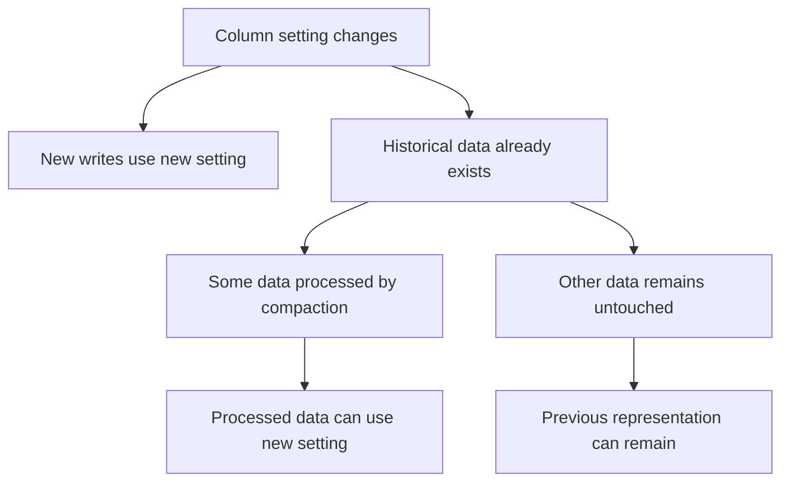

# Change YDB Column-Table Compression Without Assuming a Full Rewrite

Author: [nawazdhandala](https://www.github.com/nawazdhandala)

Tags: Database, Performance, Storage

Description: Change a YDB column's compression with versioned SQL, measure new data separately, and understand why historical data may retain its old encoding.

Changing a YDB column from `lz4` to `zstd` can succeed while the table's stored size barely changes. The schema setting and the physical representation of historical data are different things. A successful alteration does not prove that every existing data portion has been rewritten.

Treat a live compression change as a controlled configuration rollout. Verify the setting, measure newly written data, and make a separate decision about historical data. This article focuses on column-oriented tables and uses the per-column syntax documented in YDB **26.2.1.16**.

## Choose a column and a measurable objective

A compression algorithm reduces the bytes needed to represent data. It also consumes CPU when compressing and decompressing. In a column table, similar values are stored together, so the outcome depends strongly on the column's contents.

Start with one candidate column and an objective: reduce stored bytes for large payloads, lower read I/O, or improve a particular scan's cost. Do not assume that a smaller file always gives a faster application query.

| Choice | Question to test |
|---|---|
| `lz4` | Is low compression overhead more valuable than extra space savings? |
| `zstd` with an explicit level | Does the additional space saving justify CPU and latency costs? |
| `off` | Is compression unhelpful for this already-compressed or unusual data? |

The official [compression documentation source](https://github.com/ydb-platform/ydb/blob/d234401baddb8ad37a8fbd99e2a4838e4787fb6c/ydb/docs/en/core/concepts/compression.md) describes these algorithms and the historical-data caveat. The comparison above is a test plan, not benchmark results.

## Establish the original schema

Use a fresh staging table with data representative of the real column. The accompanying [schema.sql](./schema.sql) makes the storage model and initial algorithms explicit:

```sql
CREATE TABLE compression_events_lab (
    event_id Uint64 NOT NULL,
    event_time Timestamp,
    event_kind Utf8 COMPRESSION(algorithm=lz4),
    payload Utf8 COMPRESSION(algorithm=lz4),
    PRIMARY KEY (event_id)
)
PARTITION BY HASH (event_id)
WITH (STORE = COLUMN);
```

This creates a column-oriented table and partitions it using `event_id`. It is not a command to recreate an existing live table. Supply representative event identifiers and payloads through your established ingestion path. Keep the schema, partitioning, input records, and ingest concurrency identical across comparisons.

YDB's [CREATE TABLE reference](https://ydb.tech/docs/en/yql/reference/syntax/create_table/?version=v26.2) documents `STORE = COLUMN`, hash partitioning, and column options. Do not substitute row-table `ALTER FAMILY` examples when the intention is to change this column option.

Before making the live change, capture the actual table definition:

```sql
SHOW CREATE TABLE compression_events_lab;
```

Replace the lab name with the approved table name only after reviewing the result. The [SHOW CREATE reference](https://github.com/ydb-platform/ydb/blob/26.2.1.16/ydb/docs/en/core/yql/reference/syntax/show_create.md) describes the returned schema definition. Store that output with the change record so the previous explicit settings are available.

## Change one setting, then verify it

The example changes only the `payload` column:

```sql
ALTER TABLE compression_events_lab
ALTER COLUMN payload SET COMPRESSION(algorithm=zstd, level=3);
```

This is also available in [change.sql](./change.sql). The reviewed release's [ALTER COLUMN syntax](https://github.com/ydb-platform/ydb/blob/26.2.1.16/ydb/docs/en/core/yql/reference/syntax/alter_table/columns.md) supports setting the compression option without recreating the column.

The associated [column option reference](https://github.com/ydb-platform/ydb/blob/26.2.1.16/ydb/docs/en/core/yql/reference/syntax/_includes/column_option_list.md) permits levels zero through twenty-two for `zstd`. A level is not a target compression ratio. `lz4` does not use that parameter. Level three is an illustrative starting point to test, not an optimal value established here.

Run `SHOW CREATE TABLE` again and confirm the selected algorithm and level. That verifies the declared configuration. Keep the query results separate from storage observations: schema output is not a map of codecs already used by every historical data portion.

## Expect mixed physical representations



Compaction is background work that reorganizes stored data. For column tables, it does not necessarily rewrite all existing data. The official compression source states that new settings apply to new writes and to data processed by compaction; some old data can retain its previous settings.

Consequently, waiting an arbitrary number of minutes is not proof that recompression finished. Nor is an unchanged table size proof that the schema alteration failed. A mostly historical table with little new traffic can show little aggregate change after a perfectly valid setting update.

Do not assume that a row-table forced-compaction recipe is a supported, complete column-table rewrite procedure for your server version. Establish the supported operation and its scope before planning a maintenance job around it.

## Measure comparable populations

For a useful staging comparison, load the same logical dataset into two fresh equivalent tables: one configured with `lz4`, the other with the candidate `zstd` level. This isolates the new-write compression choice from the live table's mixed history.

Compare logical row counts and representative values first. Then record stored size, ingestion throughput, CPU demand, scan latency, and errors under the same workload. Include realistic payload variety; a repeated constant string is not a meaningful substitute for production messages.

For the live table, track new ingestion separately from the historical baseline. A whole-table percentage can be dominated by old data, retention deletions, or growth in other columns. Record the observation window and the amount of logical data written during it.

Do not label a compressed byte count as total disk savings without checking what the metric includes. Storage replication, metadata, and unrelated columns may be outside the measured number. Keep the comparison units explicit in the change report.

## Plan reversal and historical migration separately

If the candidate harms ingestion or query latency, restore the previous explicit setting:

```sql
ALTER TABLE compression_events_lab
ALTER COLUMN payload SET COMPRESSION(algorithm=lz4);
```

This reverses the configuration choice for subsequent processing. It does not instantaneously undo data already written with `zstd`. The same distinction between settings and stored representation applies in both directions.

If the requirement is to rewrite all history under one chosen policy, treat it as a data migration. Plan a new target, capacity for overlapping copies, a consistency strategy for concurrent writers, validation of row counts and application queries, and a controlled cutover. Do not issue a blind table-wide rewrite merely to force a storage metric to move.

## Close the change with evidence

A useful completion record includes the before-and-after table definitions, exact server version, changed column, workload window, measured effects, and whether historical data was intentionally migrated. “ALTER succeeded” answers only the configuration part.

The SQL examples here were checked against versioned official documentation, and the old-data behavior against the cited official compression source. No YDB table was created or altered during review. No codec benchmark, compaction observation, or historical rewrite was performed, so storage savings and performance must be established in your own staging workload.
